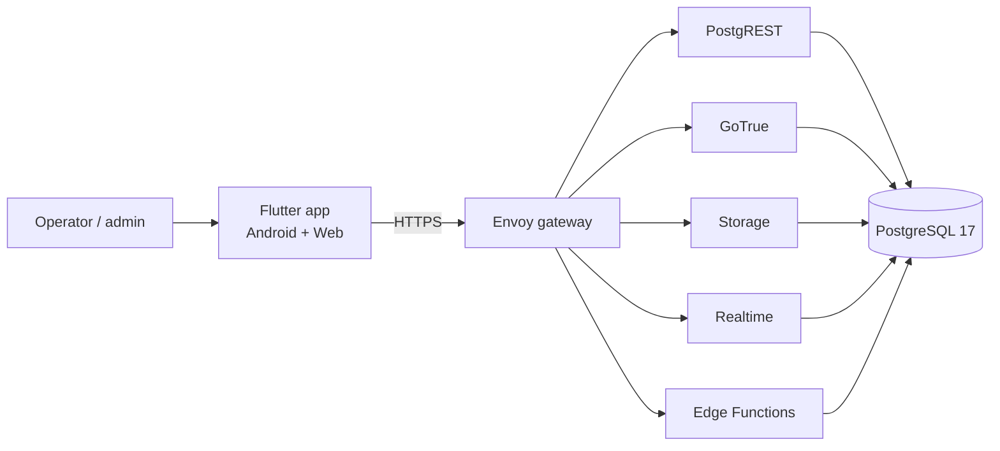

# Documentation

Operational and technical documentation for the parking management system.
Start here, then open the page you need.

| Document | What it answers |
|---|---|
| [`project-overview.md`](project-overview.md) | **Executive summary**: what the system does, module status, verified quality and intentional limitations. |
| [`environment-guide.en.md`](environment-guide.en.md) | **Onboarding guide (English)**: Docker, Supabase, mobile and web, optional integrations, what is free and what costs money. |
| [`environment-guide.md`](environment-guide.md) | The same onboarding guide in Spanish. |
| [`setup-local.md`](setup-local.md) | How to run the whole stack on a laptop from zero (Docker + Flutter + admin user + tests). |
| [`setup-cloud.md`](setup-cloud.md) | How to put it in production on a VM with a domain, HTTPS, backups and push credentials. |
| [`architecture.md`](architecture.md) | How the system is put together: components, Flutter layers, and the flows for check-in, billing, shifts, notifications and multi-site. |
| [`infrastructure.md`](infrastructure.md) | Services, ports, volumes, environment variables, operations (logs, health, backup/restore, cron, scaling). |
| [`database.md`](database.md) | Tables, relationships (ER diagram), RPC catalog, RLS model and migration rules. |
| [`runbook-restore.md`](runbook-restore.md) | Backup contents, monthly restore drill, production restore and verification checklist. |
| [`runbook-secrets.md`](runbook-secrets.md) | Secret inventory, quarterly review, PIN/JWT/DB rotation procedures and leak response. |
| [`agent-memory.md`](agent-memory.md) | Current state, invariants and gotchas for whoever (human or agent) picks the work up next. |
| [`../QUICKSTART.md`](../QUICKSTART.md) | One page, commands only: stack up, admin user, run web/Android, verify. |
| [`../CHANGELOG.md`](../CHANGELOG.md) | Notable added/changed/fixed/security items and the migration history. |

For product decisions and the delivered/planned roadmap see
[`../PROGRESS.md`](../PROGRESS.md); for coding rules see
[`../AGENTS.md`](../AGENTS.md); for specs see [`../openspec/`](../openspec).

## Diagram conventions

All diagrams are Mermaid inside Markdown, so GitHub renders them and they stay
reviewable in a diff. They are the source of truth for the shape of the system:
edit the diagram with the code change instead of adding a picture elsewhere.

## Keeping these docs true

- New table → update `database.md` (diagram + table list) in the same PR.
- New service, port or volume → update `infrastructure.md`.
- New cross-cutting flow (e.g. a payment provider) → update `architecture.md`.
- New setup step or required secret → update `setup-local.md` **and**
  `setup-cloud.md`; secrets go in `.env.example` with a safe default.
