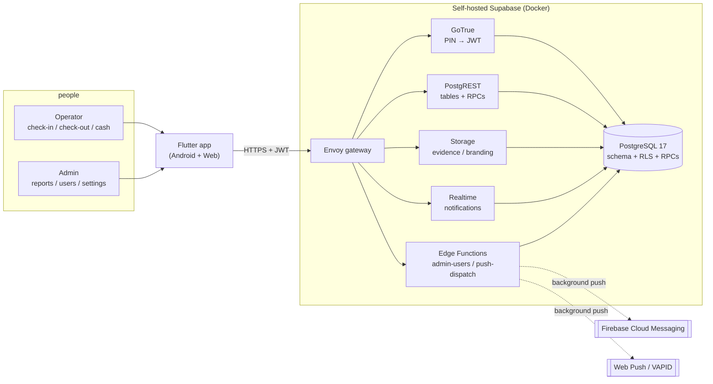
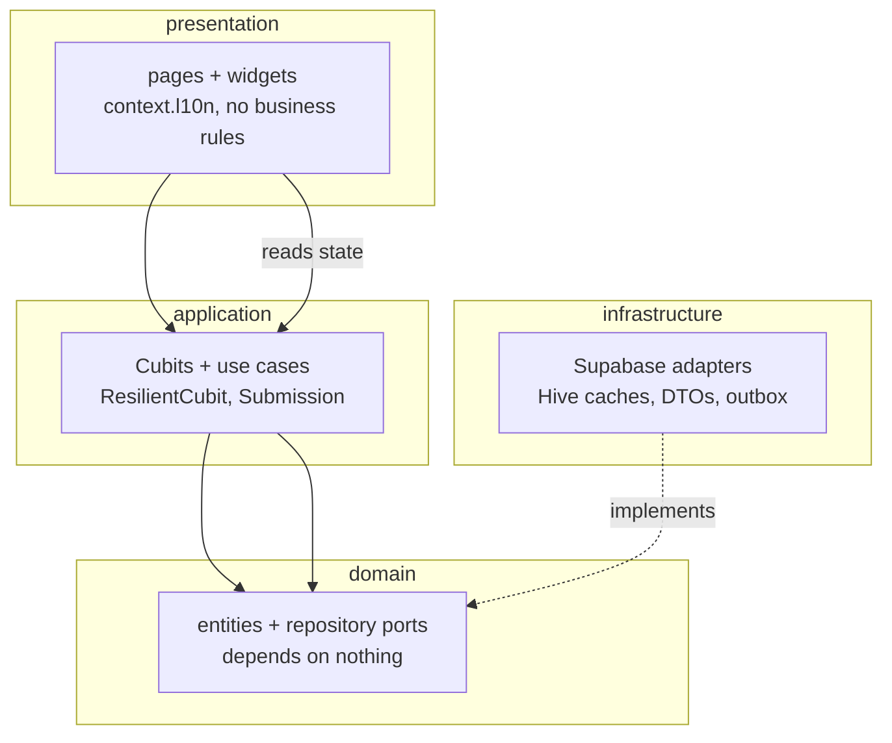
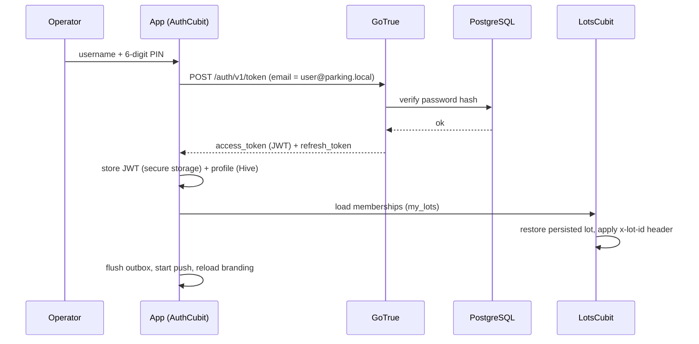
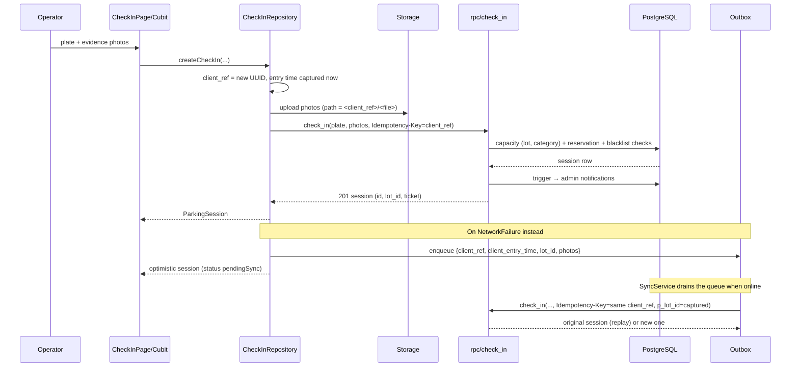
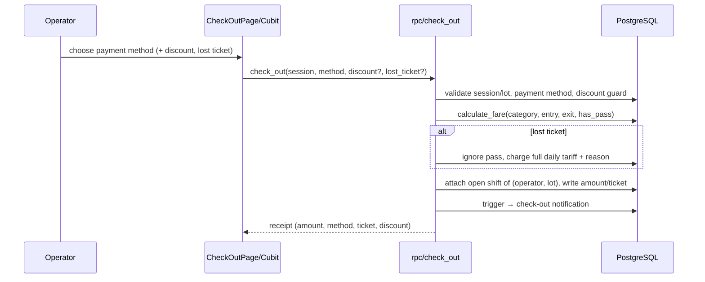
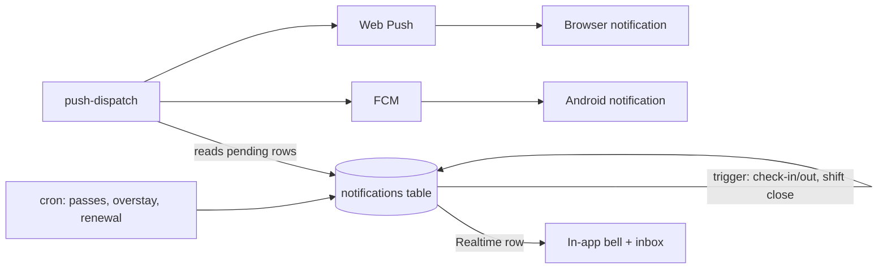
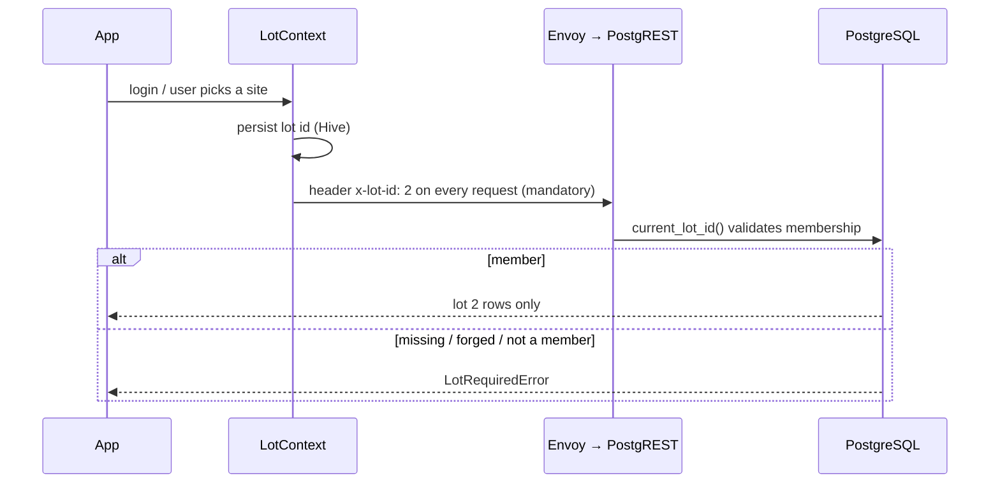

# Architecture

Hexagonal (Ports & Adapters) + Clean Architecture on the client, and a
database-centric backend: **there is no application server**. PostgreSQL owns
the business rules (SQL RPCs), and PostgREST/GoTrue/Storage/Realtime expose it
to the Flutter app under Row Level Security.

## 1. System context



| Layer | Responsibility |
|---|---|
| Flutter app | UI, state (Cubits), offline cache and outbox. Talks only to the gateway. |
| Envoy | Single entry point: routes `/auth/v1`, `/rest/v1`, `/storage/v1`, `/realtime/v1`, `/functions/v1` and Studio. |
| GoTrue | Authentication. Usernames map to `<user>@parking.local`, the PIN is the password. |
| PostgREST | REST over tables (RLS-scoped) and `rpc/*` (business operations). |
| Storage | Private `evidence` bucket, public `branding` bucket. |
| Realtime | Streams `public.notifications` rows to the signed-in user. |
| Edge Functions | `admin-users` (GoTrue admin API with the service key) and `push-dispatch` (FCM + Web Push). |
| PostgreSQL | Tables, constraints, RLS policies, `security definer` RPCs, triggers (capacity, notifications, auth mirror). |

## 2. Flutter architecture (by feature)



```
lib/
├── app/                 # composition root: get_it modules, router, shell
│   ├── di/              #   one module per feature + injection.dart
│   ├── router/          #   go_router config, route access policy
│   └── shell/           #   bottom bar / collapsible sidebar, offline banner
├── core/                # cross-cutting: error/failure, sync outbox,
│                        #   l10n, theme, widgets, lot context, receipts
└── features/<feature>/
    ├── domain/          #   entities + repository ports (+ commands)
    ├── application/     #   cubits and use cases
    ├── infrastructure/  #   Supabase + Hive adapters, DTOs/mappers
    └── presentation/    #   pages and widgets
```

Rules enforced by review and tests:

- `domain/` imports nothing from Flutter or Supabase.
- Cubits extend `ResilientCubit` so a future resolving after `close()` cannot
  throw; action outcomes are modelled as `Submission`.
- Every user-facing string comes from `context.l10n` (es/en, 390 keys at
  parity); printed receipts use `ReceiptLabels`.
- Repositories hide the network/cache split: `load()` = remote → cache, with
  `NetworkFailure` falling back to the cache.

## 3. Login and session



- The JWT lives in `flutter_secure_storage`; Hive only keeps the profile.
- GoTrue rotates tokens; the auth-state listener rewrites the Hive snapshot.
- Logout clears reference-data caches and signs out locally; the outbox is
  **never** cleared (work done offline must still reach the server).

## 4. Check-in (online and offline)



Key invariants:

- `client_ref` is generated **before** the first attempt and reused for every
  replay, so a lost response never creates a duplicate or a dead letter.
- The entry time is captured on the device (validated server-side with a 5
  minute skew tolerance), so billing starts when the operator acted.
- The lot is captured at enqueue time and validated by `resolve_lot()`, so a
  queued entry lands in the site where it happened even after a lot switch.

## 5. Check-out and billing



Billing rules live in `calculate_fare()`: fractional hours ceil per day,
daily cap per day touched, night window replaces the day tariff, monthly pass
→ 0. Discounts are admin-only with a required reason and an audit trail; lost
tickets require a reason and charge the full daily tariff. Ticket numbers carry
the site code (`TCK-<LOT>-000123`).

## 6. Shifts and cash

An operator opens one shift per site (`unique (operator_id, lot_id)`), records
withdrawals/deposits, and closes by counting the drawer. `shift_totals()`
recomputes expected cash from the sessions attached to that shift plus the
pass payments collected in cash, so it is always derived, never stored stale.
Closed shifts can be corrected by an admin with a mandatory reason; the
previous/new reconciliation stays in `shift_adjustments`.

## 7. Notifications



- In-app notifications need no configuration.
- Background delivery is opt-in: FCM service account for Android, VAPID keys
  for browsers. `push-dispatch` is service-role-only and also prunes dead
  endpoints.
- Tapping a notification deep-links by type (`/shift`, `/monthly-passes`,
  `/history?plate=…`).

## 8. Multiple parking sites



Every site-owned table carries `lot_id`. RLS filters reads, and every
`security definer` RPC stamps/filters the active lot explicitly (definer
functions bypass RLS). `parking_settings`, branding and the logo are per lot;
capacity is per `(lot, category)`; reports default to the active lot and
platform admins can request the consolidated view.

## 9. Security model

| Control | Implementation |
|---|---|
| Authentication | GoTrue only; 6-digit PIN (min length 6), signup disabled, `/token` rate-limited by client header. |
| Authorization | `public.users.role` (platform admin/operator) + `lot_members.role` per site; `is_admin()` / `is_lot_admin()`. |
| Data isolation | RLS on every table (`lot_id = current_lot_id()` for site data, ownership for notifications/tokens). |
| Writes | Only through `security definer` RPCs that derive the actor from `auth.uid()` and enforce idempotency. |
| Storage | `evidence` private and readable only through a session of the active lot; `branding` public read, admin write. |
| Service key | Never in the client; only inside `admin-users` / `push-dispatch` (server-side env). |
| Auditing | Discounts (actor/reason/instant), shift corrections, pass payments; WhatsApp/contact data is branding-only. |

## 10. Deliberate trade-offs

| Decision | Why |
|---|---|
| No application server | One deployable, no duplicated business rules, RLS is the boundary. |
| SQL RPCs own logic | Billing/capacity must be atomic; the client cannot be trusted. |
| Hive + outbox instead of live-sync | A parking lot loses connectivity; operators must keep working. |
| Header-selected lot (mandatory) | No re-login to switch sites; validated server-side, so it is only a selector. Missing header fails closed. |
| PDF/thermal receipts, no e-invoicing | Product scope: internal receipt only. |
| Separate `admin-users` function | GoTrue admin API needs the service key; it must never reach the app. |
