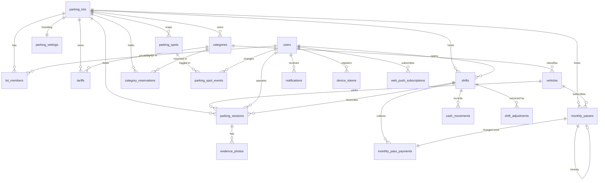

# Database

PostgreSQL 17 is the source of truth: tables, constraints, RLS policies,
`security definer` RPCs and triggers. The schema is owned by
`supabase/migrations/*.sql` (append-only, applied by `supabase-migrate`).

## 1. Entity–relationship overview



## 2. Tables

| Table | Purpose | Site-scoped |
|---|---|---|
| `parking_lots` | One row per site (`code`, `name`, `address`, `timezone`, `active`). | — |
| `lot_members` | Role per `(user, lot)`; drives the switcher and lot-admin checks. | — |
| `users` | Profile mirror of `auth.users` (username, display name, platform role, active). | no |
| `categories` | Vehicle category per site (`unique (lot_id, name)`) with optional capacity (0 = unlimited). | yes |
| `tariffs` | Hourly/daily/nightly/monthly amounts per category, with the night window; `(category_id, lot_id)` must match the category's lot (composite FK). | yes |
| `vehicles` | Global plate registry (category, color, brand, notes, blacklist, customer phone). A plate can park anywhere. | no |
| `parking_sessions` | A stay: entry/exit, amount, payment method, discount audit, lost ticket, shift, lot, ticket number; `closed_recorded_at` is the server time of the check-out (the exit time may be an offline client time). | yes |
| `evidence_photos` | Check-in photos/videos (storage path per session, unique `file_path`). | via session |
| `shifts` | Operator cash shift per site: opening float, counted cash, expected, difference. | yes |
| `cash_movements` | Withdrawals/deposits/adjustments inside a shift. | via shift |
| `shift_adjustments` | Audit of admin corrections to a closed shift. | via shift |
| `monthly_passes` | Pass period/amount, auto-renew flag, renewal link. | yes |
| `monthly_pass_payments` | Exactly one charge per pass (`pending`/`paid`/`waived`), collected into a shift. | yes |
| `category_reservations` | Capacity hold for a plate (`active`/`used`/`cancelled`/`expired`). | yes |
| `parking_spots` | Physical bay per site: code, group (`car`/`moto`/`heavy`), grid cell and `active`/`out_of_service`; unique code and cell per lot. | yes |
| `parking_spot_events` | Maintenance history of a bay: status transition, optional reason, actor and timestamp; written by `save_parking_spot`, lot-scoped RLS. | yes |
| `parking_settings` (`car_capacity`, `moto_capacity`, `key_capacity`) | Per-site branding (name, address, schedule, contacts, police quadrant, logo version/path) + `business_timezone`, `overstay_hours`, `lost_ticket_fee`, `evidence_retention_days`. | yes |
| `notifications` | Per-user inbox rows (type, title, body, data, read/pushed state, dedupe key). | optional |
| `device_tokens` | FCM tokens per user/device. | no |
| `web_push_subscriptions` | Browser push endpoints (endpoint + p256dh + auth). | no |
| `whatsapp_messages` | Queue of customer WhatsApp templates (`pending`/`sent`/`failed`, attempts, error, lot). | yes |
| `audit_log` | Admin audit trail: actor, action, table, entity, lot, changed columns (before/after). | via row |
| `client_error_reports` | Uncaught app errors (platform, message, stack, context) for support; admin-readable. | no |
| `idempotency_keys` | Replay cache for write RPCs keyed by `Idempotency-Key`. | — |
| `schema_migrations` | Applied migration files. | — |

Conventions: money is `integer` minor units of the lot currency (COP pesos, USD cents); timestamps are
`timestamptz` with the display timezone from `parking_settings.business_timezone`;
statuses are `text` with a `check` constraint; `lot_id` is `not null` everywhere
except `notifications` (global alerts).

## 3. RPC catalog

All RPCs are `security definer`, derive the actor from `auth.uid()`, and are
granted to `authenticated` only.

**Check-in / check-out**
`check_in` (incl. `p_left_keys`, `p_spot_id` and optional `p_videos`; notifies
the lot's members), `create_reservation` (holds consume group
capacity), `check_out` (notifies the lot's members; `p_card_type` required for cards,
stored in `parking_sessions.card_type`; `p_cash_received` stored with the change
in `cash_received`/`cash_change`), `check_out_preview` (amount +
billing breakdown + `lost_ticket_amount`),
`open_sessions_view` (`has_pass`, `left_keys`), `evidence_photos.kind`
(`photo`/`video`) with `duration_seconds`, `capacity_snapshot`
(`car_open/capacity/available/out_of_service/reserved`, motos, keys,
active/expiring holds),
`slot_board` (capacities, sessions, holds and out-of-service counts for the
visual board), `usable_capacity` (capacity - out of service, `0` = no limit),
`calculate_fare` (wrapper) and `fare_breakdown` (single source of truth for the
money: day/night hours, rates, daily cap, elapsed time),
`lost_ticket_amount` (internal; `greatest(fare, lot lost_ticket_fee | daily
tariff | 0)`),
`vehicle_history`, `update_vehicle_flags` (notes, blacklist, owner name + phone).
`can_read_lot(lot_id)` backs the notifications RLS for Realtime (no lot header
there).

**Physical map**
`parking_spots` (`code`, `group_name`, `grid_row`, `grid_col`, `status`;
unique code and cell per lot), `parking_spot_events` (status transitions with
actor, reason and timestamp; lot-scoped RLS, written by `save_parking_spot`),
`parking_sessions.spot_id` (one open session per bay), `save_parking_spot`,
`delete_parking_spot`, `assign_session_spot`, `list_spot_events`,
`category_group(name)`, `spot_target_capacity(lot, group)`; a group with spots
limits check-ins and holds to its active bays, and `save/delete_parking_spot`
keep the drawn bays equal to the configured capacity (`0` = no limit).
`capacity_snapshot` returns `car_target_capacity`/`moto_target_capacity` (raw
settings) beside the derived `car_capacity`/`moto_capacity`.

**Billing and reports**
`report_revenue` (active lot), `report_revenue_all` (platform admins),
`report_occupancy`, `occupancy_snapshot`, `dashboard_today` (home KPIs),
`dashboard_trend` (home 7-day series), `report_hourly_traffic` (entries/exits
per hour), `report_whatsapp` (customer message delivery).

**Legal policy**
`parking_settings.legal_policy` (template), `default_legal_policy()`,
`reset_legal_policy()` (lot admin), `public_lot_profile(lot_id)` (anon:
identity, contact, policy).

**Public evidence**
`public-evidence` Edge Function (service role): verifies a session + plate and
returns 1-hour signed URLs for that session's photos/videos (no login; the
plate is the key).

**Records**
`session_records(plate, limit, offset, from, to)`: lot-scoped session log
(entry, exit, duration, amount, status) with a partial plate filter, an
inclusive business-date range and a total; powers `/records` and its exports.

**Shifts and cash**
`open_shift`, `current_shift`, `close_shift`, `add_cash_movement`,
`shift_totals`, `list_shifts` (limit + date range), `adjust_shift`.

**Monthly passes and payments**
`pending_pass_payments`, `register_pass_payment`, `renew_monthly_passes`,
`create_pass_payment` (trigger), `notify_expiring_monthly_passes`.

**Capacity and reservations**
`create_reservation`, `cancel_reservation`, `expire_reservations`,
`enforce_category_capacity` (trigger).

**Sites and users**
`my_lots`, `list_lots`, `create_lot`, `update_lot`, `set_lot_member`,
`list_lot_members`, `set_branding_logo`.

**Audit**
`list_audit_log` (filters: limit, date range, table, actor username and
free-text search over entity, table, actor, plate and name; filters run
before the limit), `purge_audit_log`, `record_audit` (trigger on categories,
tariffs, vehicles, monthly passes, settings, lots and memberships).

**Customer messages**
`enqueue_whatsapp_message` (operators, only when the site enabled
`whatsapp_auto`), `purge_whatsapp_messages`.

**Diagnostics**
`diagnostics_snapshot` (counters, storage usage and the WhatsApp queue),
`list_client_error_reports` and `list_whatsapp_messages` (admin-only, last N
days).

**Notifications and push**
`mark_notifications_read`, `notify_session_event` (trigger),
`notify_overstays`, `register_device_token`, `unregister_device_token`,
`save_web_push_subscription`, `delete_web_push_subscription`.

**Helpers / infrastructure**
`current_app_user_id`, `current_app_role`, `is_admin`, `require_app_user`,
`is_lot_member`, `can_read_evidence`,
`require_admin`, `current_lot_id`, `lot_from_header`, `is_lot_admin`,
`require_lot_admin`, `resolve_lot`, `replay_idempotent`, `remember_idempotent`,
`purge_expired_idempotency`, `purge_stale_notifications`,
`purge_client_error_reports`, `report_client_error`,
`handle_auth_user` (trigger), `add_default_lot_member` (trigger).

## 4. Access control (RLS)

| Table | Read | Write |
|---|---|---|
| `parking_lots` | any authenticated | via `create_lot` / `update_lot` (platform admin) |
| `lot_members` | own memberships or platform admin | via `set_lot_member` (platform admin) |
| `users` | own profile or platform admin | via `admin-users` Edge Function |
| `categories`, `tariffs`, `monthly_passes` | active lot | RPC/table writes by lot admins of the active lot |
| `parking_sessions` | active lot | only through RPCs |
| `evidence_photos` | active lot | only through RPCs (rows deleted by `evidence-archive`) |
| `shifts`, `cash_movements`, `shift_adjustments` | own shift or lot admin, active lot | RPCs |
| `monthly_pass_payments`, `category_reservations` | active lot | RPCs |
| `parking_settings` (`car_capacity`, `moto_capacity`, `key_capacity`) | active lot; anonymous only the first lot (login branding) | lot admins |
| `whatsapp_messages` | admins | `enqueue_whatsapp_message` + the dispatcher |
| `notifications` | own rows, active lot (or global) | RPCs/triggers |
| `audit_log` | platform admins | triggers and the `admin-users` Edge Function |
| `device_tokens`, `web_push_subscriptions` | own rows | RPCs |

Evidence objects are special: Storage cannot forward `x-lot-id`, so the bucket
policy uses `can_read_evidence(name)` (security definer) and grants access when
the photo belongs to a session of a lot the user is a member of.

The active lot comes from `current_lot_id()`: the **mandatory** `x-lot-id`
header validated against `lot_members`. A missing or forged value raises
`LotRequiredError` (contract since `0032`). Queued offline writes pass the
captured lot through `resolve_lot()`, which validates membership the same way.
Cron jobs (`notify_overstays`, renewals, purges) deliberately avoid
`current_lot_id()` and act per row/site instead.

## 5. Migration rules

1. Add a new file `supabase/migrations/NNNN_name.sql`; never edit an applied one
   (the runner records the filename in `schema_migrations`).
2. New table → `enable row level security`, `grant select` (and the minimum
   needed) **and** policies in the same file.
3. Writes that need trust (money, capacity, users) go through
   `security definer` RPCs; plain table writes stay admin-only.
4. Grant `execute` explicitly; PostgREST does not expose functions otherwise.
5. Add a regression to `supabase/tests/rpc_test.sql` (Success / Failure /
   Security) and run `supabase/tests/run.sh`.

## 6. Useful queries

```sql
-- occupancy of the active site
select * from public.occupancy_snapshot();

-- open sessions with plate and entry time
select s.id, v.plate, s.entry_time, s.lot_id
  from public.parking_sessions s
  join public.vehicles v on v.id = s.vehicle_id
 where s.status = 'open'
 order by s.entry_time;

-- revenue per site for today (as platform admin)
select l.name, coalesce(sum(s.amount_charged), 0) as total
  from public.parking_lots l
  left join public.parking_sessions s
    on s.lot_id = l.id and s.status = 'closed'
   and (s.exit_time at time zone 'America/Bogota')::date = current_date
 group by l.name
 order by total desc;

-- what the cron keeps
select public.expire_reservations(24);
select public.purge_stale_notifications(90);
select public.purge_expired_idempotency();
```

## 7. Billing, shift and evidence rules (`0072`/`0073`)

**Fare.** `fare_breakdown` bills `ceil(stay_seconds / 3600)` hours once for the
whole stay. The stay is split into two buckets per calendar day (day / night
window, lot business timezone) and the hours are distributed by largest
remainder of each bucket's seconds (`allocate_billable_hours`; ties go to the
earliest bucket). Each day is charged `day_hours × hourly + night_hours ×
nightly`, capped by the daily tariff. Only tariffs with `t.lot_id` equal to the
category's lot are read. Output keys are unchanged.

**Monthly pass.** A stay is free only with an active pass of the **session's
lot** covering the lot's business date (`check_out`, `check_out_preview`,
`slot_board`, `open_sessions_view`).

**Lost ticket.** `gross = greatest(fare, lost_ticket_fee of the session lot |
active daily tariff | 0)`; the pass is ignored and `p_payment_method =
'monthly_pass'` raises `LostTicketPassMethodError` (the client lets the
operator pick cash/card/transfer and retries). `check_out_preview` returns:

```json
{
  "session_id": 1, "amount": 6000, "has_pass": false,
  "entry_time": "…", "previewed_at": "…",
  "hourly_rate": 3000, "nightly_rate": null, "daily_rate": null,
  "day_hours": 2, "night_hours": 0, "days": 1,
  "daily_cap_applied": false, "elapsed_seconds": 5400,
  "lost_ticket_amount": 9000
}
```

**Exit time.** `p_client_exit_time` must be within 12 h of the server clock
(`StaleExitTimeError`) and not later than now + 5 min nor before entry
(`InvalidExitTimeError`). `closed_recorded_at` stores the server time.

**Shifts.** Sales, cash movements and cash pass payments attach only to the
actor's open shift (`closed_at is null`), locked `FOR SHARE`; `close_shift`
locks it `FOR UPDATE`, so its totals include every committed writer. A
check-out replayed after its shift closed goes to the actor's current open
shift, or to no shift. `shift_totals` allows the shift owner or an admin of the
shift's lot (`is_lot_admin`).

**Capacity locks.** `check_in`, `enforce_category_capacity` and
`create_reservation` take `group:<lot>:<category_group(name)>` before
`category:<id>`.

**Pass renewal.** `renew_monthly_passes` renews active auto-renew passes whose
`end_date` is before the lot's local today and deactivates only those. A
calendar-month period (`start + n months - 1 day = end`) renews as
`end + 1 … end + 1 + n months - 1 day`; any other period keeps its day count.
The amount is copied.

**Evidence.** Every `p_photos[].path` / `p_videos[].path` given to `check_in`
must be an object in the `evidence` bucket with `owner = auth.uid()` and must
not back another `evidence_photos` row (`EvidenceNotFoundError`,
`EvidenceAlreadyUsedError`). Deterministic names
`<clientRef>/<i><ext>` and `<clientRef>/video<ext>` satisfy the bucket policy.
Upload the files **before** calling (or replaying) `check_in`.

**Currency in notifications.** `format_money(amount, currency)` mirrors
`Money.format`: COP `$5.000` (no decimals), USD `US$1,234.50` (minor units
/ 100), negative `-$1.000`.
