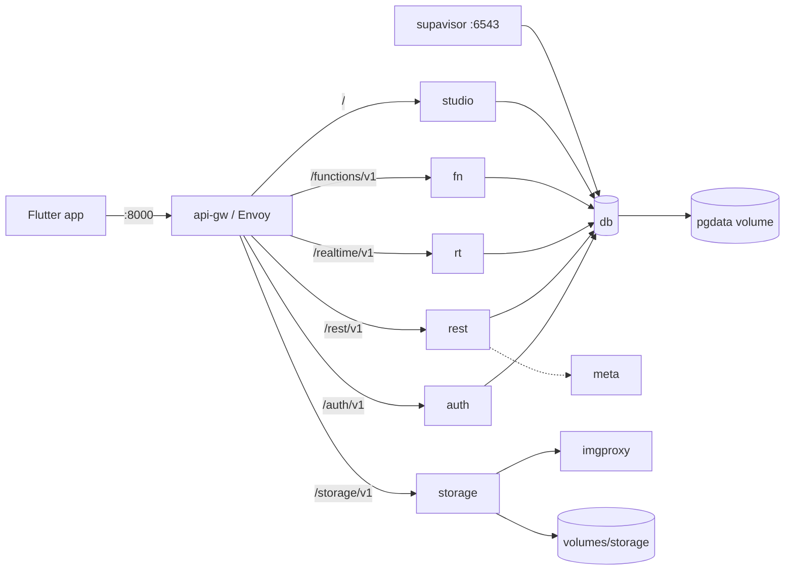

# Infrastructure

Everything runs with Docker Compose. `docker-compose.yml` (repo root) includes
`supabase/docker-compose.yml` (the Supabase stack) and adds the one-shot
`supabase-migrate` job.

## 1. Services

| Compose service | Image | Role | Exposed |
|---|---|---|---|
| `api-gw` | `envoyproxy/envoy:v1.39.1` | Single HTTP entry point; routes to the services below | `${API_GW_HTTP_PORT}` → `8000` |
| `studio` | `supabase/studio:2026.10.12` | Database UI | only through the gateway |
| `auth` | `supabase/gotrue:v2.197.0` | GoTrue: PIN login, JWT, users | internal `9999` |
| `rest` | `postgrest/postgrest:v14.18` | REST + `rpc/*` over the `public` schema | internal `3000` |
| `realtime` | `supabase/realtime:v2.143.3` | Postgres changes stream (notifications) | internal `4000` |
| `storage` | `supabase/storage-api:v1.81.0` | Object storage (evidence, branding) | internal `5000` |
| `imgproxy` | `darthsim/imgproxy:v3.31.4` | Image transforms for Storage | internal `5001` |
| `meta` | `supabase/postgres-meta:v0.100.0` | Schema introspection for Studio | internal `8080` |
| `functions` | `supabase/edge-runtime:v1.77.4` | `admin-users`, `push-dispatch` | internal `9000` |
| `db` | `supabase/postgres:17.6.1.136` | PostgreSQL 17 + roles/extensions | `${POSTGRES_PORT}` → `5432`, pooler `${POOLER_PROXY_PORT_TRANSACTION}` → `6543` |
| `supavisor` | `supabase/supavisor:2.9.13` | Connection pooler | `6543` (transaction mode) |
| `supabase-migrate` | `postgres:17-alpine` | Applies `supabase/migrations/*.sql` once | none (one-shot) |



## 2. Ports and exposure

Local development exposes the gateway (`8000`) and Postgres (`5432`/`6543`).
In production bind them to loopback so only the TLS proxy is public:

```ini
API_GW_HTTP_PORT=127.0.0.1:8000
POSTGRES_PORT=127.0.0.1:5432
POOLER_PROXY_PORT_TRANSACTION=127.0.0.1:6543
```

## 3. Persistent data

| What | Where | Backup |
|---|---|---|
| Database | Docker volume `pgdata` | `supabase/backup.sh` → `pg_dump` |
| Evidence + branding objects | `supabase/volumes/storage` | `supabase/backup.sh` → tar |
| Studio snippets | `supabase/volumes/snippets` | not critical |
| Edge Functions source | `supabase/volumes/functions` (in git) | git |
| Envoy config | `supabase/volumes/api/envoy` (in git) | git |

Losing the Docker volume means losing the database. `docker compose down` keeps
it; `docker compose down -v` deletes it.

## 4. Configuration

`.env` (from `.env.example`, secrets filled by `supabase/generate-env.sh`):

| Group | Keys | Notes |
|---|---|---|
| Database | `POSTGRES_PASSWORD`, `POSTGRES_DB`, `POSTGRES_PORT` | The app DB is `parking` by default. |
| JWT | `JWT_SECRET`, `ANON_KEY`, `SERVICE_ROLE_KEY`, `JWT_EXPIRY` | Rotating invalidates all sessions. |
| Gateway | `API_GW_HTTP_PORT`, `SUPABASE_PUBLIC_URL`, `API_EXTERNAL_URL`, `SITE_URL` | Public URLs must match the proxy. |
| Auth | `DISABLE_SIGNUP`, `PASSWORD_MIN_LENGTH`, `RATE_LIMIT_HEADER` | PINs are 6 digits. |
| Functions | `FUNCTIONS_VERIFY_JWT` | Keep the default; functions verify the caller themselves. |
| Push | `FCM_SERVICE_ACCOUNT_JSON`, `VAPID_*` | Optional; in-app works without them. |
| Storage | `GLOBAL_S3_BUCKET`, keys, `FILE_SIZE_LIMIT` | Local filesystem driver by default. |

Flutter build-time configuration is **not** read from `.env`; pass
`--dart-define=SUPABASE_URL` / `SUPABASE_ANON_KEY` (plus optional push keys).

## 5. Operations

```bash
docker compose ps                                  # health
docker compose logs -f --tail=100 api-gw rest      # follow
docker compose restart functions                   # after editing an Edge Function
docker compose up -d supabase-migrate              # apply new migrations
docker exec -it supabase-db psql -U supabase_admin -d parking
docker compose exec -T db psql -U postgres -d parking -c "select 1"
```

Health endpoints through the gateway:

- `GET /auth/v1/health` → `{"name":"GoTrue", ...}`
- `GET /rest/v1/` (with apikey) → OpenAPI document
- `GET /storage/v1/status` → storage status

## 6. Monitoring and diagnostics

```bash
sh supabase/healthcheck.sh     # services, HTTP endpoints, backlog; exit 1 on failure
sh supabase/diagnostics.sh     # tables/rows/sizes, stuck sessions, shifts, backlog
```

`healthcheck.sh` verifies running services, `/auth/v1/health`, a REST query and
`/storage/v1/status`, then warns about sessions open >48 h, shifts open >12 h,
notifications that exhausted their push attempts, a push backlog (only when
push is configured), client error reports and an oversized idempotency table.
Set `HEALTHCHECK_WEBHOOK` to a Slack-compatible endpoint to alert on failures.

Client errors are stored in `public.client_error_reports` (admins can select
them; the app reports via `rpc/report_client_error`, throttled and bounded).
Edge Functions log one JSON line per request (`fn`, `action`, `status`, `ms`,
plus counts), so `docker compose logs functions | grep '"ok":false'` finds
failures.

Recommended crons:

```cron
*/5 * * * * cd /opt/parking && HEALTHCHECK_WEBHOOK=... sh supabase/healthcheck.sh >> /var/log/parking-health.log 2>&1
```

## 7. Migrations

- `supabase/migrations/*.sql` is the only schema owner; applied in filename
  order by `supabase-migrate` and recorded in `public.schema_migrations`.
- Files are **append-only**: never edit an applied migration, add a new one.
- `0023+` are the multi-site migration; they are additive and reversible in the
  sense that old clients ignore the new columns.
- New tables must ship grants + RLS **before** PostgREST can see them; writes
  go through `security definer` RPCs.

## 8. Scheduled work

| Job | Where | Frequency |
|---|---|---|
| Pass renewal, expiry/overstay alerts, stale-notification/reservation/client-error/audit purge, idempotency purge, push flush | `supabase/notifications-cron.sh` (host cron) or `pg_cron` when available | every minute / daily |
| Evidence retention (deletes objects + rows) | `supabase/evidence-archive.sh` → `functions/evidence-archive` | daily, after the backup |
| Database + storage backup | `supabase/backup.sh` | nightly (see `setup-cloud.md`) |
| Restore drill | `supabase/restore.sh` on a scratch host | quarterly |

## 9. Scaling notes

- The DB is the bottleneck for writes (capacity locks are per category).
  Vertical scaling plus `supavisor` pooling covers many lots.
- Evidence photos are the main disk consumer: archive old objects and prune
  rows when you do.
- Files are on the local disk driver. For multiple hosts, switch Storage to S3
  (`GLOBAL_S3_BUCKET` + S3 env) before scaling horizontally.
- Realtime connections are per authenticated client; the default stack handles
  a single parking lot comfortably.

## 10. CI

`.github/workflows/ci.yml` runs on `main`, `feature/**` and PRs:

1. `flutter analyze`, `flutter test`, `flutter build web --release` (pinned
   beta SDK).
2. `docker compose config -q` with generated secrets.
3. `supabase/tests/run.sh` against `supabase/postgres` (migrations + RPC/RLS
   regressions).
4. `supabase-e2e`: brings the real stack up, creates the admin, runs
   `supabase/tests/e2e.sh` (API-level: login → check-in → check-out → report →
   history) and then the Flutter e2e (`test/integration/supabase_flow_test.dart`,
   pure-Dart client) against the same server.
