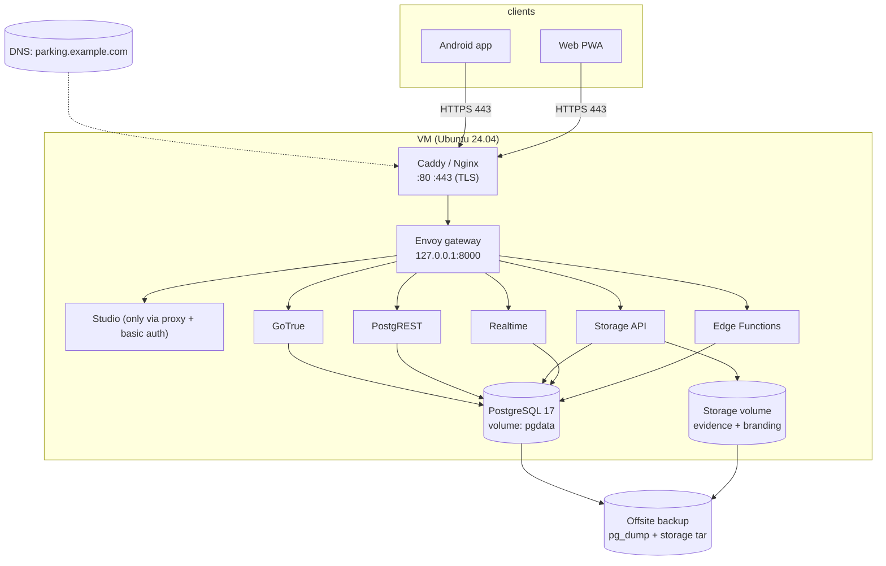

# Cloud / production setup

The supported production shape is **one VM running this Compose stack** behind a
TLS reverse proxy. The database, auth, storage, realtime and Edge Functions all
live on that host; the Flutter clients speak HTTPS to the gateway only.



## 1. Sizing

| Installation | vCPU | RAM | Disk | Notes |
|---|---|---|---|---|
| 1 site, ~100 vehicles/day | 2 | 4 GB | 40 GB SSD | Comfortable; DB and app on the same host. |
| 2–3 sites | 4 | 8 GB | 80 GB SSD | Backups on a separate disk/offsite. |
| Evidence-heavy (>2 GB/month) | 4 | 8 GB | 160 GB SSD | Archive photos periodically (see retention). |

Evidence photos dominate disk usage (JPEG/PNG up to 5 MB each). PostgreSQL
growth is small by comparison.

## 2. Provision the VM

Ubuntu 24.04 LTS, a non-root user with sudo, and Docker Engine + Compose v2:

```bash
sudo apt update && sudo apt install -y ca-certificates curl git
curl -fsSL https://get.docker.com | sudo sh
sudo usermod -aG docker "$USER"       # log out/in afterwards
```

Firewall: expose only `22`, `80`, `443`. **Do not expose `5432`, `6543` or
`8000` to the internet.**

```bash
sudo ufw allow 22/tcp && sudo ufw allow 80/tcp && sudo ufw allow 443/tcp
sudo ufw enable
```

## 3. Clone and configure

```bash
sudo mkdir -p /opt/parking && sudo chown "$USER" /opt/parking
git clone <repo> /opt/parking
cd /opt/parking

cp .env.example .env
sh supabase/generate-env.sh
```

Then edit `.env` for production:

```ini
# Public URL clients (and GoTrue redirects) use
SUPABASE_PUBLIC_URL=https://parking.example.com
API_EXTERNAL_URL=https://parking.example.com
SITE_URL=https://parking.example.com
ADDITIONAL_REDIRECT_URLS=https://parking.example.com

# Bind host ports to loopback only: the proxy is the only public entry.
API_GW_HTTP_PORT=127.0.0.1:8000
POSTGRES_PORT=127.0.0.1:5432
POOLER_PROXY_PORT_TRANSACTION=127.0.0.1:6543

# Security
PASSWORD_MIN_LENGTH=6
RATE_LIMIT_HEADER=X-Forwarded-For
DISABLE_SIGNUP=true

# Optional integrations
FCM_SERVICE_ACCOUNT_JSON=            # one-line Firebase service account
VAPID_PUBLIC_KEY=
VAPID_PRIVATE_KEY=
VAPID_SUBJECT=mailto:ops@example.com
```

Keep `.env` readable only by the service user:

```bash
chmod 600 .env
```

## 4. Start the stack

```bash
docker compose up -d
docker compose ps                        # all healthy
docker compose logs --tail=20 supabase-migrate
sh supabase/create-operator.sh admin <a-6-digit-pin> admin
```

Change that PIN from the app (`/users`) before handing the system over.

## 5. TLS reverse proxy

Caddy is the least-effort option (automatic Let's Encrypt certificates):

```caddyfile
parking.example.com {
    encode zstd gzip

    # Studio lives behind the same host: keep it private.
    @studio path /project* /api/mcp* /mcp*
    basic_auth @studio {
        admin <bcrypt-hash>       # caddy hash-password
    }

    reverse_proxy 127.0.0.1:8000
}
```

Notes:

- Realtime uses websockets under `/realtime/v1/`; Caddy/Nginx proxy these
  transparently. For Nginx add `proxy_set_header Upgrade $http_upgrade;` and
  `proxy_set_header Connection "upgrade";`.
- Allow uploads up to 6 MB (`client_max_body_size 6m;` in Nginx) so evidence
  photos fit.
- Android **release** builds must use the HTTPS URL (cleartext is blocked).

## 6. Backups

`supabase/backup.sh` dumps the database and tars the Storage volume into a
directory; `supabase/restore.sh` restores it (destructive, guarded by
`RESTORE_CONFIRM=yes`).

```bash
# every night at 02:30, keep the last 14 days, copy offsite
30 2 * * * cd /opt/parking && sh supabase/backup.sh /var/backups/parking >> /var/log/parking-backup.log 2>&1
0 4 * * * find /var/backups/parking -type d -mtime +14 -exec rm -rf {} +
15 4 * * * rclone copy /var/backups/parking remote:parking-backups   # or rsync/scp
```

**Drill the restore** on a scratch host before you need it:

```bash
RESTORE_CONFIRM=yes sh supabase/restore.sh /var/backups/parking/<stamp>
docker compose restart rest auth storage realtime functions
```

Back up before every upgrade and before rotating secrets.

## 7. Scheduled jobs

Run the notification/retention script every minute from the host:

```bash
* * * * * cd /opt/parking && sh supabase/notifications-cron.sh >> /var/log/parking-cron.log 2>&1
# daily, after the 02:30 backup; sites with retention_days = 0 are skipped
40 3 * * * cd /opt/parking && sh supabase/evidence-archive.sh >> /var/log/parking-evidence.log 2>&1
```

It renews monthly passes, raises expiry/overstay alerts, purges stale
notifications, expired reservations, old client error reports and the audit log
(365 days), cleans idempotency keys, and flushes pending push notifications.
The daily evidence job deletes photos past each site's `evidence_retention_days`
(zero keeps them forever). If your Postgres image supports `pg_cron`, the same jobs
can run inside the database (see
[`../README.md#data-retention`](../README.md#data-retention)).

## 8. Push notifications

- **Android (FCM)**: create a Firebase project, download the service account
  JSON, put it in `.env` as a single line under `FCM_SERVICE_ACCOUNT_JSON`,
  restart `functions`, and build the app with `FCM_ENABLED=true` plus the
  `FIREBASE_*` dart-defines.
- **Browser (VAPID)**: `npx web-push generate-vapid-keys`, put the keys in
  `.env`, restart `functions`, rebuild the web app with
  `--dart-define=WEB_PUSH_VAPID_PUBLIC_KEY=<public>`. Service workers require
  HTTPS (you have it). Users enable it from the inbox.

## 9. Monitoring

```bash
sh supabase/healthcheck.sh          # 0 = healthy, 1 = something is down
sh supabase/diagnostics.sh          # support snapshot
```

Cron it every 5 minutes with `HEALTHCHECK_WEBHOOK` pointing at your alert
channel; the script only posts when there is a hard failure. Pair it with an
external uptime check on `https://parking.example.com/auth/v1/health` (it needs
the `apikey` header) and a daily look at `client_error_reports` from Studio.

## 10. Android release

```bash
flutter build appbundle --release \
  --dart-define=SUPABASE_URL=https://parking.example.com \
  --dart-define=SUPABASE_ANON_KEY=<ANON_KEY> \
  --dart-define=FCM_ENABLED=true \
  --dart-define=FIREBASE_API_KEY=... \
  --dart-define=FIREBASE_APP_ID=... \
  --dart-define=FIREBASE_MESSAGING_SENDER_ID=... \
  --dart-define=FIREBASE_PROJECT_ID=...
```

Sign with your own keystore (`android/key.properties`, never committed) and
distribute through Play/internal track or MDM. The release manifest forbids
cleartext traffic, hence the HTTPS requirement.

## 11. Upgrades

```bash
cd /opt/parking
sh supabase/backup.sh /var/backups/parking/pre-upgrade
git pull --ff-only
docker compose pull
docker compose up -d                    # supabase-migrate applies new migrations
docker compose logs --tail=20 supabase-migrate
```

Manual API calls must send the active site: `-H "x-lot-id: <lot id>"` (the
Flutter app and both e2e suites do it for you).

Smoke test after every deploy:

```bash
sh supabase/tests/e2e.sh          # login → check-in → check-out → report → history
```

Then in the app: open the shift screen, `/reports` and `/audit`, and confirm the
dashboard occupancy moved.

## 12. Hardening checklist

- [ ] `chmod 600 .env`; secrets only in `.env` (or your secret manager).
- [ ] Only 22/80/443 open; gateway and DB bound to `127.0.0.1`.
- [ ] Studio protected (basic auth or IP allowlist).
- [ ] Unique 6-digit PIN per operator; rotate the bootstrap admin PIN.
- [ ] `DISABLE_SIGNUP=true`; `FUNCTIONS_VERIFY_JWT` left at its default.
- [ ] Nightly backups + offsite copy + a restore drill on record.
- [ ] Cron script running (check `/var/log/parking-cron.log`).
- [ ] Uptime check on `https://parking.example.com/auth/v1/health`.
- [ ] Android builds signed and HTTPS-only.

## Supabase Cloud instead of a VM

The repository is built for self-hosting: migrations create roles/policies for
the Compose image, `admin-users`/`push-dispatch` run on the Edge Runtime, and
`backup.sh` assumes local volumes. Using Supabase Cloud is possible but needs
adaptation (apply `supabase/migrations` with `psql` against the Cloud
connection string, deploy the functions with the Supabase CLI, re-create the
storage buckets, and re-point `.env` values). The VM path above is the
supported one; if you go Cloud, keep the SQL suite in CI against a throwaway
project before pointing production at it.
