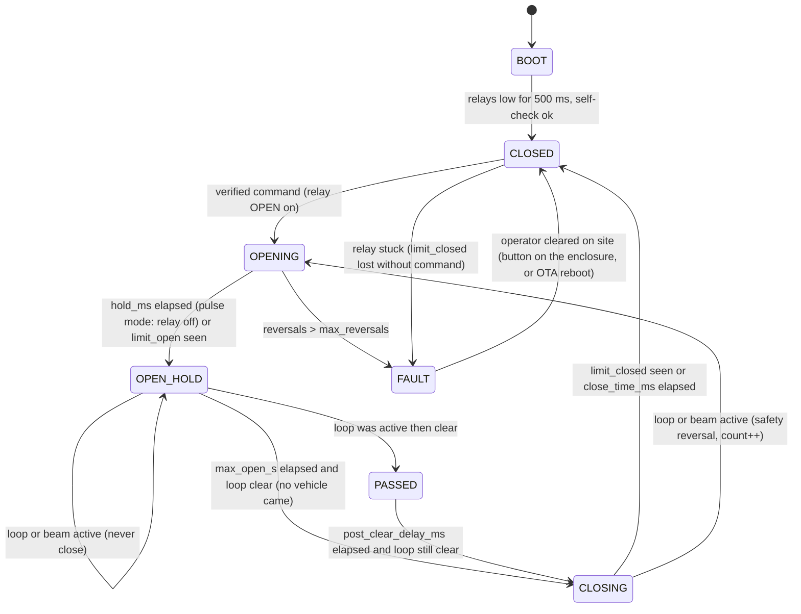
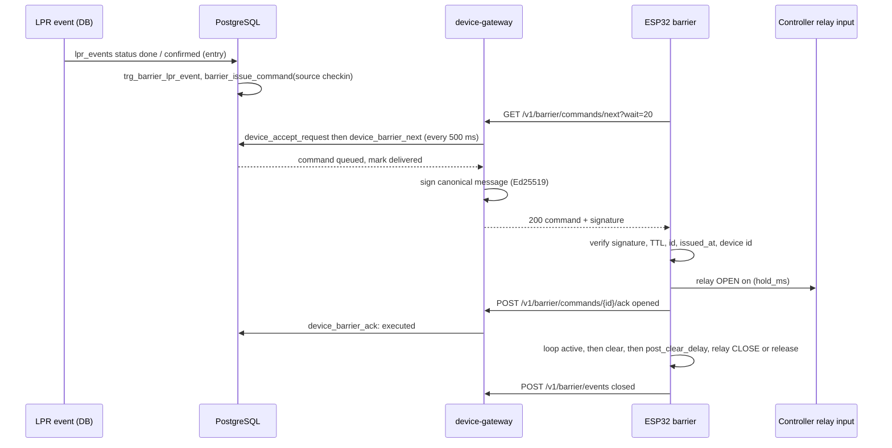
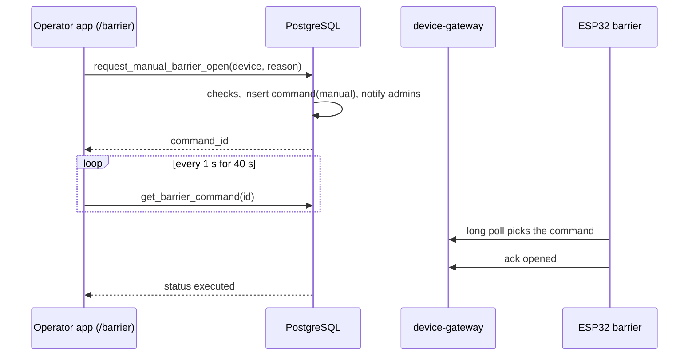
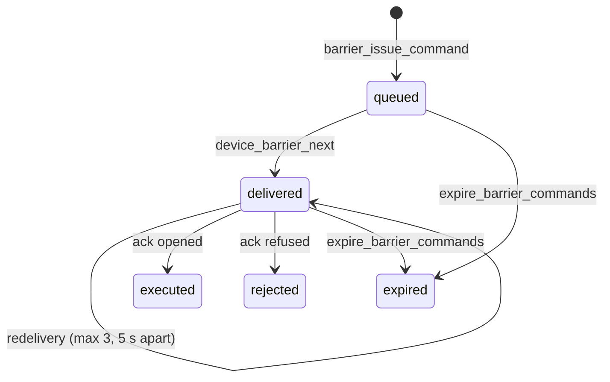

## Context

Verified in the code (migration head `0102`; `0103` belongs to `add-public-booking-captcha`):

- `parking_sessions` has `status` (`open`/`closed`), `exit_time`, `amount_charged`, `payment_method`, `lot_id`, `vehicle_id`, `spot_id`; `public.check_out(...)` (latest body in `0072_billing_integrity.sql`) is the only writer of the `open → closed` transition and fires `trg_notify_session_event` (`0056`, body in `0073`) inside its transaction. There is no separate "paid" column: **closed means paid** (including pass sessions that close with an amount of 0).
- `check_in` (latest in `0098_reservation_grace_setting.sql`) inserts the session and `trg_notify_session_event` fires on `insert ... status = 'open'`.
- Device registry, key format, headers, replay/skew rules, `device_accept_request`, error table, retry rule and the route table come from `add-device-gateway` (gateway routes live in `supabase/volumes/functions/device-gateway/routes/`). Device RPCs are `service_role` only. A device RPC receives `p_device_id` and re-reads `lot_devices`.
- `add-lpr-camera-gate` provides `public.lpr_events (direction, status, reason, has_pass, session_id, device_id, created_at)` and `lpr_camera_config`; `reason = 'exit_paid'` and `reason = 'exit_unpaid'` are the facts this change consumes.
- Edge runtime limits: `supabase/docker-compose.yml` starts the functions container with `--user-worker-request-idle-timeout 150000`, and `main/index.ts` gives a worker `workerTimeoutMs = 400_000` and `requestAbsentTimeoutMs = 60_000`; a 20-second long poll is far inside both. `0074_statement_timeouts.sql` sets 15 s / 5 s statement timeouts for `authenticated` / `anon` only (the service role is unaffected), so the long poll sleeps in the function, not in PL/pgSQL.
- Deno's WebCrypto supports Ed25519 (`crypto.subtle.sign('Ed25519', key, data)`); the function holds secrets only through environment variables listed in the `functions` service of `supabase/docker-compose.yml`, and a new variable must be added there (agent-memory).
- Notifications are inserted by `security definer` SQL with Spanish text and a `dedupe_key` (`notify_overstays` pattern); Realtime delivers them with the `can_read_lot` policy (`0057`).
- Storage buckets are created by migrations (`0003_storage_buckets.sql` pattern `insert into storage.buckets`); object deletion needs the Storage API (the reason `evidence-archive` exists).

## Goals / Non-Goals

**Goals**

- The barrier opens only on an explicit, server-issued, signed, unexpired, never-before-seen command addressed to that device.
- The decision to open is derived from facts the system already owns (session created, session paid, pass recognised) or from an audited human action; there is no code path where a device decides by itself.
- Power loss, network loss, server loss and firmware faults leave the barrier **closed and unpowered-safe**, never open by default and never driving closed onto a vehicle.
- A manual open always has a name, a reason and a time, and admins are told.
- Firmware logic (state machine, command verification, replay guard, backoff, OTA decision) is unit-tested on a host without hardware.

**Non-Goals:** see proposal.

## Decisions

### D1. Transport: long poll over HTTPS (extends the gateway decision)

`GET /v1/barrier/commands/next?wait=20` is held by the function for up to `wait` seconds (max 20), checking `device_barrier_next` every 500 ms, and returns the first command or `204`. Typical open latency is ≤ 0.5 s plus network. Each poll is one accepted request for the gateway's rate limit (≈ 3 per minute plus heartbeat). Rejected: MQTT (rationale in `add-device-gateway` D1), WebSocket (Edge runtime workers are not meant for long-lived sockets and Realtime needs a GoTrue JWT).

### D2. Command signing: Ed25519, public key in firmware, private key only in the function's environment

- Why not rely on TLS and the device key alone: the device key proves *the device* to the server; nothing proves to the device that an "open" really originates from this system's issuing logic (a compromised reverse proxy, a DNS/TLS interception with a mis-issued certificate, a leaked `key_hash` combined with a rogue server on the LAN). A signature bound to `(command id, device id, action, issued_at, expires_at, nonce)` closes that.
- Why asymmetric and not HMAC with a per-device secret: the server would have to store a reusable secret per device (or derive it from `key_hash`, which a database leak exposes). With Ed25519 the database never holds anything that can forge a command.
- Signing happens **at delivery time inside `device-gateway`**, not in SQL: the database stores the command facts; the signing key (`BARRIER_COMMAND_SIGNING_KEY`, base64 PKCS#8) exists only in the `functions` container environment. Without the variable the route answers `503 GatewayUnavailableError` for `commands/next` (fail closed).
- Canonical message (UTF-8, `|` separated, no trailing newline), version-tagged so a future format cannot be confused with this one:

```
parking-barrier-v1|<command uuid>|<device id>|open|<issued_at unix s>|<expires_at unix s>|<nonce 32 hex>|<hold_ms>|<max_open_s>
```

- The signature is Ed25519 over those bytes, sent base64 (64 bytes). `hold_ms` and `max_open_s` are inside the signed message, so a MITM cannot lengthen the opening.
- Key rotation: generate a new pair, put the private key in `.env`, ship firmware with the new public key via signed OTA **before** switching the server (the firmware accepts a list of two public keys during rotation, `COMMAND_PUBKEYS[2]`). Documented in `docs/runbook-secrets.md`.
- Test vector shared between TypeScript and C++: `edge/barrier/test/vectors/command_v1.json` (fixed test private key, message, signature), produced by a Deno test and verified by the C++ host test, so both implementations are proven to agree.

### D3. Single use, short TTL

- TTL: `barrier_config.command_ttl_seconds` (default 30, 10..120). `expires_at = issued_at + ttl`.
- Server single use: status machine `queued → delivered → executed|rejected|expired|cancelled`; an executed or rejected command is never delivered again; a delivered but unacknowledged command is re-delivered at most 3 times, at least 5 s apart, until it expires.
- Device single use (does not trust the server to be correct): the firmware (a) rejects `now_server_time > expires_at` (its clock is the gateway-synced clock: `server_time` of every response sets an offset, so only network latency matters), (b) rejects a command whose `id` is in its RAM ring of the last 16 executed ids, (c) rejects `issued_at <= last_executed_issued_at` persisted in NVS (survives reboots; protects against replay of an old-but-unexpired command after a restart), (d) rejects `device_id` ≠ its own, (e) rejects a bad signature. Every rejection is reported in the ack with a `reason` and never actuates a relay.

### D4. Who may cause an open (the only four issuers)

All four call the internal function `barrier_issue_command` (D6). None is reachable by a device or an anonymous client.

| Source (`barrier_commands.source`) | Trigger | Default | Conditions |
|---|---|---|---|
| `checkin` | `lpr_events` row becomes `done` or `confirmed` with `direction = 'entry'` and a `session_id` | on for `open_on_checkin = 'lpr_only'` | barrier = the one paired with the event's camera (`barrier_config.camera_device_id`); for `open_on_checkin = 'always'` also any `parking_sessions` insert with `status = 'open'` opens the lot's single enabled entry barrier (if there are several, none) |
| `paid_exit` | (a) `parking_sessions` update `open → closed` where an exit `lpr_events` row (`reason = 'exit_unpaid'`, same `session_id`, created within the last 15 minutes) exists, or (b) `lpr_events` insert with `direction = 'exit'`, `reason = 'exit_paid'` | `open_on_paid_exit = 'lpr_only'` | barrier = the one paired with that event's camera; `'always'` additionally opens the lot's single enabled exit barrier on any session close |
| `pass_recognised` | `lpr_events` insert with `direction = 'entry'`, `has_pass`, `reason in ('assist_mode','low_confidence')` or `status = 'done'`, mean confidence ≥ 0.95, not `blocked`, not `duplicate_session` | **off** (`open_for_pass_entry = false`) | opt-in per barrier; the event must not be older than 20 s |
| `manual` | `request_manual_barrier_open` | n/a | member of the lot, reason 3..200 chars, barrier online, no command in flight, ≤ 10 manual opens per user per hour |
| `online_payment` | `barrier_request_exit_open(session_id, 'online_payment')`, called by `add-online-payments` **if present** | n/a | same pairing as `paid_exit` |

For `paid_exit` (a) the look-back window for the waiting exit event is 15 minutes (`lpr_events.created_at >= now() - interval '15 minutes'`), the same figure as the LPR stale bound. No LPR event within the window and `open_on_paid_exit <> 'always'` → no command (the desk can use the manual action).

Never issued, by construction: for an exit with an open session; for a blacklisted vehicle; for a session closed more than 15 minutes ago; for a pass holder at an exit.

### D5. Optional hook for online payments

`add-online-payments` is later in the global order, so this change only exposes `public.barrier_request_exit_open(p_session_id integer, p_source text default 'online_payment') returns uuid` (internal; `revoke all ... from public, anon, authenticated; grant execute ... to service_role`). The payments change calls it from the transaction that marks a session paid, guarded by `if to_regprocedure('public.barrier_request_exit_open(integer,text)') is not null`. If the session is closed by the same payment, the `paid_exit` trigger already fires and the hook is idempotent: `barrier_issue_command` coalesces a duplicate `(device, source family, session)` into the existing command. Nothing in this change depends on that feature existing.

### D6. Command issuing is one internal function; triggers never fail the business transaction

`barrier_issue_command(p_device_id integer, p_source text, p_session_id integer default null, p_lpr_event_id bigint default null, p_requested_by integer default null, p_reason text default null) returns uuid` runs as `security definer`, is revoked from every client role (called only by triggers, `request_manual_barrier_open` and `barrier_request_exit_open`). It checks `kind = 'barrier'`, `enabled`, and (automatic sources) that the device is not `offline`/`never_seen` by the same rule as `list_lot_devices()`; when the barrier is not usable it still inserts the command as `expired` with `result = {"error": "barrier_unavailable"}` and creates the `barrier_command_failed` notification, so the desk knows to open it by hand. Duplicate suppression: an existing command for the same device with `source = p_source` and (`session_id`, or `lpr_event_id`) in status `queued|delivered` is returned instead of creating another.

The trigger functions wrap the call in `begin ... exception when others then raise warning 'barrier trigger: %', sqlerrm; end` so a barrier problem can never roll back a check-in or a payment.

### D7. Device behaviour and safety philosophy

The firmware is **not** a safety function. The barrier controller's own safety devices (inductive loop under the arm, photocell, safety edge, force limiting) stay wired to the controller and remain authoritative. The ESP32 only provides an "open" contact, optionally a "close" contact, and reads (never overrides) extra inputs.

State machine (`barrier_core::Fsm`, pure C++):



Rules:

1. **Local triggers do not exist.** No GPIO input is wired to the OPEN relay logic. The enclosure's push-button (if any) only resets a FAULT. The device runs no server socket, no BLE, no Wi-Fi AP after provisioning, UART console and JTAG disabled by eFuse in production.
2. **Anti-tailgating**: after a car has passed (loop active then clear), the arm closes after `post_clear_delay_ms` (default 1500, 500..10000). A second car that enters the loop during that delay keeps the arm open (safety) but a `loop_retrigger` event is sent so the desk can see it; it is not a new authorisation. If no car ever enters the loop, the arm closes after `max_open_s` (default 20, signed in the command).
3. **Safety reversal**: loop or beam active while CLOSING → drive OPEN again (this restores an authorised passage; it is not an authorisation), at most `max_reversals` (default 3, 1..10) per command, then FAULT with the arm left open and an `obstruction` event.
4. **Relay modes** (`relay_mode`, firmware build/config): `pulse` – OPEN input pulsed for `hold_ms` (default 1000, controller auto-closes or is told to close by relay K2); `hold` – OPEN relay held until PASSED/`max_open_s`, then released (controller closes on release). Which one applies depends on the controller; the commissioning doc has a table of the two wiring modes.
5. **Power loss / brown-out**: relay drivers have external pull-down resistors and normally-open contacts: no power = relays open = no command to the controller. The device never opens on power-up (BOOT keeps relays low ≥ 500 ms before the FSM starts, and the task watchdog (5 s) resets the MCU on a hang, which again drops all outputs). After reboot it reports `power_restored`. In-flight commands are not resumed: a reboot discards them (they will have expired).
6. **Network loss**: no polling success → no commands → the barrier stays closed and operators use the controller's key/remote (documented). The device keeps its FSM running for an already-accepted command (a car mid-passage is not trapped). There is **no offline whitelist** and no "open if offline" mode.
7. **Server loss during OPEN_HOLD**: timers are local (`max_open_s`, `post_clear_delay_ms`), so closing never depends on the network.
8. **Tamper**: enclosure switch (normally closed) opening → `tamper` event (queued locally if offline, sent on reconnect) and the status LED blinks; no other effect.

### D8. TLS, key storage, secure boot, OTA

- TLS 1.2+ with `esp_tls` and the **CA certificate pinned in the image** (`edge/barrier/certs/ca.pem`; public chain root of the gateway host or the private CA; pinned CA, not leaf, so Let's Encrypt leaf renewal does not brick devices). Hostname verification on, `skip_common_name` never set.
- Secrets: the per-device API key lives in an **encrypted NVS partition** (`nvs` encrypted with the key in the `nvs_keys` partition, which is itself protected by **flash encryption**). It is provisioned once by `edge/barrier/tools/provision.py`, which builds the encrypted NVS image from the key typed by the installer (copied from the show-once dialog), never from a file committed to git, never printed. The command public key(s) are compiled in (public data).
- **Secure boot v2** + **flash encryption (release mode)** are required for production units: the bootloader only runs images signed with the owner's signing key, and the flash cannot be read out. eFuse burning is irreversible; the commissioning procedure has a dry-run mode and a checklist, and the `[needs-hardware]` tasks mark it.
- **OTA**: `GET /v1/barrier/firmware?current=<semver>` → `204` or `{"version","sha256","size","image_path"}`; `GET /v1/barrier/firmware/:version/image` streams the signed image from the private `firmware` bucket (service key). The device checks the manifest SHA-256 while streaming into the OTA partition, `esp_https_ota` + secure boot verify the signature before the partition is marked bootable, `CONFIG_BOOTLOADER_APP_ROLLBACK_ENABLE` rolls back if the new image does not call `esp_ota_mark_app_valid_cancel_rollback()` after its first successful poll, and `CONFIG_BOOTLOADER_APP_ANTI_ROLLBACK` blocks older secure versions. OTA runs only in state `CLOSED` with no command in flight, at most once per 6 hours. A compromised server can therefore at worst withhold updates; it cannot install unsigned code.

### D9. Idempotent events from the device

`POST /v1/barrier/events` carries a `client_ref` (uuid generated at the moment the device observed the event, persisted in a small ring in RAM and the events queued while offline in NVS, max 32, oldest dropped); `unique (device_id, client_ref)` makes retries idempotent. Events are informational: they never change command status (that is the ack's job) except that `opened`/`closed` events enrich `barrier_commands.result` of the matching in-flight command.

### D10. Flutter: operators get status and manual open; admins also configure

One route `/barrier` for operators and admins (added to `operatorRoutes`). It lists the lot's barriers with online status (`DeviceStatus` of `add-device-gateway`), the last command, and a **Open** button per online barrier that opens a dialog with a mandatory reason field (3..200 chars, localized validation) and a confirmation. After the call, the cubit polls `get_barrier_command` once per second for up to 40 s and shows `Opening… → Opened | Failed (reason)`. Configuration (pairing, open rules, timings) is an admin-only bottom sheet. Manual open is disabled while offline and never queued.

## Data model

### `<NEXT>_barrier_config.sql`

```sql
create table if not exists public.barrier_config (
    device_id              integer primary key references public.lot_devices(id) on delete cascade,
    lot_id                 integer not null references public.parking_lots(id) on delete cascade,
    direction              text    not null default 'entry' check (direction in ('entry', 'exit')),
    camera_device_id       integer references public.lot_devices(id) on delete set null,
    open_on_checkin        text    not null default 'lpr_only' check (open_on_checkin in ('never', 'lpr_only', 'always')),
    open_on_paid_exit      text    not null default 'lpr_only' check (open_on_paid_exit in ('never', 'lpr_only', 'always')),
    open_for_pass_entry    boolean not null default false,
    open_hold_ms           integer not null default 1000  check (open_hold_ms between 200 and 30000),
    max_open_seconds       integer not null default 20    check (max_open_seconds between 5 and 120),
    post_clear_delay_ms    integer not null default 1500  check (post_clear_delay_ms between 500 and 10000),
    max_reversals          integer not null default 3     check (max_reversals between 1 and 10),
    command_ttl_seconds    integer not null default 30    check (command_ttl_seconds between 10 and 120),
    updated_at             timestamptz not null default now()
);
alter table public.barrier_config enable row level security;
revoke all on public.barrier_config from anon, authenticated;   -- reads via list_barriers()
-- A trigger rejects camera_device_id that is not a camera of the same lot.
create or replace function public.barrier_config_check() returns trigger
language plpgsql security definer set search_path = public as $$
begin
    if not exists (select 1 from public.lot_devices d where d.id = new.device_id and d.kind = 'barrier' and d.lot_id = new.lot_id) then
        raise exception 'InvalidDeviceKindError';
    end if;
    if new.camera_device_id is not null and not exists (
        select 1 from public.lot_devices c where c.id = new.camera_device_id and c.kind = 'camera' and c.lot_id = new.lot_id) then
        raise exception 'InvalidDeviceKindError';
    end if;
    return new;
end $$;
create trigger trg_barrier_config_check before insert or update on public.barrier_config
    for each row execute function public.barrier_config_check();
drop trigger if exists trg_audit_row on public.barrier_config;
create trigger trg_audit_row after insert or update or delete on public.barrier_config
    for each row execute function public.record_audit();   -- no secrets; lot_id present; id absent (entity_id null)

insert into storage.buckets (id, name, public, file_size_limit)
values ('firmware', 'firmware', false, 4194304) on conflict (id) do nothing;
-- no policies: only the service role (gateway) touches this bucket.

create table if not exists public.device_firmware (
    id           serial primary key,
    kind         text    not null check (kind in ('camera', 'barrier', 'sensor_hub')),
    version      varchar(20) not null check (version ~ '^[0-9]+\.[0-9]+\.[0-9]+$'),
    sha256       text    not null check (sha256 ~ '^[0-9a-f]{64}$'),
    size_bytes   integer not null check (size_bytes > 0),
    storage_path varchar(200) not null,
    secure_version integer not null default 0,
    released     boolean not null default false,
    created_by   integer references public.users(id) on delete set null,
    created_at   timestamptz not null default now(),
    unique (kind, version)
);
alter table public.device_firmware enable row level security;
revoke all on public.device_firmware from anon, authenticated;
```

(The `device_firmware` table is shared with `add-bay-sensors`; whichever change is implemented first creates it, the other uses `create table if not exists`.)

### `<NEXT>_barrier_commands.sql`

```sql
create table if not exists public.barrier_commands (
    id            uuid primary key default gen_random_uuid(),
    lot_id        integer not null references public.parking_lots(id) on delete cascade,
    device_id     integer references public.lot_devices(id) on delete set null,
    device_name   varchar(60) not null,
    action        text not null default 'open' check (action = 'open'),
    source        text not null check (source in ('checkin','paid_exit','pass_recognised','manual','online_payment')),
    reason        text check (reason is null or char_length(btrim(reason)) between 3 and 200),
    session_id    integer references public.parking_sessions(id) on delete set null,
    lpr_event_id  bigint  references public.lpr_events(id) on delete set null,
    requested_by  integer references public.users(id) on delete set null,
    nonce         text not null default replace(gen_random_uuid()::text, '-', ''),
    status        text not null default 'queued' check (status in ('queued','delivered','executed','rejected','expired','cancelled')),
    deliveries    integer not null default 0,
    issued_at     timestamptz not null default now(),
    expires_at    timestamptz not null,
    delivered_at  timestamptz,
    acked_at      timestamptz,
    result        jsonb not null default '{}'::jsonb,
    check (source <> 'manual' or (requested_by is not null and reason is not null))
);
create index if not exists ix_barrier_commands_lot_issued on public.barrier_commands(lot_id, issued_at desc);
create index if not exists ix_barrier_commands_device_open on public.barrier_commands(device_id, issued_at)
    where status in ('queued', 'delivered');
alter table public.barrier_commands enable row level security;
revoke all on public.barrier_commands from anon, authenticated;   -- reads via list_barrier_commands()/get_barrier_command()

create table if not exists public.barrier_events (
    id         bigserial primary key,
    lot_id     integer not null references public.parking_lots(id) on delete cascade,
    device_id  integer not null references public.lot_devices(id) on delete cascade,
    client_ref uuid not null,
    event      text not null check (event in ('opened','closed','loop_retrigger','obstruction','tamper','power_restored','fault','fault_cleared')),
    detail     jsonb not null default '{}'::jsonb,
    happened_at timestamptz not null,
    created_at timestamptz not null default now(),
    unique (device_id, client_ref)
);
create index if not exists ix_barrier_events_lot on public.barrier_events(lot_id, happened_at desc);
alter table public.barrier_events enable row level security;
revoke all on public.barrier_events from anon, authenticated;
```

`barrier_commands` is never purged before 365 days (`purge_barrier_events(p_days default 365)` purges events and commands older than that): it is the audit trail of every opening.

### `<NEXT>_barrier_triggers.sql`

All `security definer set search_path = public`, each body wrapped in `begin ... exception when others then raise warning ...; end` (D6).

| Trigger | On | Function |
|---|---|---|
| `trg_barrier_lpr_event` | `after insert or update of status on public.lpr_events` | `barrier_on_lpr_event()` — handles `checkin`, `pass_recognised`, `paid_exit` (b) |
| `trg_barrier_session_closed` | `after update of status on public.parking_sessions when (old.status = 'open' and new.status = 'closed')` | `barrier_on_session_closed()` — `paid_exit` (a) and `'always'` |
| `trg_barrier_session_opened` | `after insert on public.parking_sessions when (new.status = 'open')` | `barrier_on_session_opened()` — only acts for `open_on_checkin = 'always'` |

### `<NEXT>_barrier_operator_rpcs.sql`

Client RPCs (`revoke all ... from public; grant execute ... to authenticated`; first line `require_app_user()`; lot from `current_lot_id()`):

| Function | Signature | Who | Returns / errors |
|---|---|---|---|
| `list_barriers` | `()` | member | `{"barriers":[{"device_id":7,"name":"Salida","direction":"exit","status":"online","last_seen_at":"...","firmware_version":"barrier-1.0.0","camera_device_id":3,"config":{...},"in_flight":null,"last_command":{...}}]}` (config fields as in the table; `in_flight` = command object or null) |
| `request_manual_barrier_open` | `(p_device_id integer, p_reason text)` | member | `{"command_id":"uuid","expires_at":"..."}`; `DeviceNotFoundError`, `InvalidDeviceKindError`, `BarrierReasonRequiredError` (trimmed length not 3..200), `BarrierOfflineError`, `BarrierBusyError`, `BarrierRateLimitedError` |
| `get_barrier_command` | `(p_command_id uuid)` | member | command object; `BarrierCommandNotFoundError` (also for another lot) |
| `list_barrier_commands` | `(p_device_id integer default null, p_limit integer default 50)` | member | array of command objects with `requested_by_name`, newest first, limit 1..200 |
| `set_barrier_config` | `(p_device_id integer, p_direction text default null, p_camera_device_id integer default null, p_open_on_checkin text default null, p_open_on_paid_exit text default null, p_open_for_pass_entry boolean default null, p_open_hold_ms integer default null, p_max_open_seconds integer default null, p_post_clear_delay_ms integer default null, p_max_reversals integer default null, p_command_ttl_seconds integer default null)` | lot admin | config object; `DeviceNotFoundError`, `InvalidDeviceKindError`, `InvalidDataError`; `p_camera_device_id = 0` clears the pairing |
| `release_device_firmware` | `(p_kind text, p_version text, p_sha256 text, p_size_bytes integer, p_storage_path text, p_secure_version integer default 0)` | platform admin (`require_admin()`) | firmware object; `InvalidDataError`, `ConflictError` on duplicate version |

Command object: `{"id":"uuid","device_id":7,"device_name":"Salida","source":"manual","reason":"Cliente sin ticket","status":"executed","session_id":null,"requested_by_name":"Ana","issued_at":"...","expires_at":"...","acked_at":"...","result":{"result":"opened","open_ms":4210}}`.

Job and internal functions: `expire_barrier_commands()` (`queued|delivered` with `expires_at < now()` → `expired`, `result = {"error":"expired"}`, `barrier_command_failed` notification once per command; returns count), `purge_barrier_events(p_days integer default 365)`, `barrier_issue_command(...)`, `barrier_request_exit_open(...)`, `barrier_notify(...)`: all `revoke all ... from public, anon, authenticated` (the second also `grant ... to service_role`).

Service-role RPCs for the gateway (`grant execute ... to service_role` only): `device_barrier_config(p_device_id integer)`, `device_barrier_next(p_device_id integer)` (returns the command object or null; marks `delivered`, increments `deliveries`, enforces "at most 3 deliveries, ≥ 5 s apart", skips expired), `device_barrier_ack(p_device_id integer, p_command_id uuid, p_result text, p_detail jsonb default '{}')` (`p_result` in `opened`, `refused`; idempotent; `BarrierCommandNotFoundError` for a command of another device; status → `executed` or `rejected`; `rejected` creates the `barrier_command_failed` notification), `device_barrier_event(p_device_id integer, p_client_ref uuid, p_event text, p_at timestamptz, p_detail jsonb default '{}')` (idempotent; creates `barrier_fault` notifications for `obstruction`, `tamper`, `power_restored`, `fault`; at most one per device, event type and 10 minutes), `device_firmware_manifest(p_device_id integer, p_current text)`.

Notification texts (SQL, Spanish) and dedupe keys, recipients as in the `notifications` delta:

| type | title | body | dedupe_key |
|---|---|---|---|
| `barrier_manual_open` | `Barrera abierta manualmente` | `<barrier>: <operator> la abrió. Motivo: <reason>` | `'barrier_manual_open:' \|\| command_id \|\| ':user:' \|\| user_id` |
| `barrier_command_failed` | `La barrera no abrió` | `<barrier> no ejecutó la orden (<source text>)` | `'barrier_command_failed:' \|\| command_id \|\| ':user:' \|\| user_id` |
| `barrier_fault` | `Alerta en la barrera` | `<barrier>: <obstrucción \| manipulación \| reinicio por falla de energía \| falla>` | `'barrier_fault:' \|\| device_id \|\| ':' \|\| event \|\| ':' \|\| to_char(now(),'YYYYMMDDHH24MI') \|\| ':user:' \|\| user_id` |

## Device HTTP protocol (extends the `add-device-gateway` v1 protocol; same headers and errors; kind `barrier` only)

### `GET /v1/barrier/config`

`200 {"direction":"exit","open_hold_ms":1000,"max_open_s":20,"post_clear_delay_ms":1500,"max_reversals":3,"command_ttl_s":30,"poll_wait_s":20,"heartbeat_interval_s":60}`. Fetched at boot and every 10 minutes. Timings used by the FSM for an accepted command come from the **signed** command (`hold_ms`, `max_open_s`); `post_clear_delay_ms` and `max_reversals` are bounded locally by firmware limits (500..10000, 1..10) so a bad server value cannot disable safety.

### `GET /v1/barrier/commands/next?wait=20`

`200`:

```json
{"command": {"id": "6f1c1d8e-0b34-4d44-8a3e-6f5c1c1d9a10", "device_id": 7, "action": "open",
             "issued_at": 1731247401, "expires_at": 1731247431,
             "nonce": "9f2c4a7e1b3d5f60718293a4b5c6d7e8",
             "hold_ms": 1000, "max_open_s": 20,
             "signature": "<base64 of 64 bytes>"},
 "server_time": "2026-11-10T14:03:21.512Z"}
```

`204` (no body) when nothing is pending after `wait` seconds. `503 GatewayUnavailableError` when `BARRIER_COMMAND_SIGNING_KEY` is missing. One poll at a time per device (a second concurrent poll returns `409 BarrierPollInProgressError`, enforced by the function checking an in-memory `Map` best-effort and, authoritatively, by the rate limit).

### `POST /v1/barrier/commands/:id/ack`

`Idempotency-Key` = command id. Body: `{"result":"opened","open_ms":4210,"closed_ms":6120}` or `{"result":"refused","reason":"expired|bad_signature|replayed|wrong_device|busy|fault|safety_input"}`. `200 {"status":"executed"|"rejected"}`; `404 BarrierCommandNotFoundError`. An ack retried after a network failure answers the same.

### `POST /v1/barrier/events`

`{"client_ref":"uuid","event":"tamper","at":"2026-11-10T14:03:21Z","detail":{"input":"enclosure"}}` → `200 {"ok":true}`; `400 InvalidDataError` for an unknown event.

### `GET /v1/barrier/firmware?current=1.0.0` and `GET /v1/barrier/firmware/:version/image`

`204` when the device is current or no release exists; else `200 {"version":"1.1.0","sha256":"<64 hex>","size":1048576,"secure_version":2,"image_path":"/v1/barrier/firmware/1.1.0/image"}`. The image route streams `application/octet-stream` for a **released** version of kind `barrier` only; any other version → `404 NotFoundError`.

### Sequence: automatic opening after a check-in



### Sequence: manual open



### Command state machine



## Firmware layout: `edge/barrier/` (NEW top-level directory)

```
edge/barrier/
├── README.md                       # build, provision, flash, test
├── platformio.ini                  # envs: native (host tests), esp32s3 (firmware), esp32s3_release (secure boot + flash encryption)
├── sdkconfig.defaults              # shared ESP-IDF options
├── sdkconfig.release               # secure boot v2, flash encryption (release), rollback, anti-rollback, disable UART/JTAG
├── partitions.csv                  # nvs (encrypted), nvs_keys, otadata, ota_0, ota_1, phy_init
├── certs/ca.pem                    # pinned CA (public); replaced per deployment
├── include/command_pubkeys.h       # generated by tools/gen_command_key.sh (public keys only)
├── lib/                            # lib_extra_dirs = ../common adds device_core (backoff, seq_counter, Clock/Storage/Rng ports, shared with edge/bay-hub)
│   ├── barrier_core/               # PURE C++17, no ESP/Arduino headers
│   │   ├── fsm.{h,cpp}             # Fsm: tick(now_ms, Inputs) -> Outputs; state machine of D7
│   │   ├── command.{h,cpp}         # Command parse (JSON), canonical message builder
│   │   ├── verifier.{h,cpp}        # CommandVerifier(Clock&, PublicKeys&, ReplayGuard&) -> Verdict
│   │   ├── replay_guard.{h,cpp}    # ring of 16 ids + monotonic issued_at (storage via interface)
│   │   ├── debounce.{h,cpp}        # per-input debounce (default 30 ms)
│   │   ├── ota_policy.{h,cpp}      # decide(current, manifest, state, last_check) -> Decision
│   │   └── ports.h                 # interfaces: Verifier (Clock, Storage, Rng come from device_core)
│   └── monocypher/                 # vendored monocypher + ed25519 (public domain), version pinned in README
├── src/                            # ESP-IDF application (needs hardware)
│   ├── main.cpp                    # wiring, tasks
│   ├── gpio_io.{h,cpp}             # relay drivers (init low first), debounced inputs
│   ├── net_client.{h,cpp}          # esp_http_client + esp_tls pinned CA, headers, seq/timestamp
│   ├── nvs_store.{h,cpp}           # encrypted NVS: api_key, boot_counter, last_issued_at, queued events
│   ├── clock.{h,cpp}               # server_time offset + SNTP
│   ├── ota.{h,cpp}                 # esp_https_ota, sha256 check, rollback mark
│   └── status_led.{h,cpp}
├── tools/
│   ├── provision.py                # builds the encrypted NVS image, flashes with esptool
│   ├── gen_command_key.sh          # openssl Ed25519 pair -> private base64 for .env, public header
│   └── fake_gateway.py             # stdlib server that issues signed commands for bench tests
└── test/                           # `pio test -e native` (Unity)
    ├── test_fsm/
    ├── test_verifier/
    ├── test_replay_guard/
    ├── test_command/
    ├── test_backoff_seq/
    ├── test_ota_policy/
    └── vectors/command_v1.json
```

Tasks (FreeRTOS, `src/main.cpp`): `fsm_task` priority 5, 10 ms tick (reads debounced inputs, calls `Fsm::tick`, applies outputs); `poll_task` priority 3 (long poll → verify → hand the command to `fsm_task` through a 1-slot queue → ack); `heartbeat_task` priority 2 (60 s, also pulls `/v1/barrier/config` every 10 minutes); `ota_task` priority 1 (checks every 6 h in `CLOSED`); the task watchdog (5 s) subscribes `fsm_task` and `poll_task`.

### Pin table (assumption: ESP32-S3-WROOM-1 module on a custom or dev carrier; verify against the board, avoid strapping pins 0/3/45/46 and the PSRAM/flash pins on octal modules)

| Function | GPIO | Direction | Notes |
|---|---|---|---|
| `RELAY_OPEN` | 4 | output | via ULN2003 or optocoupled relay board, **external 10 kΩ pull-down**, normally-open contact to the controller's OPEN input |
| `RELAY_CLOSE` | 5 | output | optional (relay_mode `pulse` with controller that needs an explicit CLOSE), same drive and pull-down |
| `IN_LOOP` | 6 | input | dry contact from the loop detector's auxiliary output through an optocoupler, active = vehicle present, 30 ms debounce |
| `IN_BEAM` | 7 | input | photocell auxiliary output, active = beam blocked (optional; unused = tied inactive) |
| `IN_LIMIT_OPEN` | 15 | input | optional controller feedback |
| `IN_LIMIT_CLOSED` | 16 | input | optional controller feedback; if absent, `close_time_ms` (default 6000) is used |
| `IN_TAMPER` | 17 | input | enclosure switch, normally closed to ground, open = tamper |
| `LED_STATUS` | 18 | output | blink codes: 1 = ok, 2 = no network, 3 = auth fault, 4 = FAULT |
| `BTN_RESET_FAULT` | 8 | input | enclosure button, only clears FAULT |

### Config (compile-time defaults in `src/config.h`, overridable from the signed `/v1/barrier/config` within firmware bounds)

`gateway_host`, `ca_pem` (embedded), `relay_mode` (`pulse`|`hold`), `close_time_ms` 6000, `poll_wait_s` 20, `heartbeat_interval_s` 60, `input_debounce_ms` 30, `ota_check_interval_s` 21600, `event_queue_max` 32. The API key and `boot_counter` are in NVS, not in config.

### What cannot be verified without hardware, and how the rest is tested

Host-verifiable (`pio test -e native`, run in CI): the whole FSM (every transition, timers with a fake clock, reversal limit, anti-tailgating, FAULT), canonical-message building, Ed25519 verification against the shared vector, TTL/expiry, replay guard (RAM ring and monotonic `issued_at` across a simulated reboot), wrong device id, backoff schedule, sequence counter, OTA policy decisions (version comparison, anti-rollback, only-when-idle), JSON parsing of server messages, and that relay outputs stay low in every state not in `{OPENING, OPEN_HOLD(hold mode), CLOSING(pulse close)}`.

Hardware-only (`[needs-hardware]` tasks): relay driving and contact ratings, optocoupler input levels and noise immunity, real loop/beam behaviour and timing with the controller, `power-off`/brown-out outputs, TLS handshake with the pinned CA on the real network stack, NVS encryption and flash encryption (eFuse burn is irreversible), secure boot rejecting an unsigned image, OTA with rollback, watchdog recovery, enclosure tamper switch, EMC, and **any safety validation of the installation**, which belongs to a qualified installer under the local machinery/gate standard and is outside this change.

### Hardware bill of materials (assumptions)

ESP32-S3-WROOM-1-N16 (secure boot v2 on every revision, 16 MB flash); W5500 SPI Ethernet module (wired is preferred at a gate; Wi-Fi build flag exists but is not the default); 2-channel 5 V relay board with optocouplers (contacts rated ≥ 2 A at 30 V DC) for OPEN/CLOSE; 4 optocoupler input channels (loop, beam, limit, limit); tamper microswitch; 12/24 V to 5 V DC-DC with surge protection and a supercapacitor or small battery to ride through brown-outs; IP65 enclosure with cable glands; and, on the barrier side, a controller with dry-contact OPEN/CLOSE inputs, an inductive loop with detector, and a photocell, all supplied with the barrier.

## Flutter

### File tree (NEW unless marked)

```
lib/features/barrier/
├── domain/
│   ├── entities/barrier.dart              # Barrier, BarrierDirection, BarrierConfig
│   ├── entities/barrier_command.dart      # BarrierCommand, BarrierCommandStatus, BarrierSource
│   ├── commands/open_barrier_request.dart # OpenBarrierRequest {deviceId, reason}
│   ├── commands/barrier_config_update.dart
│   └── repositories/barrier_repository.dart
├── application/
│   └── barrier_cubit.dart                 # BarrierCubit + sealed BarrierState
├── infrastructure/
│   ├── barrier_remote_data_source.dart
│   └── barrier_repository_impl.dart
└── presentation/
    ├── barrier_page.dart                  # /barrier
    └── widgets/{barrier_card.dart, open_barrier_dialog.dart, barrier_config_sheet.dart, barrier_history_sheet.dart}
lib/app/di/modules/barrier_module.dart
```

Modified: `injection.dart`, `app_router.dart` (plain route under the shell), `route_access.dart` (`'/barrier'` in `operatorRoutes`), `app_destinations.dart` (`Icons.garage_outlined` / `Icons.garage`), `notification_routes.dart` (`'barrier_manual_open' || 'barrier_command_failed' || 'barrier_fault' => '/barrier'`), `notifications_page.dart`, `failure_messages.dart`, `supabase_error_mapper.dart` `_domainCodes`, ARB files.

### Entities and port

`Barrier {int deviceId; String name; BarrierDirection direction; DeviceStatus status; DateTime? lastSeenAt; String? firmwareVersion; int? cameraDeviceId; BarrierConfig config; BarrierCommand? inFlight; BarrierCommand? lastCommand}`; `BarrierConfig {String openOnCheckin; String openOnPaidExit; bool openForPassEntry; int openHoldMs; int maxOpenSeconds; int postClearDelayMs; int maxReversals; int commandTtlSeconds}`; `BarrierCommand {String id; BarrierSource source; BarrierCommandStatus status; String? reason; String? requestedByName; DateTime issuedAt; DateTime expiresAt; Map<String,dynamic> result}`; `BarrierCommandStatus {queued, delivered, executed, rejected, expired, cancelled}`.

```dart
abstract class BarrierRepository {
  Future<List<Barrier>> list();
  Future<BarrierCommand> openManually(OpenBarrierRequest request);
  Future<BarrierCommand> command(String id);
  Future<List<BarrierCommand>> history({int? deviceId});
  Future<Barrier> saveConfig(BarrierConfigUpdate update);
}
```

### Cubit states

```dart
sealed class BarrierState extends Equatable {}
final class BarrierLoading extends BarrierState {}
final class BarrierEmpty extends BarrierState {}                 // no barrier devices registered: CTA to /devices (admin) or text (operator)
final class BarrierLoaded extends BarrierState {
  final List<Barrier> barriers;
  final Submission submission;          // manual open request
  final BarrierCommand? tracking;       // command being tracked after a manual open
}
final class BarrierError extends BarrierState { final Failure failure; }
```

`BarrierCubit extends ResilientCubit`: `load()`, `openManually(OpenBarrierRequest)` (sets `tracking`, polls `command(id)` every 1 s up to 40 s, stops on a terminal status or `close()`), `saveConfig(BarrierConfigUpdate)`. UI: Loading = skeleton cards; Success = one card per barrier (name, direction chip, status chip with icon+text, last command line, **Open** button ≥ 48 dp, disabled when not online or a command is in flight); Empty and Error as in AGENTS §3.A. Open dialog: reason `TextFormField` required, 3..200 chars, localized errors, confirm button labelled with the barrier name; tracking banner shows `Abriendo…` / `Abierta` / `No se pudo abrir: <reason>` with `Semantics(liveRegion: true)`.

### l10n keys (ES / EN)

| Key | ES | EN |
|---|---|---|
| `navBarrier` | Barrera | Barrier |
| `barrierTitle` | Barreras | Barriers |
| `barrierEmptyTitle` | No hay barreras registradas | No barriers registered |
| `barrierEmptyBody` | Registra una barrera en Dispositivos para controlarla desde aquí. | Register a barrier under Devices to control it from here. |
| `barrierOpen` | Abrir barrera | Open barrier |
| `barrierOpenTitle` | Abrir {name} | Open {name} |
| `barrierReasonLabel` | Motivo (obligatorio) | Reason (required) |
| `barrierReasonHint` | Ej. Cliente sin ticket | e.g. Customer without ticket |
| `barrierReasonInvalid` | Escribe un motivo de 3 a 200 caracteres | Enter a reason of 3 to 200 characters |
| `barrierOpenConfirm` | Se registrará quién la abrió y por qué, y los administradores serán avisados. | Who opened it and why will be recorded, and admins will be notified. |
| `barrierOpening` | Abriendo… | Opening… |
| `barrierOpened` | Barrera abierta | Barrier opened |
| `barrierOpenFailed` | No se pudo abrir: {reason} | Could not open: {reason} |
| `barrierOffline` | Sin conexión: usa la llave o el control de la barrera | Offline: use the barrier's key or remote |
| `barrierDirectionEntry` | Entrada | Entry |
| `barrierDirectionExit` | Salida | Exit |
| `barrierLastCommand` | Última orden: {source} · {when} | Last command: {source} · {when} |
| `barrierSourceCheckin` | Entrada registrada | Check-in |
| `barrierSourcePaidExit` | Salida pagada | Paid exit |
| `barrierSourcePass` | Mensualidad reconocida | Pass recognised |
| `barrierSourceManual` | Manual | Manual |
| `barrierSourceOnlinePayment` | Pago en línea | Online payment |
| `barrierStatusQueued` | En cola | Queued |
| `barrierStatusDelivered` | Enviada | Sent |
| `barrierStatusExecuted` | Ejecutada | Executed |
| `barrierStatusRejected` | Rechazada | Rejected |
| `barrierStatusExpired` | Vencida | Expired |
| `barrierConfigTitle` | Configuración de la barrera | Barrier settings |
| `barrierConfigCamera` | Cámara asociada | Paired camera |
| `barrierConfigOpenOnCheckin` | Abrir al registrar entrada | Open on check-in |
| `barrierConfigOpenOnPaidExit` | Abrir al pagar la salida | Open on paid exit |
| `barrierConfigRuleNever` | Nunca | Never |
| `barrierConfigRuleLpr` | Solo con cámara | Camera only |
| `barrierConfigRuleAlways` | Siempre | Always |
| `barrierConfigPass` | Abrir para mensualidades en la entrada | Open for pass holders at the entry |
| `barrierConfigPassWarning` | Una placa falsa con una mensualidad vigente podría abrirla. | A spoofed plate with a valid pass could open it. |
| `barrierConfigHold` | Duración del pulso (ms) | Pulse length (ms) |
| `barrierConfigMaxOpen` | Máximo abierta (s) | Maximum open time (s) |
| `barrierConfigPostClear` | Cierre tras pasar (ms) | Close delay after passing (ms) |
| `barrierConfigTtl` | Vigencia de la orden (s) | Command lifetime (s) |
| `barrierHistory` | Historial | History |
| `barrierNeedsConnection` | Abrir la barrera necesita conexión | Opening the barrier needs a connection |
| `notifTypeBarrierManual` | Barrera abierta manualmente | Barrier opened manually |
| `notifTypeBarrierFailed` | La barrera no abrió | Barrier did not open |
| `notifTypeBarrierFault` | Alerta en la barrera | Barrier alert |
| `errorBarrierReason` | Escribe un motivo de 3 a 200 caracteres | Enter a reason of 3 to 200 characters |
| `errorBarrierOffline` | La barrera no está en línea | The barrier is offline |
| `errorBarrierBusy` | Ya hay una orden en curso para esta barrera | A command is already in progress for this barrier |
| `errorBarrierRate` | Demasiadas aperturas manuales; espera un momento | Too many manual openings; wait a moment |
| `errorBarrierCommandNotFound` | La orden ya no existe | The command no longer exists |

## Threat model

| Threat | Mitigation | Residual |
|---|---|---|
| Stolen barrier API key | Cannot forge commands (needs the Ed25519 private key); can poll (receives only commands addressed to that device, which are already signed for it), ack, post events (rate-limited) and send false `tamper`/`obstruction` alerts; rotate in the app | Nuisance alerts, refused acks (`DoS` of one lane) until rotation |
| Command replay (captured TLS is not possible; a rogue server could re-send) | TTL 30 s, single use server-side, device ring of 16 ids, persisted monotonic `issued_at`, device id inside the signature | A rogue server with the signing key can issue fresh commands |
| Signing key stolen from the `functions` environment | It lives only in `.env` (mode 600) and the container environment; rotate with the two-key firmware window (D2); an attacker also needs to answer the device's poll (gateway host or a trusted TLS MITM) | Full compromise of the gateway host = commands can be forged; flagged in `docs/runbook-secrets.md` |
| Spoofed plate (paper/screen) at an entry with `open_for_pass_entry` | Off by default; confidence ≥ 0.95; blocked/duplicate sessions excluded; every opening is in `barrier_commands` with the LPR event and snapshot | A skilled spoof of a real pass plate opens the entry; owner must accept or keep the option off |
| Insider opens the gate for friends | Reason mandatory, name and time stored for 365 days, admins notified per opening, 10 per hour per user | Collusion with an admin |
| Unauthenticated local trigger | None exists (no input, no server socket, UART/JTAG disabled, no AP); physical bypass at the controller itself is outside the device's control | Anyone with the controller's key/remote can open; same as before this change |
| Physical tamper with the ESP32 | Secure boot + flash encryption + encrypted NVS, enclosure switch → `tamper` event (queued offline) | Destructive attack on the enclosure; the barrier stays closed without commands |
| Malicious firmware via a compromised OTA server | Image signature checked by the bootloader (secure boot v2), SHA-256 from the manifest, anti-rollback, rollback on failed health check | Withholding updates |
| Lot isolation | Commands are created only for a device of the event's/user's lot; `barrier_issue_command` rejects a device of another lot; the device sees only its own commands | — |
| Barrier closes on a vehicle | Controller's own safety stays authoritative; firmware closes only after loop clear + delay, reverses on loop/beam while closing, FAULT leaves the arm open | Installation must follow the local standard (outside scope) |
| Network or power loss traps cars | Relays are normally open, local timers finish an accepted passage, controller key/remote documented | A car arriving during an outage waits for manual release |

## Failure modes

- Gateway/DB down: no commands arrive; barrier stays closed; commands that were issued expire (30 s) with a notification; desk uses the key.
- Signing key missing: `commands/next` answers 503; barrier stays closed; devices still heartbeat and the admin sees the config problem in logs.
- Clock skew on the ESP32: the device uses `server_time` offsets for TTL checks; gateway rejects the request itself at ±5 minutes (the standard clock handling).
- Duplicate command delivery (ack lost): the device refuses with `replayed` (id in ring / `issued_at` not greater); the server marks the command `rejected` unless an `opened` ack was already stored (idempotent ack keeps the first result).
- Trigger error inside check-in/check-out: swallowed with a `warning`; business transaction commits.
- Pairing missing: `paid_exit`/`checkin` in `lpr_only` mode find no barrier and issue nothing (the manual button remains).
- Two cars, one command: the second is not authorised; it only keeps the arm open by safety; `loop_retrigger` event.
- OTA interrupted: the old partition stays bootable; the new image never marked valid rolls back.

## Risks / Trade-offs

- [Long poll holds an Edge worker per barrier] → a lot has a handful of barriers; compose already sets a 150 s idle timeout.
- [Polling means up to 0.5 s + RTT open latency] → acceptable for a boom barrier; the car is stationary at a reader.
- [Triggers on `lpr_events` and `parking_sessions` couple modules] → they are `after` triggers with swallowed errors and fixed tests, and are the only way to react to `check_out` without redefining its 11-argument body.
- [Secure boot/flash encryption are irreversible] → the procedure has a development flavour (`esp32s3`) and a release flavour, documented checklists, and a spare-unit recommendation.
- [Ed25519 on ESP32 via vendored Monocypher] → small, audited, constant-time; the shared test vector proves interoperability; ESP-IDF mbedTLS does not provide Ed25519.

## Migration Plan

1. Implement and deploy `add-device-gateway` and `add-lpr-camera-gate` first.
2. Generate the signing pair (`tools/gen_command_key.sh`), put `BARRIER_COMMAND_SIGNING_KEY` in `.env`, add it to the `functions` service, apply the four migrations, deploy the routes, restart `functions` and `rest`.
3. Build and flash a **development** unit (`esp32s3` env), register it in `/devices`, set direction and pairing in `/barrier`, bench-test against the relay board with a lamp instead of the controller.
4. Install on the barrier with the controller's safety devices verified by a qualified installer; run the commissioning checklist; keep `open_on_checkin`/`open_on_paid_exit` at `lpr_only`.
5. Production units: release flavour (secure boot + flash encryption) only after the dev unit passes the field test.
6. Rollback: disable the barrier device (`update_lot_device(enabled => false)`) or set both open rules to `never`; the barrier controller works as it did before.

## Open Questions

1. Which barrier controller and wiring (pulse OPEN with auto-close, or hold-to-open with CLOSE)? It decides `relay_mode` and whether `RELAY_CLOSE` and the limit switches are used.
2. Is the barrier installation covered by a maintenance contract that can certify the safety devices (loop, photocell)? This change cannot.
3. Ethernet (W5500) or Wi-Fi at the gate? The BOM assumes Ethernet.
4. Should `open_for_pass_entry` ever be offered, given the spoofing risk, or removed?
5. Is 10 manual opens per hour per user and 365 days of retention acceptable?
6. Who owns the firmware signing key, and where is it stored (HSM, offline machine)?
7. Does the owner want the offline whitelist rejected here to be reconsidered for outage tolerance (it weakens D3)?
