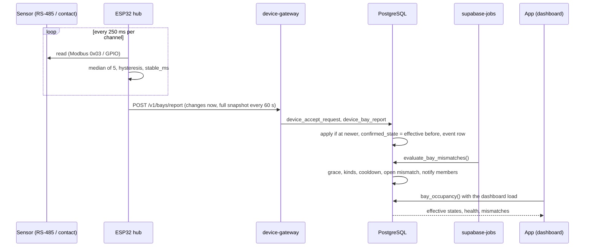
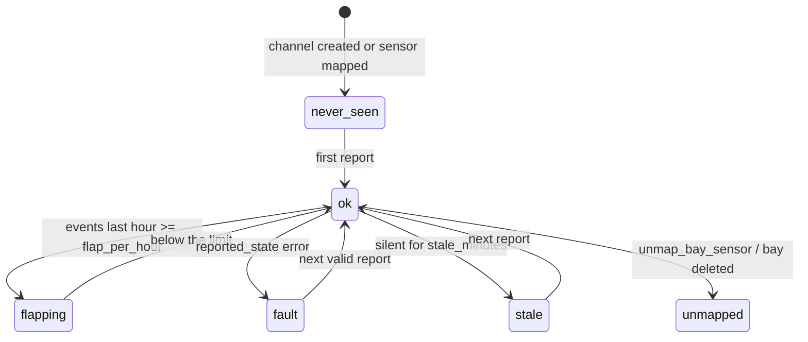
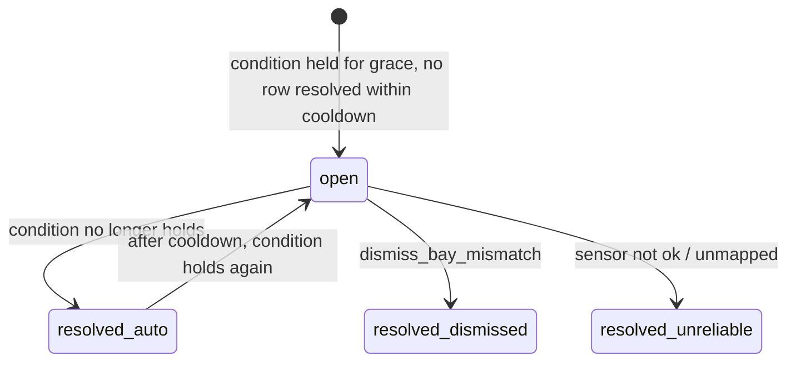

## Context

Verified in the code (migration head `0102`; `0103` belongs to `add-public-booking-captcha`):

- `public.parking_spots` (`0058`): `id`, `lot_id`, `code varchar(16)`, `group_name in ('car','moto','heavy')`, `grid_row`, `grid_col`, `status in ('active','out_of_service')`, `unique (lot_id, code)`, `uq_spot_cell (lot_id, grid_row, grid_col)`. Select policy `spots_select_lot` (`lot_id = current_lot_id()`); writes only through `save_parking_spot` (latest 7-argument body in `0081`; the 6-argument overload is **dropped on purpose**), `delete_parking_spot`, `assign_session_spot`. Deleting a bay sets `parking_sessions.spot_id` to null (`0059`).
- `parking_sessions.spot_id` with `uq_open_session_spot` (one open session per bay). `check_in` (latest `0098`) picks a bay (`p_spot_id` or first free by `grid_row, grid_col`) when the group has bays.
- `parking_spot_events` (`0081`) records out-of-service transitions with actor and reason.
- `public.slot_board()` (latest `0072`, `stable security definer`, lot from `current_lot_id()`) returns `{car_capacity, moto_capacity, car_out_of_service, moto_out_of_service, sessions:[{session_id, plate, entry_time, left_keys, spot_id, photo_count, video_count, has_pass, group}], holds:[...], spots:[{id, code, group, row, col, active}]}`. In it "occupied" means "has an open session". Capacity is `usable_capacity()` and, when a map exists, the number of active bays (`0060`).
- Flutter: the board is `lib/features/home/presentation/widgets/slot_board_card.dart` (`SlotBoardCard`, `SlotFilter { all, car, moto, holds }`), each bay is drawn by `lib/features/spots/presentation/widgets/spot_cell_view.dart` (`SpotCellView(spot, primary, secondary, size, highlighted, occupied)`), loaded by `DashboardCubit` (`lib/features/home/application/dashboard_cubit.dart`, `_fetch()` runs `todaySummary`, `dashboardTrend`, `capacitySnapshot`, `slotBoard`, `_inside()`, `lotSetup` together and degrades each failure on its own; `DashboardLoaded.slotBoard`). The bay editor is `lib/features/spots/presentation/spots_page.dart` (`_EditSpotSheet`, `_SpotHistoryDialog`), state in `SpotsCubit` (`lib/features/spots/application/spots_cubit.dart`). Entities `ParkingSpot` (`lib/features/spots/domain/entities/parking_spot.dart`) and `SlotBoard`/`SlotSession`/`SlotGroup` (`lib/features/check_out/domain/entities/slot_board.dart`).
- Device registry, gateway, key, replay/skew, error table and route table come from `add-device-gateway`; `device_firmware` and the signed-OTA scheme come from `add-barrier-control` (created with `create table if not exists`, whichever is implemented first).
- `docs/slot-board.md`: "Known limits" says out of service without a map is a count; with a map it is per bay; the board is "an exact copy of the configured distribution".
- Scheduled jobs: `supabase/jobs.sh` (loop every `JOBS_INTERVAL_SECONDS`, default 300) and `supabase/notifications-cron.sh`; there is no `pg_cron`.

## Goals / Non-Goals

**Goals**

- Show, per mapped bay, the physical state (free / occupied / unknown) next to the session state on the board.
- Notify when the two disagree for longer than a grace period, with a cooldown, and let operators dismiss.
- Never show a wrong "free"/"occupied" when the sensor is silent, faulty or flapping: the state becomes `unknown` and the health says why.
- Lots, bays and hubs without sensors behave exactly as before.

**Non-Goals:** see proposal.

## Decisions

### D1. Sensors are advisory and live beside the board, not inside `slot_board()`

Redefining `slot_board()` (its latest body is large and was changed by `0052`, `0054`, `0058`, `0064`, `0072`) to add sensor fields would put the most-used read at risk for a feature most lots will not have. New read-only RPC `bay_occupancy()` returns the sensor layer; the client merges it by `spot_id`. Capacity (`usable_capacity`, the capacity trigger), `check_in` bay choice and reservations ignore sensors. A bay physically occupied but "free" in the system is still offered to the next check-in; the mismatch alert is how humans find out.

### D2. The hub thresholds and filters; the server debounces and judges

The hub (near the sensor) converts a raw reading to a state with a median-of-5 filter and a hysteresis threshold taken from server config (`threshold`, `hysteresis`), requires `stable_ms` (default 5000) of consistent readings before reporting a change, and reports changes immediately plus a full snapshot of all channels every `report_interval_s` (default 60). The server never trusts a state to be instantaneous: it applies its own debounce at read time (D3), health rules (D4) and mismatch grace (D5). Raw values are reported and shown so an admin can calibrate the threshold from the app without reflashing.

### D3. Per-channel state model and read-time debounce

Stored per sensor: `reported_state` (`free`/`occupied`/`error`, the latest report), `reported_since` (the hub's `at` of the last change), `confirmed_state` (the effective state just before the last change, null when none), `last_report_at`, `last_raw`. A report is applied only if its `at` is greater than `last_report_at` (older reports are counted as `ignored`; this makes retries and buffered replays idempotent without a nonce table) and not more than 5 minutes ahead of the server (`max_client_clock_skew()` from `add-device-gateway`; older than 15 minutes is accepted when it is newer than `last_report_at`, to allow a hub that buffered changes during an outage). When `reported_state` changes, the function first computes the **effective state at that moment** and stores it as `confirmed_state`, then sets `reported_state`, `reported_since = at` and inserts a `bay_sensor_events` row.

Effective state (SQL function `bay_effective_state(sensor, debounce_seconds, stale_minutes)`, `stable`):

1. `unknown` when `last_report_at is null`;
2. `unknown` when `last_report_at < now() - stale_minutes`;
3. `unknown` when `reported_state = 'error'`;
4. `reported_state` when `reported_since <= now() - debounce_seconds`;
5. otherwise `coalesce(confirmed_state, 'unknown')`.

So a state that has not been stable for `debounce_seconds` (default 20) does not replace the previous one, silence makes it `unknown` instead of keeping a stale "free", and no job is needed for the board. Rejected: storing every raw reading (a hub reporting 16 channels every 60 s is 23k rows/day for nothing; only transitions are stored); a server-side cron that promotes states (adds latency and a scheduler dependency).

### D4. Health

`bay_health(sensor, settings)` returns the first match of: `unmapped` (`spot_id is null`), `never_seen` (`last_report_at is null`), `stale` (older than `stale_minutes`, default 5), `fault` (`reported_state = 'error'`), `flapping` (≥ `flap_per_hour`, default 12, rows in `bay_sensor_events` in the last hour), else `ok`. Mismatch detection ignores sensors that are not `ok`; open mismatches of a sensor that stops being `ok` are resolved with reason `sensor_unreliable` (a broken sensor must not keep raising cars-in-the-wrong-bay alerts). Admins are notified once per sensor per day of `stale`, `fault` and `flapping` (`bay_sensor_unhealthy`). A hub that is offline makes all its sensors `stale` and also raises `device_offline` from `add-device-gateway`; `bay_sensor_unhealthy` is skipped for sensors whose hub `device_status` is `offline` to avoid a storm.

### D5. Mismatch kinds, grace and cooldown

Evaluated by `evaluate_bay_mismatches()` for every mapped sensor with health `ok` whose lot has `bay_sensor_settings` (or defaults), where `eff` = effective state, `stable_for` = `now() - reported_since` when `eff = reported_state`:

| Kind | Condition (all must hold for ≥ `mismatch_grace_minutes`, default 3) | Meaning |
|---|---|---|
| `occupied_unassigned` | `eff = 'occupied'`, bay `status = 'active'`, no open session with `spot_id = bay` | car parked with no session in that bay (not checked in, or assigned elsewhere) |
| `assigned_empty` | `eff = 'free'`, an open session has `spot_id = bay` and `entry_time <= now() - grace` | session says the car is here, bay is empty (car left without check-out, or parked elsewhere) |
| `occupied_out_of_service` | `eff = 'occupied'`, bay `status = 'out_of_service'` | car in a bay that must not be used |

Behaviour: a new `bay_mismatches` row (status `open`) is created once per `(spot, kind)` while open (partial unique index) and a `bay_mismatch` notification goes to every active member of the lot; when the condition stops holding the row becomes `resolved` (`resolved_reason = 'auto'`); an operator may `dismiss_bay_mismatch` (`resolved_reason = 'dismissed'`, optional note ≤ 200 chars). A row for the same `(spot, kind)` resolved less than `cooldown_minutes` ago (default 30) blocks opening a new one. The job runs from `supabase/jobs.sh` every loop; documented advice: `JOBS_INTERVAL_SECONDS=60` on lots with sensors (alert latency = grace + interval).

### D6. Mapping: one sensor per bay, channels appear by themselves

A hub that reports an unknown `channel` creates an unmapped `bay_sensors` row (`spot_id null`, `health = 'unmapped'`), up to 64 channels per hub (`ChannelLimitError` beyond). The bay editor lists unmapped channels of the lot's hubs so an admin picks `(hub, channel)` for a bay (`map_bay_sensor`). `unique (spot_id) where spot_id is not null` enforces one sensor per bay. Deleting a bay (`on delete set null`) leaves the sensor unmapped, not deleted; deleting a hub device deletes its sensors (`on delete cascade`). Changing a mapping clears the sensor's state history for that bay (mismatches of the old bay are resolved with `sensor_unreliable`).

### D7. Transport and OTA are the gateway's

Plain `POST` batches from the hub; no long poll needed (the hub receives no commands). Firmware updates use the same signed-OTA scheme as `add-barrier-control` (D8 there) with kind `sensor_hub`; secure boot and flash encryption are recommended for production units but a development/pilot flavour without eFuse burning is supported (the hub cannot open anything, so the risk is lower than the barrier's).

### D8. Flutter: a second signal on the same cell

`SpotCellView` gains an optional `signal` (`BaySignal`: sensor state, health and mismatch kind). The cell keeps its colour for the **session** state (unchanged); the physical state is a small corner marker with icon and semantic text, and a mismatch adds an alert border using the existing anomaly colour (`StatusColors.error`-style token; no hardcoded `Color(0xFF...)`). A new filter chip "Alertas" shows only bays with an open mismatch. The dashboard loads `bay_occupancy()` in the same `.wait` tuple as the other extras with a `catchError` returning `BayOccupancy.empty`, so a sensor failure never blocks the board and lots without sensors get `sensorsEnabled = false` and render nothing new. The hive dashboard cache does not store sensor data (it is live-only; offline shows no sensor layer).

## Data model

### `<NEXT>_bay_sensors.sql`

```sql
create table if not exists public.bay_sensor_settings (
    lot_id                 integer primary key references public.parking_lots(id) on delete cascade,
    debounce_seconds       integer not null default 20 check (debounce_seconds between 5 and 300),
    stale_minutes          integer not null default 5  check (stale_minutes between 2 and 60),
    flap_per_hour          integer not null default 12 check (flap_per_hour between 3 and 120),
    mismatch_grace_minutes integer not null default 3  check (mismatch_grace_minutes between 1 and 60),
    cooldown_minutes       integer not null default 30 check (cooldown_minutes between 1 and 1440),
    updated_at             timestamptz not null default now()
);
alter table public.bay_sensor_settings enable row level security;
revoke all on public.bay_sensor_settings from anon, authenticated;   -- via get/set RPCs

create or replace function public.bay_sensor_effective_settings(p_lot_id integer)
returns public.bay_sensor_settings language sql stable security definer set search_path = public as $$
    select coalesce((select s from public.bay_sensor_settings s where s.lot_id = p_lot_id),
                    row(p_lot_id, 20, 5, 12, 3, 30, now())::public.bay_sensor_settings);
$$;
revoke all on function public.bay_sensor_effective_settings(integer) from public, anon, authenticated;
grant execute on function public.bay_sensor_effective_settings(integer) to service_role;

create table if not exists public.bay_sensors (
    id              serial primary key,
    lot_id          integer  not null references public.parking_lots(id) on delete cascade,
    hub_device_id   integer  not null references public.lot_devices(id) on delete cascade,
    channel         smallint not null check (channel between 1 and 64),
    spot_id         integer  references public.parking_spots(id) on delete set null,
    sensor_type     text     not null default 'ultrasonic' check (sensor_type in ('ultrasonic', 'magnetic', 'contact')),
    threshold       numeric(8,1) not null default 1800 check (threshold > 0),   -- mm for ultrasonic, uT for magnetic, ignored for contact
    hysteresis      numeric(8,1) not null default 150  check (hysteresis >= 0),
    reported_state  text     check (reported_state in ('free', 'occupied', 'error')),
    reported_since  timestamptz,
    confirmed_state text     check (confirmed_state in ('free', 'occupied')),
    last_report_at  timestamptz,
    last_raw        numeric(10,2),
    created_at      timestamptz not null default now(),
    unique (hub_device_id, channel)
);
create unique index if not exists uq_bay_sensor_spot on public.bay_sensors(spot_id) where spot_id is not null;
create index if not exists ix_bay_sensors_lot on public.bay_sensors(lot_id);
alter table public.bay_sensors enable row level security;
revoke all on public.bay_sensors from anon, authenticated;

-- A trigger rejects a spot or hub of another lot, and a hub that is not a sensor_hub.
create or replace function public.bay_sensors_check() returns trigger
language plpgsql security definer set search_path = public as $$
begin
    if not exists (select 1 from public.lot_devices d where d.id = new.hub_device_id and d.kind = 'sensor_hub' and d.lot_id = new.lot_id) then
        raise exception 'InvalidDeviceKindError';
    end if;
    if new.spot_id is not null and not exists (select 1 from public.parking_spots p where p.id = new.spot_id and p.lot_id = new.lot_id) then
        raise exception 'SpotNotFoundError';
    end if;
    return new;
end $$;
create trigger trg_bay_sensors_check before insert or update of hub_device_id, spot_id, lot_id on public.bay_sensors
    for each row execute function public.bay_sensors_check();
-- Mapping changes are audited (no secrets in this table).
create trigger trg_audit_row after insert or update or delete on public.bay_sensors
    for each row execute function public.record_audit();

create table if not exists public.bay_sensor_events (
    id        bigserial primary key,
    lot_id    integer not null references public.parking_lots(id) on delete cascade,
    sensor_id integer not null references public.bay_sensors(id) on delete cascade,
    state     text    not null check (state in ('free', 'occupied', 'error')),
    at        timestamptz not null
);
create index if not exists ix_bay_sensor_events_sensor on public.bay_sensor_events(sensor_id, at desc);
alter table public.bay_sensor_events enable row level security;
revoke all on public.bay_sensor_events from anon, authenticated;

create table if not exists public.bay_mismatches (
    id              bigserial primary key,
    lot_id          integer not null references public.parking_lots(id) on delete cascade,
    spot_id         integer not null references public.parking_spots(id) on delete cascade,
    sensor_id       integer references public.bay_sensors(id) on delete set null,
    kind            text    not null check (kind in ('occupied_unassigned', 'assigned_empty', 'occupied_out_of_service')),
    session_id      integer references public.parking_sessions(id) on delete set null,
    status          text    not null default 'open' check (status in ('open', 'resolved')),
    resolved_reason text    check (resolved_reason in ('auto', 'dismissed', 'sensor_unreliable')),
    note            text    check (note is null or char_length(note) <= 200),
    resolved_by     integer references public.users(id) on delete set null,
    opened_at       timestamptz not null default now(),
    resolved_at     timestamptz
);
create unique index if not exists uq_bay_mismatch_open on public.bay_mismatches(spot_id, kind) where status = 'open';
create index if not exists ix_bay_mismatches_lot on public.bay_mismatches(lot_id, status, opened_at desc);
alter table public.bay_mismatches enable row level security;
revoke all on public.bay_mismatches from anon, authenticated;

create or replace function public.bay_effective_state(s public.bay_sensors, p_debounce_seconds integer, p_stale_minutes integer)
returns text language sql stable set search_path = public as $$
    select case
        when s.last_report_at is null then 'unknown'
        when s.last_report_at < now() - make_interval(mins => p_stale_minutes) then 'unknown'
        when s.reported_state = 'error' then 'unknown'
        when s.reported_since <= now() - make_interval(secs => p_debounce_seconds) then s.reported_state
        else coalesce(s.confirmed_state, 'unknown')
    end;
$$;
```

All five `lot_id`-bearing tables follow the repo rule "every table carries `lot_id`"; reads go through RPCs because the sensor layer needs joins and computed fields (effective state, health) that PostgREST views would duplicate; Realtime is not used (the board refreshes with the dashboard and on a `bay_mismatch` notification).

### `<NEXT>_bay_sensor_ingest.sql` (service role)

`revoke all ... from public, anon, authenticated; grant execute ... to service_role`:

| Function | Signature | Returns / errors |
|---|---|---|
| `device_bay_config` | `(p_device_id integer)` | `{"report_interval_s":60,"stable_ms":5000,"channels":[{"ch":3,"type":"ultrasonic","threshold":1800.0,"hysteresis":150.0,"mapped":true}]}` for every known channel of that hub; `InvalidDeviceKindError` if the device is not a `sensor_hub` |
| `device_bay_report` | `(p_device_id integer, p_channels jsonb, p_full boolean default false)` | `{"accepted":2,"ignored":1,"created_channels":[7]}`; `p_channels` is an array of `{"ch":int,"state":"free|occupied|error","raw":number|null,"at":"ISO"}` with 1..64 elements; errors `InvalidDataError` (not an array, empty, > 64, bad channel/state/`at`), `InvalidReadTimeError` (an `at` more than 5 minutes ahead), `ChannelLimitError` (more than 64 channels would exist on the hub), `InvalidDeviceKindError` |

`device_bay_report` locks the hub's sensors `for update` in channel order, applies each element per D3 (inserting the sensor row for an unknown channel with `lot_id` taken from the device), always sets `last_raw` when `raw` is present and `at` is newer, and when `p_full` is true treats channels of the hub that are **absent** from the batch as untouched (their staleness will surface through `last_report_at`). It never writes `bay_mismatches` (the job does) and never notifies.

### `<NEXT>_bay_sensor_rpcs.sql`

Client RPCs (`revoke all ... from public; grant execute ... to authenticated`; `require_app_user()` first; lot from `current_lot_id()`):

| Function | Signature | Who | Returns / errors |
|---|---|---|---|
| `bay_occupancy` | `()` | member | `{"sensors_enabled":true,"bays":[{"spot_id":12,"state":"occupied","since":"2026-11-10T14:03:21Z","health":"ok","mismatch":"occupied_unassigned"}],"mismatches":[{"id":9,"spot_id":12,"spot_code":"A3","kind":"occupied_unassigned","session_id":null,"plate":null,"opened_at":"..."}]}`; `sensors_enabled` is true iff at least one sensor of the lot is mapped to a bay; otherwise `{"sensors_enabled":false,"bays":[],"mismatches":[]}`; `state` is the effective state; `bays` has one element per mapped bay; `plate` of an `assigned_empty` mismatch comes from its session |
| `list_bay_sensors` | `()` | lot admin | `{"sensors":[{"id":4,"hub_device_id":2,"hub_name":"Hub nivel 1","channel":3,"spot_id":12,"spot_code":"A3","sensor_type":"ultrasonic","state":"occupied","health":"ok","last_report_at":"...","last_raw":742.0,"unit":"mm","threshold":1800.0,"hysteresis":150.0,"flaps_last_hour":1}],"unmapped":[{...same shape with spot_id null...}]}` |
| `map_bay_sensor` | `(p_spot_id integer, p_sensor_id integer)` | lot admin | sensor object; `SpotNotFoundError`, `SensorNotFoundError`, `SensorAlreadyMappedError` (the sensor already belongs to another bay), `SpotHasSensorError` (the bay already has a sensor) |
| `unmap_bay_sensor` | `(p_spot_id integer)` | lot admin | `{"spot_id":12}`; resolves the bay's open mismatches with `sensor_unreliable`; `SensorNotFoundError` |
| `set_bay_sensor_threshold` | `(p_sensor_id integer, p_sensor_type text default null, p_threshold numeric default null, p_hysteresis numeric default null)` | lot admin | sensor object; `SensorNotFoundError`, `InvalidDataError` (threshold ≤ 0, hysteresis < 0, unknown type) |
| `dismiss_bay_mismatch` | `(p_mismatch_id bigint, p_note text default null)` | member | `{"id":9,"status":"resolved"}`; `MismatchNotFoundError` (including another lot's), `MismatchResolvedError` |
| `get_bay_sensor_settings` | `()` | member | settings object |
| `set_bay_sensor_settings` | `(p_debounce_seconds integer default null, p_stale_minutes integer default null, p_flap_per_hour integer default null, p_mismatch_grace_minutes integer default null, p_cooldown_minutes integer default null)` | lot admin | settings object; `InvalidDataError` |

Job functions (`revoke all ... from public, anon, authenticated`): `evaluate_bay_mismatches()` (returns the number of changes: opened + resolved), `purge_bay_sensor_events(p_days integer default 30)`.

Notification texts (SQL, Spanish): `bay_mismatch` title `Revisar bahía <code>`, body by kind — `occupied_unassigned`: `Hay un vehículo en <code> sin registro`; `assigned_empty`: `<plate> figura en <code> pero la bahía está vacía`; `occupied_out_of_service`: `Hay un vehículo en <code>, que está fuera de servicio`; `data = {"mismatch_id","spot_id","spot_code","kind","session_id"}`, `dedupe_key = 'bay_mismatch:' || id || ':user:' || user_id`. `bay_sensor_unhealthy` title `Sensor de bahía con problemas`, body `<code> (<hub> canal <n>): <sin señal | con falla | inestable>`, `dedupe_key = 'bay_sensor_unhealthy:' || sensor_id || ':' || health || ':' || current_date || ':user:' || user_id`.

## Device HTTP protocol (extends `add-device-gateway` v1; kind `sensor_hub` only)

### `GET /v1/bays/config`

`200` body as `device_bay_config`. Fetched at boot and every 10 minutes; the hub applies `threshold`/`hysteresis` per channel and keeps its last good config in NVS for reboots without network.

### `POST /v1/bays/report`

Body ≤ 16 KiB:

```json
{"full": false,
 "channels": [
   {"ch": 3, "state": "occupied", "raw": 742.0, "at": "2026-11-10T14:03:21Z"},
   {"ch": 4, "state": "free",     "raw": 1893.5, "at": "2026-11-10T14:03:21Z"}
 ]}
```

`200 {"accepted":2,"ignored":0,"created_channels":[]}`. Errors: 400 `InvalidDataError`, `InvalidReadTimeError`, `ChannelLimitError`; 403 `DeviceKindNotAllowedError`. A report is safe to retry unchanged (older-or-equal `at` is ignored). The hub sends a change as soon as it is stable (`stable_ms`) and a `full` snapshot of every channel every `report_interval_s`; while offline it buffers up to 256 changes (oldest dropped first, a counter reported in the heartbeat as `dropped`) and sends them in order, oldest first, in batches of up to 64 on recovery.

### `GET /v1/bays/firmware?current=<semver>` and `GET /v1/bays/firmware/:version/image`

As in `add-barrier-control` with kind `sensor_hub`; handlers shared in `routes/firmware_common.ts`.

### Sequence



### Sensor and mismatch state machines





## Hub firmware: `edge/bay-hub/` (NEW) and `edge/common/device_core/` (NEW, shared)

```
edge/common/device_core/            # PURE C++17 + ports, used by edge/barrier and edge/bay-hub
├── backoff.{h,cpp}                 # moved here from edge/barrier/lib/barrier_core
├── seq_counter.{h,cpp}             # (boot_counter << 32) | n
└── ports.h                         # Clock, Storage, Rng
edge/bay-hub/
├── README.md
├── platformio.ini                  # envs: native (host tests), esp32s3, esp32s3_release; lib_extra_dirs = ../common
├── sdkconfig.defaults / sdkconfig.release
├── partitions.csv / certs/ca.pem
├── lib/hub_core/                   # PURE C++17
│   ├── channel_filter.{h,cpp}      # median-of-5 + hysteresis + stable_ms -> ChannelState
│   ├── report_builder.{h,cpp}      # changes immediately, full snapshot on interval, batches <= 64, JSON
│   ├── change_buffer.{h,cpp}       # bounded ring (256), oldest dropped, drop counter
│   ├── modbus.{h,cpp}              # CRC16, request/response frames for function 0x03
│   ├── config.{h,cpp}              # parse /v1/bays/config, keep last good
│   ├── sensor_driver.h             # interface: read(channel) -> Reading{ok, value}
│   └── ota_policy.{h,cpp}
├── src/                            # ESP-IDF application (hardware)
│   ├── main.cpp                    # tasks: scan_task, report_task, heartbeat_task, ota_task
│   ├── rs485_driver.{h,cpp}        # UART1 + DE/RE control, ModbusUltrasonic
│   ├── contact_driver.{h,cpp}      # GPIO dry contacts
│   ├── net_client.{h,cpp} / nvs_store.{h,cpp} / clock.{h,cpp} / ota.{h,cpp} / status_led.{h,cpp}
├── tools/{provision.py, fake_gateway.py}
└── test/{test_channel_filter, test_report_builder, test_change_buffer, test_modbus, test_config, test_ota_policy}/
```

Process: `scan_task` (priority 4) visits channels round-robin so each channel is read every 250 ms (16 sensors take ≤ 4 s per full sweep at 9600 baud: configurable `scan_period_ms`), feeding `ChannelFilter`; `report_task` (priority 3) sends changes and snapshots; `heartbeat_task` (60 s, includes `{"channels_ok":14,"channels_error":1,"dropped":0,"buffered":0}`); `ota_task` (priority 1). Task watchdog 5 s on `scan_task` and `report_task`. A sensor that fails to answer 3 consecutive times reports `state: "error"` for that channel (`raw: null`).

Pin table (assumption: ESP32-S3-WROOM-1; verify against the carrier; avoid strapping pins 0/3/45/46 and octal-PSRAM pins):

| Function | GPIO | Notes |
|---|---|---|
| `RS485_TX` | 17 | UART1 TX to MAX485 DI |
| `RS485_RX` | 18 | UART1 RX from MAX485 RO |
| `RS485_DE_RE` | 8 | direction control (high = transmit) |
| `CONTACT_1..6` | 4, 5, 6, 7, 15, 16 | dry-contact inputs through optocouplers, channels 17..22, active = occupied |
| `TAMPER` | 9 | enclosure switch, reported in the heartbeat |
| `LED_STATUS` | 21 | 1 blink ok, 2 no network, 3 auth fault |

Channels 1..16 are Modbus addresses 1..16; channels 17..22 are the contact inputs. Ultrasonic sensors are mounted above the bay pointing down; `occupied` when the measured distance is below `threshold - hysteresis` and `free` when above `threshold + hysteresis` (the same band logic for magnetic in µT with the comparison reversed per `sensor_type`).

Defaults in `src/config.h` (overridable from `/v1/bays/config` within bounds): `scan_period_ms` 250, `stable_ms` 5000 (1000..60000), `report_interval_s` 60 (10..300), `median_window` 5, `change_buffer_max` 256, `batch_max` 64.

Host-verifiable (`pio test -e native`): filter behaviour with scripted readings (spikes rejected by the median, hysteresis band, `stable_ms` with a fake clock, error after 3 failures, recovery), report building (immediate changes, snapshot cadence, batch splitting at 64, JSON exactly as the protocol, no `at` older than the buffer), buffering (ring eviction, order, drop counter), Modbus CRC16 and frame parsing against known vectors, config parsing with fallback to the last good config, OTA policy, backoff/sequence (shared). Hardware-only (`[needs-hardware]`): RS-485 electricals and termination on 30 m runs, real sensor accuracy and temperature drift, optocoupler noise, brown-out behaviour, TLS with the pinned CA, NVS/flash encryption, OTA rollback, EMC.

Hardware BOM (assumptions): ESP32-S3-WROOM-1-N16; MAX485 (or isolated RS-485 transceiver) with 120 Ω termination at both ends of the bus and shielded twisted pair; wired ultrasonic distance sensors with a Modbus-RTU interface (or magnetometer nodes with the same register map; a driver per model is the integration work), IP65 housings, ceiling brackets above each bay; W5500 Ethernet (preferred) or Wi-Fi; 24 V supply with a buck to 5 V/3.3 V; optocouplers for contact inputs; enclosure tamper switch. One hub serves up to 16 Modbus channels plus 6 contacts; the sensors are what dominates cost.

## Flutter

### File tree (NEW unless marked)

```
lib/features/bay_sensors/
├── domain/
│   ├── entities/bay_occupancy.dart      # BayOccupancy, BayReading, BayState, BayHealth
│   ├── entities/bay_mismatch.dart       # BayMismatch, BayMismatchKind
│   ├── entities/bay_sensor.dart         # BaySensor, BaySensorType
│   ├── entities/bay_sensor_settings.dart
│   ├── commands/map_bay_sensor.dart     # MapBaySensor {spotId, sensorId}
│   ├── commands/sensor_threshold_update.dart
│   └── repositories/bay_repository.dart
├── application/
│   └── bay_sensors_cubit.dart           # editor-side: BaySensorsCubit + sealed BaySensorsState
├── infrastructure/
│   ├── bay_remote_data_source.dart
│   └── bay_repository_impl.dart
└── presentation/
    ├── bay_signal_marker.dart           # corner marker for SpotCellView
    ├── bay_alerts_card.dart             # mismatch list on the dashboard
    ├── bay_sensor_section.dart          # inside the bay editor sheet
    └── bay_sensor_settings_sheet.dart
lib/app/di/modules/bay_sensors_module.dart
```

Modified: `lib/features/home/application/dashboard_cubit.dart` (new optional constructor parameter `BayRepository? bays` placed with the other named options; `_fetch()` gains a 7th future `_bays?.occupancy().catchError((_) => BayOccupancy.empty) ?? BayOccupancy.empty`; `DashboardLoaded` gains `final BayOccupancy bayOccupancy` default `BayOccupancy.empty` and includes it in `props`; `_fromCache`/cache writing unchanged), `lib/features/home/presentation/widgets/slot_board_card.dart` (reads `bayOccupancy` from `DashboardLoaded`, passes a `BaySignal` to `SpotCellView`, adds `SlotFilter.alerts` chip only when `sensorsEnabled`), `lib/features/home/presentation/home_page.dart` (places `BayAlertsCard` under the board), `lib/features/spots/presentation/widgets/spot_cell_view.dart` (optional `BaySignal? signal`), `lib/features/spots/presentation/spots_page.dart` (`_EditSpotSheet` embeds `BaySensorSection`; app bar action for the settings sheet, admins only), DI `injection.dart` and the dashboard registration in `lib/app/di/modules/check_out_module.dart` (pass `sl<BayRepository>()`), `notification_routes.dart` (`'bay_mismatch' || 'bay_sensor_unhealthy' => '/'`), `notifications_page.dart`, `failure_messages.dart`, `supabase_error_mapper.dart`, ARB files, test helpers (`test/helpers/dashboard_fixtures.dart`, new `fake_bay_repository.dart`).

### Entities and port

`enum BayState { free, occupied, unknown }` (`fromWire`, unknown strings → `unknown`), `enum BayHealth { ok, stale, fault, flapping, unmapped, neverSeen }`, `enum BayMismatchKind { occupiedUnassigned, assignedEmpty, occupiedOutOfService }` (unknown strings throw `FormatException`). `BayReading {int spotId; BayState state; DateTime? since; BayHealth health; BayMismatchKind? mismatch}`; `BayMismatch {int id; int spotId; String spotCode; BayMismatchKind kind; int? sessionId; String? plate; DateTime openedAt}`; `BayOccupancy {bool sensorsEnabled; List<BayReading> bays; List<BayMismatch> mismatches; static const empty; BayReading? of(int spotId)}`; `BaySensor {int id; int hubDeviceId; String hubName; int channel; int? spotId; String? spotCode; BaySensorType type; BayState state; BayHealth health; DateTime? lastReportAt; double? lastRaw; String unit; double threshold; double hysteresis; int flapsLastHour}`; `BaySensorSettings {int debounceSeconds; int staleMinutes; int flapPerHour; int mismatchGraceMinutes; int cooldownMinutes}`.

```dart
abstract class BayRepository {
  Future<BayOccupancy> occupancy();
  Future<({List<BaySensor> mapped, List<BaySensor> unmapped})> sensors();
  Future<BaySensor> mapSensor(MapBaySensor command);
  Future<void> unmapSensor(int spotId);
  Future<BaySensor> setThreshold(SensorThresholdUpdate update);
  Future<void> dismissMismatch(int id, {String? note});
  Future<BaySensorSettings> settings();
  Future<BaySensorSettings> saveSettings(BaySensorSettings settings);
}
```

### Cubit states

```dart
sealed class BaySensorsState extends Equatable {}
final class BaySensorsLoading extends BaySensorsState {}
final class BaySensorsEmpty extends BaySensorsState {}      // no hub reported any channel yet: guidance to register a sensor hub in /devices
final class BaySensorsLoaded extends BaySensorsState {
  final List<BaySensor> mapped; final List<BaySensor> unmapped; final Submission submission;
}
final class BaySensorsError extends BaySensorsState { final Failure failure; }
```

`BaySensorsCubit extends ResilientCubit`: `load()`, `map(MapBaySensor)`, `unmap(int spotId)`, `setThreshold(SensorThresholdUpdate)`. The dashboard side has no cubit of its own: occupancy is part of `DashboardLoaded`; dismissing a mismatch calls `BayRepository.dismissMismatch` then `DashboardCubit.load()`.

UI states: the bay editor section renders Loading (skeleton rows), Loaded (mapped sensor card: state, health chip with icon and text, last report time, raw value with unit, threshold and hysteresis fields (admin), Unmap; or a dropdown of unmapped channels with Map), Empty (text + CTA to `/devices`) and Error (retry). The dashboard `BayAlertsCard` renders only when `sensorsEnabled`: list of mismatches with Dismiss (operators and admins), a "no alerts" row with a check icon when empty. Marker colours and borders come from `Theme.of(context)`/`StatusColors`; every marker carries text in its `Semantics` label (`Ocupado A3 · Sensor: ocupado · Sin registro`).

### l10n keys (ES / EN)

| Key | ES | EN |
|---|---|---|
| `baySensorState` | Sensor: {state} | Sensor: {state} |
| `baySensorOccupied` | ocupado | occupied |
| `baySensorFree` | libre | free |
| `baySensorUnknown` | sin lectura | no reading |
| `bayHealthOk` | Funciona bien | Working |
| `bayHealthStale` | Sin señal | No signal |
| `bayHealthFault` | Con falla | Fault |
| `bayHealthFlapping` | Inestable | Unstable |
| `bayHealthUnmapped` | Sin asignar | Unassigned |
| `bayHealthNeverSeen` | Nunca reportó | Never reported |
| `bayMismatchOccupiedUnassigned` | Vehículo sin registro | Vehicle without a record |
| `bayMismatchAssignedEmpty` | Registrado pero vacía | Recorded but empty |
| `bayMismatchOutOfService` | Vehículo en bahía fuera de servicio | Vehicle in an out-of-service bay |
| `bayAlertsTitle` | Alertas de bahías | Bay alerts |
| `bayAlertsNone` | Sin alertas de bahías | No bay alerts |
| `bayAlertDismiss` | Descartar | Dismiss |
| `bayAlertFilter` | Alertas | Alerts |
| `bayAlertSince` | Desde {time} | Since {time} |
| `bayAlertPlate` | {plate} figura aquí | {plate} is recorded here |
| `baySensorsUnavailable` | Los sensores no están disponibles | Sensors are unavailable |
| `baySensorSectionTitle` | Sensor de la bahía | Bay sensor |
| `baySensorNone` | Esta bahía no tiene sensor | This bay has no sensor |
| `baySensorPick` | Elegir sensor | Choose sensor |
| `baySensorChannel` | {hub} · canal {channel} | {hub} · channel {channel} |
| `baySensorLastReport` | Último reporte: {when} | Last report: {when} |
| `baySensorRaw` | Lectura: {value} {unit} | Reading: {value} {unit} |
| `baySensorThreshold` | Umbral ({unit}) | Threshold ({unit}) |
| `baySensorHysteresis` | Histéresis ({unit}) | Hysteresis ({unit}) |
| `baySensorMap` | Asignar | Assign |
| `baySensorUnmap` | Quitar sensor | Remove sensor |
| `baySensorEmptyBody` | Registra un concentrador de sensores en Dispositivos y espera su primer reporte. | Register a sensor hub under Devices and wait for its first report. |
| `baySettingsTitle` | Sensores de bahías | Bay sensors |
| `baySettingsDebounce` | Estabilidad del estado (s) | State stability (s) |
| `baySettingsStale` | Minutos sin señal | Minutes without signal |
| `baySettingsFlap` | Cambios por hora para marcar inestable | Changes per hour to flag unstable |
| `baySettingsGrace` | Minutos antes de avisar | Minutes before alerting |
| `baySettingsCooldown` | Minutos sin repetir el aviso | Minutes before repeating an alert |
| `notifTypeBayMismatch` | Revisar bahía | Check bay |
| `notifTypeBaySensor` | Sensor de bahía | Bay sensor |
| `errorSensorNotFound` | El sensor ya no existe | The sensor no longer exists |
| `errorSensorAlreadyMapped` | Ese sensor ya está asignado a otra bahía | That sensor is already assigned to another bay |
| `errorSpotHasSensor` | Esa bahía ya tiene un sensor | That bay already has a sensor |
| `errorMismatchNotFound` | La alerta ya no existe | The alert no longer exists |
| `errorMismatchResolved` | La alerta ya fue atendida | The alert was already handled |

## Threat model

| Threat | Mitigation | Residual |
|---|---|---|
| Stolen hub key | Scoped to `sensor_hub` kind and one lot; a thief can fake occupancy states, raising false mismatches or hiding real ones; rotate in the app; sensors are advisory so no money, capacity or access is affected | Nuisance alerts until rotation |
| Sensor spoofing / blocking (object on the sensor, cardboard under it) | Out of scope for a wired advisory sensor; `flapping` and `fault` health catch many tampering patterns | Physical tamper can hide a car; the session record remains the truth |
| Replay or reordering of reports | Gateway sequence; server applies only `at` newer than `last_report_at`, so replays are ignored; `at` more than 5 minutes ahead refused | — |
| Report for another lot's sensor | Channels belong to `(hub device, channel)`; the hub's lot comes from the registry; a hub cannot name a spot at all | — |
| Mapping a hub of lot A to a bay of lot B | `bay_sensors_check` trigger and `lot_id` equality; `map_bay_sensor` runs under `require_lot_admin()` | — |
| Operator abuses dismiss to hide a car | Dismissals are rows with `resolved_by`, note and time (kept until purge), cooldown limits repeat suppression | Logged, not prevented |
| Flood of channels from a rogue hub | 64 channels per hub, 16 KiB body, per-device rate limit | — |
| Data protection | No personal data stored by sensors; mismatch rows carry the session id, plate is joined at read | — |

## Failure modes

- Hub offline: its sensors become `stale` after `stale_minutes`, states show `unknown` (never a stale "free"), mismatches of those sensors resolve `sensor_unreliable`; `device_offline` alerts admins from the gateway change.
- Network loss on the hub: changes buffered (256), sent in order on recovery; the server applies them by `at`.
- RS-485 bus fault: 3 consecutive failed reads → channel `error` → health `fault`; one bad sensor does not affect others on the bus (round-robin with a per-channel timeout of 150 ms).
- Clock drift on the hub: gateway ±5 minutes rule; the hub syncs from `server_time`.
- Dashboard cannot load sensors: `BayOccupancy.empty`, board unchanged, muted notice `baySensorsUnavailable`.
- Bay deleted or renumbered in the editor: sensor becomes unmapped, mismatches resolved, no orphan alerts.
- Jobs interval too long: mismatch alerts later than grace; documented.

## Risks / Trade-offs

- [A second source of truth may confuse operators] → the cell colour stays the session state; the sensor is a marker; alerts are explicit about which record disagrees.
- [Read-time effective state costs a function call per sensor] → at most dozens of sensors per lot; indexes on `lot_id`.
- [Job-based detection is not instant] → grace is minutes anyway; interval guidance documented.
- [Sensor accuracy depends on mounting and weather] → thresholds are tunable from the app with the raw value visible; owner must pilot on 4 to 8 bays first.
- [One sensor per bay] → keeps the mapping and the mismatch logic unambiguous; revisit for wide bays.

## Migration Plan

1. After `add-device-gateway`: apply the three migrations, deploy the routes, `docker compose restart functions rest`.
2. Add `evaluate_bay_mismatches` and `purge_bay_sensor_events` to the job scripts; advise `JOBS_INTERVAL_SECONDS=60`.
3. Ship the Flutter release (lots without sensors see nothing new).
4. Pilot: one hub, 4 to 8 sensors, register the hub in `/devices`, power it, wait for the channels to appear, map them in the bay editor, tune thresholds with the raw values, watch alerts for a week before relying on them.
5. Rollback: delete the hub device (sensors cascade) or unmap all bays; `bay_occupancy()` then returns `sensors_enabled: false`.

## Open Questions

1. Which sensors will be used (RS-485 ultrasonic, magnetometer nodes, or dry-contact loops) and what is their register map? Only the driver depends on it.
2. How many bays and what cable lengths (RS-485 up to ~1000 m, but each hub serves 16 + 6 channels)?
3. Is a pilot on a few bays acceptable before covering the lot?
4. Should operators or only admins see mismatch alerts? (Specified: all members of the lot.)
5. Should a mismatch be able to offer "assign the session to this bay" later (needs `assign_session_spot`)? Out of scope here.
6. Grace of 3 minutes and cooldown of 30 minutes: right for this lot's traffic?
