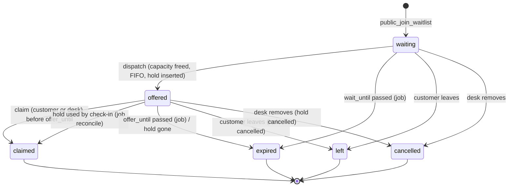

## Context

`/reserve?lot=<id>` (`PublicBookingPage`) reads `public_availability(p_lot_id)` (latest body: `0098`, possibly re-declared by changes ordered before this one: always search `supabase/migrations` for the highest-numbered definition). A category is full when `PublicCategoryAvailability.isFull` (`available != null && available <= 0`); the whole lot is full when `PublicBookingAvailability.hasAvailability` is false and the page renders `_NoSpace`. Holds live in `public.category_reservations` (`0021`; columns added by `0087`, `0100`: `customer_name`, `customer_phone`, `source in ('app','public')`, `reminder_sent_at`; status `active|cancelled|used|expired` after `0028`).

Capacity (verified in the files named):

- `reservation_capacity_check(p_lot integer, p_category_id integer, p_plate text) returns void` (latest `0098`) takes `pg_advisory_xact_lock(hashtext('group:'||lot||':'||group))` then `pg_advisory_xact_lock(hashtext('category:'||category_id))`, and raises `VehicleAlreadyInsideError`, `CategoryFullError` or `ParkingFullError` when `open sessions + active holds >= capacity`. A hold counts while `status = 'active' and reserved_until + reservation_grace(lot) > now()`; `reservation_grace(p_lot)` reads `parking_settings.reservation_grace_minutes` (default 15, `0098`).
- `check_in` (latest `0098`) takes the group lock first, converts the plate's own active hold to `used` when `reserved_until + grace > now()`, then inserts the session; the trigger `enforce_category_capacity` (latest `0058`) re-counts holds with `reserved_until > now()` (no grace, a pre-existing inconsistency: grace is honoured by hold creation and by the check-in conversion, not by the walk-in trigger).
- `check_out` (latest `0072`) closes the session (`status = 'closed'`).
- Bays: `parking_spots.status in ('active','out_of_service')` (`0058`).

Jobs: pg_cron is not available. `docker-compose.yml` service `supabase-jobs` runs `supabase/jobs.sh` every `JOBS_INTERVAL_SECONDS` (default 300) via `psql -tAc "select public.<fn>();"` as `postgres` and POSTs `functions/v1/whatsapp-dispatch` with the service key (commit `24a1835`). `supabase/notifications-cron.sh` is the host-cron twin (it calls the same functions, for example `expire_reservations(24)` at line 32). Both must stay idempotent.

WhatsApp: `whatsapp_messages` (`0042`: `id, user_id, lot_id, to_phone, template, language, params jsonb, status pending|sent|failed, attempts, error, created_at, sent_at`). Rows are inserted by security-definer RPCs only when `parking_settings.whatsapp_auto`, and drained by `supabase/volumes/functions/whatsapp-dispatch/index.ts`, whose `TEMPLATES` map rejects unknown template names (`Unknown template`), so a new template name needs a map entry. Without `WHATSAPP_TOKEN`/`WHATSAPP_PHONE_NUMBER_ID` the function answers `{"configured":false}` and rows stay `pending` until `purge_whatsapp_messages` (`0096`) drops them after 90 days.

`add-public-booking-captcha` (migration `0103_public_booking_protection.sql`, Edge Function `public-booking`) adds `parking_settings.public_booking_captcha`, `public_booking_hourly_limit`, the gate/verified split of `public_create_reservation`, the advisory lock `pg_advisory_xact_lock(hashtext('public_booking_throttle'), p_lot_id)` and `BookingThrottledError`. **Implementers MUST read `openspec/changes/add-public-booking-captcha/design.md` and the merged `0103` file before writing this change**: the waitlist join copies that gate/verified split and that lock order (throttle lock first, then capacity locks).

## Goals / Non-Goals

**Goals:** a customer can queue when full and is told when a space frees; the space is never double-sold; abuse limits equal the booking ones; the desk sees and manages the queue; WhatsApp optional.

**Non-Goals:** see `proposal.md`.

## Decisions

### 1. An offer is a real reservation row (rejected: a distinct soft hold)

When capacity frees, the dispatch inserts a row in `category_reservations` with `source = 'waitlist'`, `status = 'active'`, `reserved_from = now()`, `reserved_until = now() + waitlist_claim_minutes`, the entry's plate, category, name and phone, after `reservation_capacity_check` passed under the group/category locks. Why: every consumer of capacity (`reservation_capacity_check`, `enforce_category_capacity`, `capacity_snapshot`, `public_availability`, `slot_board`, `check_in` conversion, the board) already counts active holds. A separate `waitlist_offers` table would need all of those re-declared (each is redefined by several migrations and by other changes in flight) and any miss is an oversell. With a real row there is nothing to miss.

Claiming extends the same row (`reserved_until = now() + entry.hold_minutes`) and flips `source` to `'public'`, so from that moment it is indistinguishable from a web booking: `public_cancel_reservation`, `public_reservation_lookup`, `notify_expiring_reservations`, the "Web" badge, `report_reservations.public` all apply with no change. While it is an unclaimed offer (`source = 'waitlist'`) none of the `source = 'public'`-only functions touch it, which is intended: the customer leaves through `public_leave_waitlist`, not through the cancel RPC.

Constraint changes needed on `category_reservations` (names verified in `0087`/`0088`): `category_reservations_source_check` becomes `source in ('app','public','waitlist')`; `category_reservations_public_contact_check` becomes `source not in ('public','waitlist') or (customer_name is not null and length(btrim(customer_name)) between 1 and 120 and customer_phone ~ '^3[0-9]{9}$')`.

### 2. Capacity proof (cannot overbook)

Let `C` be the capacity of a group (or category), `O` open sessions, `H` the holds counted by `reservation_capacity_check`. Every writer that can increase `O + H` does so only after evaluating `O + H < C` while holding the group lock (then the category lock): `check_in` (explicit group lock before the insert), `create_reservation`, `public_create_reservation_verified`, and now the dispatch. Postgres advisory locks are transaction scoped and mutually exclusive per key, so two such writers are serialized and the second sees the first one's committed row.

- **Offer** inserts one hold after the same check: `O + H` goes from `< C` to `<= C`. Safe by the same argument as any hold.
- **Claim** only changes `reserved_until` and `source` of a row that is already counted (it requires `status = 'active'` and `offer_until > now()`, so the row counts both before and after). `H` does not change. No lock needed beyond the entry row.
- **Expire / leave / desk remove** set the hold `status` to `expired`/`cancelled`: `H` only decreases.
- **Check-in by the offered customer** turns the hold `used` before the session insert: `H - 1`, `O + 1`, net zero (existing behaviour of `0098`).
- **Grace**: an unclaimed offer must free its space at `offer_until`, not at `offer_until + grace`, or the cascade would starve. The expiry job therefore sets the hold `status = 'expired'` explicitly (status-based exclusion ignores grace). Until the job runs (at most one job interval) the offer still counts through grace, which only errs on the safe side. If the customer walks in inside that interval, `check_in` converts the still-active hold (existing behaviour) and the next job run reconciles the entry to `claimed`.
- **Triggers vs. jobs**: capacity-freeing triggers call the dispatch with `pg_try_advisory_xact_lock` (never a blocking wait): if the group lock is busy the trigger records a row in `waitlist_kicks` and returns; the job drains the kicks. Rationale: a blocking wait inside `check_out`'s transaction could deadlock with a `check_in` of the same plate (the new open session insert waits for the closing row's uncommitted update through `uq_open_session_per_vehicle`, while the closing transaction would wait for the group lock held by the check-in). Because every `try` caller already holds the group lock, the following blocking `category:` lock inside `reservation_capacity_check` cannot be held by anyone else (all `category:` lock takers hold the group lock first).
- **Entry rows lock order**: always the waitlist entry row first, then the reservation row (dispatch inserts the hold after locking the entry with `for update skip locked`; claim, leave, desk remove and expiry lock the entry first). `check_in` never touches an entry row, so no cycle exists.
- **Races**: (a) two concurrent check-outs freeing two spaces: each trigger either gets the group lock and offers, or kicks; the second dispatch recounts and offers the next entry; (b) claim vs. expiry: both lock the entry row; the loser re-reads the status and answers `OfferNoLongerAvailableError` (claim) or does nothing (expiry updates `where status = 'offered' and offer_until <= now()`, re-evaluated by READ COMMITTED after the lock); (c) offer vs. a walk-in or a regular public booking: serialized by the group lock, loser sees the space gone. A regular public booking can take a freed space between the free event and the dispatch (barging); with trigger dispatch inside the freeing transaction this window is the lock wait only; with the job fallback it is up to one interval. Accepted and listed as an open question.
- `now()` is constant inside a transaction (agent-memory gotcha): the dispatch computes `offer_until` once from `now()`; the expiry compares each row against the job transaction's `now()`; tests that need time to pass must backdate `reserved_until`/`offer_until` with `update`, never `pg_sleep`.

### 3. FIFO per group

Order: `created_at, id`. The dispatch for `(lot, group)` iterates `waiting` entries of that group in that order. For each: group full (`ParkingFullError`) stops the loop (nobody behind can fit); `CategoryFullError` skips to the next entry (only that category is full; FIFO is preserved per category); `VehicleAlreadyInsideError` or an existing active hold for the plate skips the entry. Groups come from `category_group(name)` (`0058`): `car`, `moto`, `heavy`. `heavy` categories have no group capacity (`group_configured` false) so only category capacity applies.

### 4. Anonymous surface, copying the booking protections

- Gate/verified split exactly like `0103`: `public_join_waitlist` (anon + authenticated) refuses with `CaptchaRequiredError` when `parking_settings.public_booking_captcha` is on for the lot, else calls `public_join_waitlist_verified` (service_role only; revoke names `public, anon, authenticated` explicitly because Supabase default privileges grant new functions to them).
- Throttle: inside the verified function, `perform pg_advisory_xact_lock(hashtext('public_booking_throttle'), p_lot_id)` first, then `count(*) from reservation_waitlist where lot_id = p_lot_id and created_at > now() - interval '1 hour'` against `parking_settings.public_booking_hourly_limit`; at or above it raises `BookingThrottledError`. Rows count whatever their status. Separate window from bookings (a waitlist flood cannot eat booking quota and vice versa), same ceiling value and same lock key (serialized, same lock order).
- Business limits: one `waiting|offered` entry per `(lot, plate)` (`WaitlistExistsError`, also enforced by a partial unique index), at most 2 per phone (`WaitlistLimitError`), at most `waitlist_max_entries` per lot (`WaitlistFullError`).
- Anti-bypass: join is refused with `WaitlistNotNeededError` when the capacity check would pass now (the customer should book), and with `ReservationExistsError` when the plate already has an active hold.
- The `public-booking` Edge Function gets `action: 'waitlist_join'` (see §Edge Functions). Lookup, claim, leave and info are protected like `public_reservation_lookup`/`public_cancel_reservation` (entry code + mobile, no captcha: they cannot create capacity pressure).

### 5. Notifications

- Desk: inside the join, one `public.notifications` row per active lot member (same insert shape as `0103` lines 148-167): `type = 'waitlist_joined'`, `title = 'Lista de espera: ' || plate`, `body = name || ' espera ' || category_name`, `data = {entry_id, plate, category_id}`, `dedupe_key = 'waitlist_joined:' || id || ':user:' || u.id`. Inside the offer: `type = 'waitlist_offer'`, `title = 'Cupo ofrecido: ' || plate`, body `'Oferta hasta ' || HH24:MI || (case when whatsapp_auto then ' (avisado por WhatsApp)' else ' - llamar al cliente' end)`, `dedupe_key = 'waitlist_offer:' || entry_id || ':user:' || u.id`.
- Customer: `whatsapp_messages` row with template `waitlist_offer` when `whatsapp_auto` (see §WhatsApp). Claim queues the existing `reservation_confirmed` (same params as `0103`).
- Degradation: `whatsapp_auto = false` (or credentials absent: rows stay pending and are purged) means the join answer carries `notify_channel = 'screen'`; the page tells the customer to keep the code, polls the lookup every 30 s while open, and the desk notification says "llamar al cliente". The feature never fails because WhatsApp is missing.

## Data model

```sql
alter table public.parking_settings
    add column if not exists waitlist_enabled boolean not null default false,
    add column if not exists waitlist_claim_minutes integer not null default 15,
    add column if not exists waitlist_max_entries integer not null default 30;
alter table public.parking_settings drop constraint if exists parking_settings_waitlist_check;
alter table public.parking_settings add constraint parking_settings_waitlist_check check (
    waitlist_claim_minutes between 5 and 120 and waitlist_max_entries between 1 and 500);

create table if not exists public.reservation_waitlist (
    id             bigserial   primary key,
    lot_id         integer     not null references public.parking_lots(id),
    category_id    integer     not null,
    group_name     text        not null check (group_name in ('car','moto','heavy')),
    plate          varchar(20) not null,
    customer_name  varchar(120) not null,
    customer_phone varchar(20) not null,
    status         text        not null default 'waiting'
                   check (status in ('waiting','offered','claimed','expired','left','cancelled')),
    wait_until     timestamptz not null,
    hold_minutes   integer     not null default 60 check (hold_minutes between 10 and 1440),
    offered_at     timestamptz,
    offer_until    timestamptz,
    reservation_id bigint      references public.category_reservations(id) on delete set null,
    claimed_at     timestamptz,
    created_at     timestamptz not null default now(),
    constraint reservation_waitlist_category_lot_fkey
        foreign key (category_id, lot_id) references public.categories (id, lot_id),
    constraint reservation_waitlist_contact_check check (
        customer_phone ~ '^3[0-9]{9}$' and length(btrim(customer_name)) between 1 and 120),
    constraint reservation_waitlist_offer_check check (
        (status = 'offered') = (offer_until is not null and reservation_id is not null)
        or status <> 'offered')
);
create unique index if not exists uq_waitlist_active_plate
    on public.reservation_waitlist (lot_id, plate) where status in ('waiting','offered');
create index if not exists ix_waitlist_fifo
    on public.reservation_waitlist (lot_id, group_name, created_at, id) where status = 'waiting';
create index if not exists ix_waitlist_phone_active
    on public.reservation_waitlist (lot_id, customer_phone) where status in ('waiting','offered');
create index if not exists ix_waitlist_offer_due
    on public.reservation_waitlist (offer_until) where status = 'offered';
create index if not exists ix_waitlist_created
    on public.reservation_waitlist (lot_id, created_at);

create table if not exists public.waitlist_kicks (
    lot_id     integer     not null references public.parking_lots(id) on delete cascade,
    group_name text        not null,
    created_at timestamptz not null default now(),
    primary key (lot_id, group_name)
);

alter table public.reservation_waitlist enable row level security;
alter table public.waitlist_kicks enable row level security;   -- no policy, no grant: definer functions only
revoke all on public.reservation_waitlist, public.waitlist_kicks from anon, authenticated;
grant select on public.reservation_waitlist to authenticated;
drop policy if exists waitlist_read on public.reservation_waitlist;
create policy waitlist_read on public.reservation_waitlist
    for select to authenticated using (lot_id = public.current_lot_id());
```

`supabase/tests/rpc_test.sql` already asserts RLS is enabled on every public table; both tables comply. Anon has no grant, so `select` from anon fails with `insufficient_privilege` (a test asserts it). Writes happen only inside the security-definer functions below. `waitlist_kicks` is internal.

## RPC signatures

All `language plpgsql`, `security definer`, `set search_path = public`, all new names (no overload traps; do not add parameters to existing functions). Typed errors are raised as `raise exception '<Name>Error'` (PostgREST message = name, mapped by `mapSupabaseError` through SQLSTATE `P0001`).

| Function | Grants | Notes |
|---|---|---|
| `public_waitlist_info(p_lot_id integer) returns jsonb` (stable) | anon, authenticated | `null` when the lot is missing/inactive |
| `public_join_waitlist(p_lot_id integer, p_plate text, p_category_id integer, p_wait_until timestamptz, p_hold_minutes integer, p_customer_name text default null, p_customer_phone text default null) returns jsonb` | anon, authenticated | gate: `CaptchaRequiredError` or delegates |
| `public_join_waitlist_verified(` same args `) returns jsonb` | service_role only | body |
| `public_waitlist_lookup(p_lot_id integer, p_entry_id bigint, p_customer_phone text) returns jsonb` (stable) | anon, authenticated | `null` when nothing matches |
| `public_claim_waitlist(p_lot_id integer, p_entry_id bigint, p_customer_phone text) returns jsonb` | anon, authenticated | |
| `public_leave_waitlist(p_lot_id integer, p_entry_id bigint, p_customer_phone text) returns jsonb` | anon, authenticated | |
| `list_waitlist() returns table(id bigint, plate text, category_id integer, category_name text, customer_name text, customer_phone text, status text, wait_until timestamptz, hold_minutes integer, offer_until timestamptz, reservation_id bigint, position integer, created_at timestamptz)` | authenticated | `language sql stable security invoker`; RLS filters the lot; only `waiting|offered`, ordered `created_at, id` |
| `desk_claim_waitlist(p_id bigint) returns jsonb` | authenticated | `require_app_user()`; entry lot must equal `current_lot_id()` else `LotRequiredError` |
| `desk_remove_waitlist(p_id bigint) returns jsonb` | authenticated | same auth; sets `cancelled`; cancels the hold when offered |
| `set_waitlist_settings(p_enabled boolean default null, p_claim_minutes integer default null, p_max_entries integer default null) returns jsonb` | authenticated | `require_lot_admin()`; `null` keeps; out of range raises `InvalidDataError`; returns `{enabled, claim_minutes, max_entries}` |
| `waitlist_dispatch(p_lot integer, p_group text) returns integer` | none (internal) | revoke from public, anon, authenticated; returns offers created |
| `waitlist_try_dispatch(p_lot integer, p_group text) returns void` | none (internal) | try-lock wrapper used by triggers; on lock miss or any exception inserts into `waitlist_kicks` |
| `waitlist_expire() returns integer` | service_role | job |
| `waitlist_dispatch_all() returns integer` | service_role | job: drains `waitlist_kicks`, then dispatches every `(lot, group)` with `waiting` entries |
| `purge_waitlist(p_days integer default 30) returns integer` | service_role | deletes terminal entries older than `p_days` |

Revoke pattern for service-only and internal functions: `revoke all on function ... from public, anon, authenticated; grant execute ... to service_role;` (jobs run as `postgres`, which owns the functions).

### Return shapes

`public_waitlist_info`: `{"enabled": bool, "claim_minutes": int, "max_hold_minutes": 1440, "notify_channel": "whatsapp"|"screen", "waiting": [{"category_id": int, "count": int}]}`. `notify_channel` is `whatsapp` iff `parking_settings.whatsapp_auto`.

`public_join_waitlist(_verified)`: `{"id": bigint, "plate": text, "category_id": int, "category_name": text, "status": "waiting", "position": int, "wait_until": timestamptz, "hold_minutes": int, "claim_minutes": int, "notify_channel": "whatsapp"|"screen", "lot": {"id": int, "name": text, "address": text, "phone": text, "whatsapp": text}}`.

`public_waitlist_lookup`: same keys as join plus `status` (any of the six, entries from the last 48 h), `offer_until` (nullable), `reservation_id` (nullable; set when offered or claimed). Never returns another phone's entry.

`public_claim_waitlist` / `desk_claim_waitlist`: `{"entry_id": bigint, "id": bigint (reservation id), "plate", "category_id", "category_name", "reserved_until", "status": "active", "lot": {...}}`: the same keys as the booking answer plus `entry_id`, so `PublicReservation.fromJson` parses it.

`public_leave_waitlist` / `desk_remove_waitlist`: `{"id": bigint, "status": "left"|"cancelled"}`.

### Typed errors (new unless marked existing)

`WaitlistDisabledError`, `WaitlistNotNeededError`, `WaitlistExistsError`, `WaitlistLimitError`, `WaitlistFullError`, `InvalidWaitWindowError` (`p_wait_until` outside `now()+10 min .. now()+24 h` or `p_hold_minutes` outside 10..1440), `WaitlistEntryNotFoundError`, `WaitlistNotOfferedError` (claim on a `waiting` entry), `OfferNoLongerAvailableError` (claim on expired/left/cancelled, or hold gone), `WaitlistNotifyError` is NOT introduced. Existing and reused: `LotNotFoundError`, `InvalidPlateError`, `InvalidNameError`, `InvalidPhoneError`, `CategoryNotFoundError`, `ReservationExistsError`, `VehicleAlreadyInsideError`, `BookingThrottledError`, `CaptchaRequiredError`, `LotRequiredError`, `AdminRequiredError`, `InvalidDataError`, `InvalidTokenError`.

### Function algorithms (normative steps)

**`public_join_waitlist_verified`**: (1) lot active else `LotNotFoundError`; (2) validate plate `^[A-Z0-9-]{3,20}$` after the same normalisation as `0103` (`InvalidPlateError`), name 1..120 (`InvalidNameError`), phone via the `0103` phone normalisation to 10 digits `^3[0-9]{9}$` (`InvalidPhoneError`); (3) `p_wait_until` and `p_hold_minutes` ranges (`InvalidWaitWindowError`); (4) `waitlist_enabled` else `WaitlistDisabledError`; (5) category belongs to lot else `CategoryNotFoundError`; (6) throttle lock + hourly count (`BookingThrottledError`); (7) capacity probe: `begin perform reservation_capacity_check(lot, category, plate); raise exception 'WaitlistNotNeededError'; exception when others then if sqlerrm not in ('CategoryFullError','ParkingFullError') then raise; end if; end;` (implementers: the `WaitlistNotNeededError` raised inside the block must not be swallowed; structure the probe with a flag variable instead of raising inside the block); (8) plate has an active hold (`status='active' and reserved_until > now()`) then `ReservationExistsError`; (9) active entry for plate then `WaitlistExistsError`; phone count >= 2 then `WaitlistLimitError`; lot active count >= `waitlist_max_entries` then `WaitlistFullError`; (10) insert with `group_name = category_group(lower(category name))` (call `category_group(c.name)`), compute `position`; (11) notify desk; (12) return the shape above.

**`waitlist_dispatch(p_lot, p_group)`**: (1) caller already holds the group lock; (2) `waitlist_enabled` false returns 0; (3) loop at most 50 times: pick the oldest `waiting` entry of `(lot, group)` with `wait_until > now()` not yet tried in this call, `for update skip locked`; none then exit; (4) skip when the plate has an active hold; (5) sub-block `reservation_capacity_check(lot, entry.category_id, entry.plate)`: `ParkingFullError` exits the loop, `CategoryFullError`/`VehicleAlreadyInsideError` mark the entry tried and continue; (6) insert the hold (`source = 'waitlist'`, `created_by = null`, `notes = 'waitlist:' || entry.id`); (7) update the entry (`offered`, `offered_at = now()`, `offer_until`, `reservation_id`); (8) desk notifications, WhatsApp row when enabled; (9) count and continue (a second freed space serves the next entry).

**`waitlist_try_dispatch(p_lot, p_group)`**: `if not pg_try_advisory_xact_lock(hashtext('group:'||p_lot||':'||p_group)) then insert into waitlist_kicks ... on conflict do nothing; return; end if; perform waitlist_dispatch(p_lot, p_group);` wrapped in `exception when others then insert into waitlist_kicks ... on conflict do nothing`. A failure here must never abort the originating write.

**`public_claim_waitlist`** and **`desk_claim_waitlist`** (shared helper `waitlist_claim(p_entry public.reservation_waitlist)` not exposed): lock the entry `for update`; match `lot_id`, and `customer_phone` for the anonymous one; status `waiting` raises `WaitlistNotOfferedError`; `expired|left|cancelled|claimed` raises `OfferNoLongerAvailableError` (an already `claimed` entry returns the current hold instead, idempotent); `offer_until <= now()` raises `OfferNoLongerAvailableError`; update the hold (`reserved_until = now() + hold_minutes`, `source = 'public'`, `status = 'active'` required, else mark entry `expired` and raise); entry `claimed`, `claimed_at = now()`; queue `reservation_confirmed` when `whatsapp_auto`; return the shape above.

**`public_leave_waitlist`** / **`desk_remove_waitlist`**: lock the entry; `waiting` becomes `left`/`cancelled`; `offered` additionally sets the hold `cancelled` (its AFTER UPDATE trigger dispatches the next entry); `claimed|expired|left|cancelled` raises `WaitlistEntryNotFoundError` (anonymous) or `OfferNoLongerAvailableError` (desk).

**`waitlist_expire`**: (1) reconcile `offered` entries whose hold is no longer `active`: hold `used` becomes entry `claimed`; `cancelled`/`expired` become entry `expired`; (2) `offered` with `offer_until <= now()` and active hold: hold `expired`, entry `expired`; (3) `waiting` with `wait_until <= now()` becomes `expired`; (4) `perform waitlist_dispatch_all()`; return the number of rows changed in 1-3.

**`report_reservations` (re-declared in the second migration)**: keep every existing key but add `and r.source <> 'waitlist'` to each existing count (unclaimed offers are not bookings) and add `"waitlist": {"joined", "offered", "claimed", "expired", "left", "cancelled", "waiting"}` counting `reservation_waitlist` rows whose `created_at` falls in the same business window (`offered` counts entries with `offered_at is not null`).

### Triggers (all `security definer`, `set search_path = public`, `for each row`)

| Trigger | Table / event | Condition | Action |
|---|---|---|---|
| `trg_waitlist_session_closed` | `parking_sessions` after update of `status` | `old.status = 'open' and new.status <> 'open'` | group of the vehicle's category; `waitlist_try_dispatch(new.lot_id, group)` |
| `trg_waitlist_hold_released` | `category_reservations` after update of `status` | `old.status = 'active' and new.status in ('cancelled','expired')` | group of `new.category_id`; try dispatch |
| `trg_waitlist_spot_freed` | `parking_spots` after insert, and after update of `status` | `new.status = 'active'` (and `old.status <> 'active'` on update) | `waitlist_try_dispatch(new.lot_id, new.group_name)` |
| `trg_waitlist_settings_capacity` | `parking_settings` after update of `car_capacity, moto_capacity, car_out_of_service, moto_out_of_service` | any capacity grew or out-of-service shrank | try dispatch for `car` and `moto` |
| `trg_waitlist_category_capacity` | `categories` after update of `capacity` | `new.capacity is distinct from old.capacity` | group of the category; try dispatch |

The trigger functions share one body style: compute `(lot, group)`, call `waitlist_try_dispatch`, return `new`. `used` holds never trigger (the space is taken by the session).

## State machines

Waitlist entry:



Linked hold (`category_reservations.status`): `active` (source `waitlist`) -> `active` (source `public`, on claim) -> `used` | `cancelled` | `expired`; an unclaimed offer ends `expired` or `cancelled` and its trigger cascades to the next entry.

## Jobs

`supabase/jobs.sh` (loop body, after `run expire_reservations`): `run waitlist_expire`, `run waitlist_dispatch_all`, `run purge_waitlist`. `supabase/notifications-cron.sh` calls the same three with the same `psql`/REST style it already uses for `expire_reservations(24)` (open the file and copy its calling convention; the functions are granted to `service_role`). With the default 300 s interval the worst-case latency of a job-only dispatch is 5 min against a default claim window of 15 min; operators who rely on the fallback should lower `JOBS_INTERVAL_SECONDS` (documented in the doc task).

## WhatsApp

New template row value `waitlist_offer` in `whatsapp_messages.template`, `language = 'es'`, `params` (positional, all strings): `[customer_name, plate, deadline "HH24:MI" in the lot timezone, lot_name, code]` where `code` is the entry id.

ES text to submit to Meta (body, variables `{{1}}..{{5}}`): "Hola {{1}}, se liberó un cupo para la placa {{2}} en {{4}}. Resérvalo antes de las {{3}} con el código {{5}} en nuestra página de reservas o llamando al parqueadero." (EN gloss: "Hi {{1}}, a space was freed for plate {{2}} at {{4}}. Claim it before {{3}} with code {{5}} on our booking page or by calling the lot.")

`supabase/volumes/functions/whatsapp-dispatch/index.ts`: add `waitlist_offer: Deno.env.get('WHATSAPP_TEMPLATE_WAITLIST_OFFER') ?? 'waitlist_offer'` to `TEMPLATES` and the header comment (`body params: name, plate, deadline, lot, code`); add `WHATSAPP_TEMPLATE_WAITLIST_OFFER=waitlist_offer` to `.env.example` next to `WHATSAPP_TEMPLATE_READY`. Per `docs/agent-memory.md`, the `functions` service in `supabase/docker-compose.yml` does not pass `WHATSAPP_*` to the container and `whatsapp-dispatch` is not allowlisted in `supabase/.gitignore` (pre-existing); the task list verifies both and fixes them only if missing, noting it in the changelog.

## Edge Function `public-booking`

Add a top-level `action` field to the JSON body: absent or `'book'` keeps today's behaviour; `'waitlist_join'` runs the same Turnstile verification and then calls `public_join_waitlist_verified` with the service key (or `public_join_waitlist` with the anon key when no secret is configured, the same inert rule as bookings). Body fields: `lot_id, plate, category_id, wait_until, hold_minutes, name, phone, captcha_token`. Unknown `action` returns `{"message":"InvalidDataError"}` with 400. Errors travel as `{"message":"<Name>Error"}` (the existing `refusal()` regexp passes the new names; `BookingThrottledError` stays 429).

## Flutter

New feature `lib/features/waitlist/`:

```text
lib/features/waitlist/
  domain/entities/waitlist_entry.dart            # desk row
  domain/entities/public_waitlist.dart           # PublicWaitlistInfo, PublicWaitlistEntry
  domain/entities/waitlist_settings.dart
  domain/repositories/waitlist_repository.dart           # desk port
  domain/repositories/public_waitlist_repository.dart    # anonymous port
  application/waitlist_cubit.dart                # desk
  application/public_waitlist_cubit.dart         # public card
  infrastructure/waitlist_remote_data_source.dart
  infrastructure/waitlist_repository_impl.dart
  infrastructure/public_waitlist_remote_data_source.dart
  infrastructure/public_waitlist_repository_impl.dart
  presentation/waitlist_section.dart             # desk section inside the board
  presentation/waitlist_settings_dialog.dart
  presentation/public_waitlist_card.dart         # join form + status
lib/app/di/modules/waitlist_module.dart          # NEW
```

Entities (Equatable; `fromJson(Map<String, dynamic>)` on the entity like `PublicReservation.fromJson`):

- `enum WaitlistStatus { waiting, offered, claimed, expired, left, cancelled }` with `static WaitlistStatus parse(String)` (unknown value falls back to `expired`).
- `WaitlistEntry {int id, String plate, int categoryId, String categoryName, String customerName, String customerPhone, WaitlistStatus status, DateTime waitUntil, int holdMinutes, DateTime? offerUntil, int? reservationId, int position, DateTime createdAt}` with `isOffered`, `contactLine` (same rule as `Reservation.contactLine`).
- `PublicWaitlistInfo {bool enabled, int claimMinutes, WaitlistChannel notifyChannel, Map<int,int> waitingByCategory}`; `enum WaitlistChannel { whatsapp, screen }`.
- `PublicWaitlistEntry {int id, String plate, int categoryId, String categoryName, WaitlistStatus status, int position, DateTime waitUntil, int holdMinutes, int claimMinutes, DateTime? offerUntil, int? reservationId, WaitlistChannel notifyChannel, String lotName, String address, String phone, String whatsapp}`.
- `WaitlistSettings {bool enabled, int claimMinutes, int maxEntries}`.

Ports:

```dart
abstract class WaitlistRepository {            // desk, authenticated
  Future<List<WaitlistEntry>> list();
  Future<PublicReservation> claim(int id);     // desk_claim_waitlist
  Future<void> remove(int id);                 // desk_remove_waitlist
  Future<WaitlistSettings> loadSettings();     // select of the 3 columns (RLS: own lot)
  Future<WaitlistSettings> saveSettings(WaitlistSettings settings); // set_waitlist_settings
}
abstract class PublicWaitlistRepository {      // anonymous
  Future<PublicWaitlistInfo?> info(int lotId);
  Future<PublicWaitlistEntry> join({required int lotId, required String plate,
      required int categoryId, required DateTime waitUntil, required int holdMinutes,
      required String phone, required String name, String? captchaToken});
  Future<PublicWaitlistEntry?> lookup({required int lotId, required int entryId, required String phone});
  Future<PublicReservation> claim({required int lotId, required int entryId, required String phone});
  Future<void> leave({required int lotId, required int entryId, required String phone});
}
```

(`PublicReservation` is imported from `features/public_booking/domain/entities/public_booking.dart`; its `fromJson` accepts the claim answer. `claim` desk returns the same type.) Data sources call the RPCs by name with `p_*` params and wrap every call in `try { ... } catch (error) { throw mapSupabaseError(error); }`; `join` with a token calls `_client.functions.invoke('public-booking', body: {'action': 'waitlist_join', ...})` and maps typed errors exactly like `_verifiedBooking` in `public_booking_remote_data_source.dart`. The desk `loadSettings` reads `parking_settings` with `.select('waitlist_enabled,waitlist_claim_minutes,waitlist_max_entries').limit(1)` (RLS returns only the active lot row). Nothing here uses `SyncOutbox`.

Cubits (extend `ResilientCubit`, sealed `Equatable` states, the four UI states):

- `WaitlistCubit` (desk): `WaitlistInitial`, `WaitlistLoading` (skeleton rows), `WaitlistLoaded(entries, {Submission submission, WaitlistSettings? settings})` (empty list renders the empty state), `WaitlistFailure(message)` (retry). Methods: `load()`, `claim(int id)`, `remove(int id)`, `saveSettings(WaitlistSettings)`; actions reuse `Submission` from `core/state/submission.dart` like `ReservationsCubit._submit`.
- `PublicWaitlistCubit` (public): `PublicWaitlistLoading`, `PublicWaitlistReady(info, {entry, submitting, actionFailure, claimed})` (card shows the join form, or the entry status), `PublicWaitlistUnavailable` (disabled or info null: the card renders nothing, "empty"), `PublicWaitlistFailure(failure)` (retry). Methods: `load(lotId)`, `join(...)`, `lookup(entryId, phone)`, `claim()`, `leave()`, `poll()` (30 s while an entry is open and `notify_channel == screen`, or always while waiting; cancelled on close). The cubit keeps the phone in memory so claim/leave need no retyping (same pattern as `PublicBookingCubit._phone`).

Widgets reused by name: `SectionHeader`, `EmptyState`, `ErrorState`, `StatusChip`, `SkeletonList`, `AppIconButton`, `ConfirmDialog`, `PlateText`, `PlateInputField` (desk only), `BookingCaptchaField` (join form, same captcha parameters as `_FormCard`), and the page's private notice widget pattern (`_Notice`) reimplemented in the card, never imported. No colors outside `Theme.of(context)`; every target at least `Layout.minTouch`.

Integration points (verified):

- `PublicBookingPage` (`lib/features/public_booking/presentation/public_booking_page.dart`): new optional constructor field `final int? waitlistCode;`. In the build around line 311, when `!availability.hasAvailability` render `PublicWaitlistCard` below `_NoSpace`; for a full category (`PublicCategoryAvailability.isFull`) the card shows a "Unirme a la lista de espera" button on that category (the card receives the full categories and preselects the first full one). The card gets `captchaSiteKey` and `captchaBuilder` from the page and reuses `_captchaBuilder`/`turnstileSupported` logic (`widget.captchaBuilder ?? (turnstileSupported ? buildTurnstile : null)`). It is wrapped by `BlocProvider<PublicWaitlistCubit>` created in `app_router.dart`'s `reservePath` builder next to `PublicBookingCubit`. `waitlistCode` pre-fills the lookup field.
- `ReservationsPage` (`lib/features/reservations/presentation/reservations_page.dart`): a `WaitlistSection` above the list (collapsed when empty and for non-admins the settings action is hidden), a "Solo web" style unchanged. `app_router.dart` `reservations` route becomes a `MultiBlocProvider` with `ReservationsCubit` and `WaitlistCubit`.
- `Reservation` (`reservation.dart`): add `bool get isWaitlistOffer => source == 'waitlist';` and render the `StatusChip` "Oferta" for it; `Reservation.isPublic` stays `source == 'public'`.
- `ReservationReport` (`lib/features/reports/domain/entities/reservation_report.dart`): add `WaitlistReport waitlist` (const `empty`) parsed from `json['waitlist']` (missing key = zeros, so an older database still parses), shown by `ReportsPage` as a "Lista de espera" block of `MetricCard`s (joined, offered, claimed, conversion `claimed*100/offered` rounded or `null`).
- Notifications: `notification_routes.dart` maps `'waitlist_joined' || 'waitlist_offer' => '/reservations'`; `notifications_page.dart` adds both types to the filter list (label `notifTypeWaitlist`) and to the icon switch (`Icons.hourglass_top_outlined`).
- Route: no new path. Deep link `/reserve?lot=<id>&waitlist=<code>` is read in the `reservePath` builder (`int.tryParse(state.uri.queryParameters['waitlist'] ?? '')`).
- DI: `registerWaitlistModule(GetIt sl)` registers `WaitlistRemoteDataSource`, `PublicWaitlistRemoteDataSource` (lazy singletons over `sl<SupabaseClient>()`), both repositories (lazy singletons), `WaitlistCubit` and `PublicWaitlistCubit` (factories); call it in `lib/app/di/injection.dart` next to `registerPublicBookingModule`.
- Failure texts: add the new typed names to `lib/core/l10n/failure_messages.dart` `_byCode`.

## l10n (add to both ARB files, regenerate)

| Key | ES | EN |
|---|---|---|
| `waitlistJoinTitle` | Lista de espera | Waitlist |
| `waitlistJoinHint` | Estamos llenos. Déjanos tus datos y te avisamos cuando se libere un cupo. | We are full. Leave your details and we will tell you when a space frees up. |
| `waitlistJoinAction` | Unirme a la lista de espera | Join the waitlist |
| `waitlistWaitFor` | Puedo esperar hasta: | I can wait until: |
| `waitlistHoldFor` | Reservar el cupo por: | Hold the space for: |
| `waitlistHoldHours` | {hours, plural, =1{1 hora} other{{hours} horas}} | {hours, plural, =1{1 hour} other{{hours} hours}} |
| `waitlistJoined` | Estás en la lista de espera | You are on the waitlist |
| `waitlistPosition` | Tu turno: {position} | Your turn: {position} |
| `waitlistCode` | Código {code} | Code {code} |
| `waitlistKeepCode` | Guarda este código: lo necesitas para reclamar o salir de la lista. | Keep this code: you need it to claim or leave. |
| `waitlistNotifyWhatsapp` | Te avisaremos por WhatsApp. | We will notify you by WhatsApp. |
| `waitlistNotifyScreen` | Mantén esta página abierta o llámanos: te avisaremos aquí. | Keep this page open or call us: we will tell you here. |
| `waitlistOfferTitle` | ¡Se liberó un cupo! | A space is free! |
| `waitlistOfferBody` | Resérvalo antes de las {time}. | Claim it before {time}. |
| `waitlistClaim` | Reclamar mi cupo | Claim my space |
| `waitlistLeave` | Salir de la lista | Leave the waitlist |
| `waitlistLeft` | Saliste de la lista de espera | You left the waitlist |
| `waitlistExpiredTitle` | Tu oferta venció | Your offer expired |
| `waitlistExpiredHint` | Puedes volver a unirte a la lista. | You can join the waitlist again. |
| `waitlistWaitingCount` | {count, plural, =1{1 persona esperando} other{{count} personas esperando}} | {count, plural, =1{1 person waiting} other{{count} people waiting}} |
| `waitlistLookupLabel` | Código de lista de espera | Waitlist code |
| `waitlistDeskTitle` | Lista de espera | Waitlist |
| `waitlistDeskEmptyTitle` | Nadie en lista de espera | Nobody on the waitlist |
| `waitlistDeskEmptyHint` | Cuando el parqueadero se llene, los clientes web podrán anotarse aquí. | When the lot is full, web customers can join here. |
| `waitlistDeskOffered` | Oferta hasta {time} | Offer until {time} |
| `waitlistDeskCallCustomer` | Llamar: el cliente no tiene WhatsApp automático | Call: automatic WhatsApp is off |
| `waitlistDeskClaim` | Dar el cupo | Give the space |
| `waitlistDeskRemove` | Quitar de la lista | Remove from the waitlist |
| `waitlistDeskRemoveBody` | Se quitará a {plate} de la lista y se liberará su oferta. | {plate} will be removed and its offer released. |
| `waitlistSettingsTitle` | Lista de espera | Waitlist |
| `waitlistSettingsEnabled` | Activar lista de espera pública | Enable public waitlist |
| `waitlistSettingsClaimMinutes` | Minutos para reclamar una oferta | Minutes to claim an offer |
| `waitlistSettingsMaxEntries` | Máximo de personas en lista | Maximum people on the list |
| `waitlistOfferChip` | Oferta | Offer |
| `notifTypeWaitlist` | Lista de espera | Waitlist |
| `errorWaitlistDisabled` | La lista de espera no está disponible. | The waitlist is not available. |
| `errorWaitlistNotNeeded` | Hay cupo disponible: puedes reservar ahora. | There is space: you can book now. |
| `errorWaitlistExists` | Esa placa ya está en la lista de espera. | That plate is already on the waitlist. |
| `errorWaitlistLimit` | Este celular ya tiene dos turnos en la lista. | This mobile already has two turns on the list. |
| `errorWaitlistFull` | La lista de espera está llena. | The waitlist is full. |
| `errorWaitlistWindow` | Elige un tiempo de espera válido. | Pick a valid waiting time. |
| `errorWaitlistNotFound` | No encontramos ese turno. | We could not find that turn. |
| `errorWaitlistNotOffered` | Aún no hay un cupo para ti. | There is no space for you yet. |
| `errorOfferGone` | La oferta ya no está disponible. | The offer is no longer available. |
| `reportWaitlistTitle` | Lista de espera | Waitlist |
| `reportWaitlistJoined` | Anotados | Joined |
| `reportWaitlistOffered` | Ofertas | Offers |
| `reportWaitlistClaimed` | Reclamadas | Claimed |

## Offline behaviour

Every waitlist call is online-only. A `NetworkFailure` renders the error state with retry; nothing is queued, `MutationEntity` and `PendingMutation` are untouched, no persisted outbox format changes and no Hive adapter is added (AGENTS §5: customer-facing and idempotent-by-design writes stay remote). Duplicate submits are absorbed by the unique active-plate index and `WaitlistExistsError`.

## Security analysis

| Actor | Can | Cannot |
|---|---|---|
| anon | `public_waitlist_info`, `public_join_waitlist` (gate), `public_waitlist_lookup`, `public_claim_waitlist`, `public_leave_waitlist` | select the tables; execute `*_verified`, desk RPCs, settings RPC, job functions |
| authenticated operator | desk list, `desk_claim_waitlist`, `desk_remove_waitlist` in own lot (header-validated) | `set_waitlist_settings` (`AdminRequiredError`), other lots (`LotRequiredError`) |
| lot admin | all operator rights + `set_waitlist_settings` | other lots |
| service_role | verified join, jobs | n/a |

- Lot isolation: every definer function stamps/filters `lot_id` explicitly (definer functions bypass RLS); the table policy uses `current_lot_id()`.
- Enumeration: lookup/claim/leave need entry code AND the mobile (the same bar as `public_reservation_lookup`); a wrong pair answers `null`/`WaitlistEntryNotFoundError`. Entry ids are sequential, so the secret is the phone; an attacker who knows a victim's mobile can read or cancel that victim's entry (same exposure as today's reservation lookup; listed as an open question).
- Abuse: captcha gate, hourly ceiling, per-plate, per-phone and per-lot caps. A flood is bounded by `waitlist_max_entries` (default 30) and cannot create capacity pressure by itself; offers are limited to real free capacity.
- Offer griefing (join with a victim's plate to receive offers that then expire): bounded by the per-phone cap and by the offer lasting only `waitlist_claim_minutes`, but a griefer can occupy a freed space for that time. Mitigated by FIFO + short window; listed as open question.
- PII: name, mobile and plate. Terminal entries are deleted by `purge_waitlist` after 30 days; WhatsApp rows already purge at 90 days (`0096`); the desk notification bodies contain name and category only. Logs of the Edge Function never include them (copy the `public-booking` rule).

## Trade-offs and rejected alternatives

- Soft-hold table: rejected (§1).
- Offer only as a notification with no hold: rejected, two customers could race for one space and the first walk-in would take it, defeating the promise.
- Strict barring of walk-ins and public bookings while people wait: rejected for this change (it would require re-declaring `check_in` and the verified booking, high conflict with changes in flight); fairness comes from dispatching inside the freeing transaction.
- Offering the second chance to a lapsed entry: rejected (it would let one person block the queue); they can rejoin at the back.
- Realtime push of the queue to the board: not needed, the board reloads on open and pull-to-refresh; the desk gets notifications.
- `pg_cron`: unavailable; the jobs container is the scheduler.

## Open questions for the owner

1. Should regular public bookings be blocked from taking a freed space while a waitlist entry of that group exists (fairer, needs re-declaring the booking function)?
2. Default claim window 15 min and default hold 60 min: right for this lot? Should the customer choose the hold, or should it be fixed?
3. Is it acceptable that a person who knows a customer's mobile can see/leave that customer's entry? (Add a per-phone attempt limiter?)
4. Should the desk be able to re-order the queue or give an offer to someone out of turn?
5. Meta template `waitlist_offer`: is the owner able to get it approved, and is the wording above acceptable?
6. Retention of ended entries: 30 days enough?
