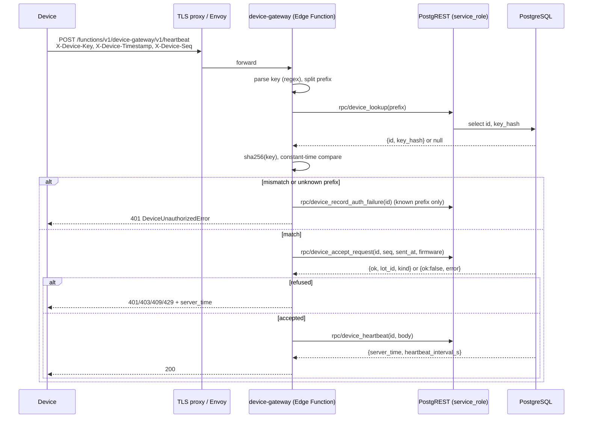
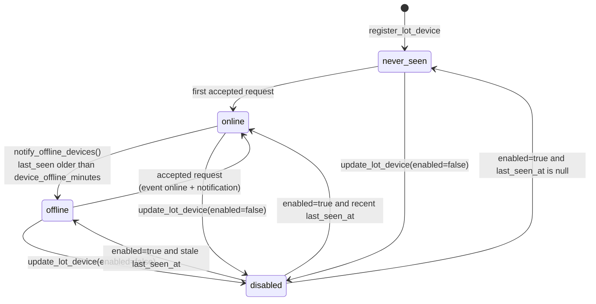

## Context

Facts verified in the code on `feature/supabase` (migration head `0102`; `0103` belongs to `add-public-booking-captcha`):

- Every business RPC derives the actor with `public.require_app_user()` → `public.current_app_user_id()` → `public.users.auth_user_id = auth.uid()`, and the lot with `public.current_lot_id()` (reads `request.headers ->> 'x-lot-id'` through `public.lot_from_header()` and checks `public.lot_members`). A caller without a GoTrue user gets `InvalidTokenError`. Devices therefore cannot call any existing RPC, by design.
- The pattern for "a privilege the client cannot obtain" already exists in `0103_public_booking_protection.sql`: the body lives in a function granted to `service_role` only (`revoke all ... from public, anon, authenticated` — the revoke must name `anon, authenticated` because Supabase default privileges grant new functions to them) and an Edge Function holding `SUPABASE_SERVICE_ROLE_KEY` calls it over `${SUPABASE_URL}/rest/v1/rpc/<name>` (`supabase/volumes/functions/public-booking/index.ts`).
- Edge Functions are served by `supabase/volumes/functions/main/index.ts`: the first path segment after `/functions/v1/` selects the directory under `/home/deno/functions/`; the rest of the path reaches the function untouched. `main` verifies a JWT only when `VERIFY_JWT` is `true`; `.env.example` ships `FUNCTIONS_VERIFY_JWT=false`. The Envoy listener (`supabase/volumes/api/envoy/lds.template.yaml`, route `functions-v1-all`) does not demand an `apikey` for `/functions/v1/`.
- A new function directory is ignored by git unless allowlisted in `supabase/.gitignore` (`volumes/functions/**`), and any new env var must be added to the `functions` service in `supabase/docker-compose.yml` (`docs/agent-memory.md`, "Public booking bot protection").
- `MAX_CLIENT_CLOCK_SKEW` (AGENTS §5) is not a setting: it is the literal `interval '5 minutes'` in `public.check_in` (`InvalidEntryTimeError`, latest body in `0098_reservation_grace_setting.sql`) and `public.check_out` (`InvalidExitTimeError`, latest body in `0072_billing_integrity.sql`; replays older than 12 h raise `StaleExitTimeError`).
- `public.idempotency_keys.user_id` is `not null references public.users(id)`, so `replay_idempotent` / `remember_idempotent` cannot serve a device. Device-originated rows carry their own `(device_id, client_ref)` unique key (used by the follow-up changes).
- `public.record_audit()` (generic row trigger, `0031_audit_log.sql`) copies the whole row to `audit_log.before/after` and strips only `pin_hash`. Attaching it to a table that holds a key hash would copy the hash into the audit table. `lot_devices` MUST NOT get `trg_audit_row`; it has its own event log.
- Notifications are rows in `public.notifications (user_id, type, title, body, data, dedupe_key, lot_id)` inserted by `security definer` functions with Spanish `title`/`body` (`notify_session_event`, `notify_overstays`); the app streams them through Realtime with the policy `notifications_select_own` (`0057`, uses `can_read_lot(lot_id)` because Realtime strips `x-lot-id`). Scheduled producers run from `supabase/jobs.sh` (compose service `supabase-jobs`, every `JOBS_INTERVAL_SECONDS`, default 300) and `supabase/notifications-cron.sh`. `pg_cron` is not available in the `parking` database.
- `pgcrypto` lives in the `extensions` schema on the Supabase image and every RPC runs with `set search_path = public`; this design uses only core functions (`sha256(bytea)`, `gen_random_uuid()`), never `digest()` / `gen_random_bytes()`.
- SQL regression tests live in one file, `supabase/tests/rpc_test.sql` (one transaction, rolled back; actor switched with `set local request.jwt.claim.sub = '<uuid>'`; lot with `set local request.headers = '{"x-lot-id":"1"}'`), run by `sh supabase/tests/run.sh`.

## Goals / Non-Goals

**Goals:**

- A device credential that authenticates exactly one device of exactly one lot and is worthless against GoTrue, PostgREST, Storage and Realtime.
- The lot of a device request comes from the registry row, never from anything the device sends.
- The key is recoverable by nobody after creation (hash at rest, shown once), rotatable in one action.
- A request that is replayed, too old, too far in the future or too frequent is refused before any business RPC runs.
- Admins see which devices are alive and get a notification when one goes silent.
- One route table that the three hardware changes extend without touching authentication.

**Non-Goals:** see `proposal.md`.

## Decisions

### D1. Transport: HTTPS request/response to one Edge Function (polling), no broker

`POST|GET https://<public host>/functions/v1/device-gateway/v1/<route>`. Devices initiate every exchange; server-to-device messages (barrier commands, in `add-barrier-control`) are answers to a short poll.

Rejected: **MQTT broker** (Mosquitto/EMQX). It would add a second public listener (8883), a second credential store and ACL language to keep in sync with `lot_devices`, a bridge process to turn messages into RPC calls (the repo has no application server on purpose), another thing to back up and monitor on a single VM, and a different TLS termination from the Caddy/Nginx proxy that already fronts `:443` (`docs/setup-cloud.md` §5). The only gain is lower latency for server→device pushes; a 1 s poll on a LAN/4G link covers a boom barrier (see `add-barrier-control`). Rejected: **Realtime/WebSocket from the device** — Realtime authorizes with a GoTrue JWT, which is exactly what a device must not hold.

### D2. Credential: random API key, SHA-256 at rest, shown once

- Format: `pkd_<prefix>_<secret>` where `<prefix>` is 12 lowercase hex characters and `<secret>` is 64 lowercase hex characters. Total length 81. Regex: `^pkd_[0-9a-f]{12}_[0-9a-f]{64}$`.
- Generated in SQL with core functions only: `prefix := substr(replace(gen_random_uuid()::text, '-', ''), 1, 12)`; `secret := replace(gen_random_uuid()::text, '-', '') || replace(gen_random_uuid()::text, '-', '')` (two v4 UUIDs = 244 random bits).
- Stored: `key_prefix` (unique, the lookup index, not secret) and `key_hash = encode(sha256(convert_to(<full key>, 'UTF8')), 'hex')` (64 hex chars).
- Verified in the Edge Function: look the row up by prefix, compute SHA-256 of the presented key with WebCrypto, compare the two 64-character hex strings in constant time (XOR-accumulate over all 64 positions; a length mismatch or unknown prefix still runs the loop against a fixed dummy hash so timing does not reveal whether the prefix exists).
- Why SHA-256 and not Argon2id (the project rule for password hashing): the secret has 244 bits of entropy, so a slow KDF adds no resistance and would cost CPU on every device request. Argon2id stays the rule for human-chosen secrets.

Rejected: **HMAC-signed requests** — the server would have to keep a reusable secret (or a hash that *is* the signing key), which defeats "hashed at rest". Rejected for v1: **per-device Ed25519 key pairs** (device signs, server stores the public key) — strongest option, but needs on-device key generation and a provisioning step the owner has not asked for; listed in Open Questions. Rejected: **GoTrue user per device** — a device would then hold a credential valid against every authenticated RPC.

### D3. Replay protection: strictly increasing sequence + timestamp window

- `X-Device-Seq`: unsigned 63-bit integer, strictly greater than `lot_devices.last_seq`. Devices build it as `(boot_counter << 32) | request_counter`, persisting only `boot_counter` (one flash write per boot on ESP32; a file on the Jetson). A device has at most one request in flight (requests are serialized), so ordering is total.
- `X-Device-Timestamp`: Unix seconds. Accepted when `abs(now() - sent_at) <= public.max_client_clock_skew()` (NEW immutable function returning `interval '5 minutes'`, the same bound `check_in`/`check_out` hardcode). Existing RPCs are not refactored to use it.
- A rejected sequence answers `409 DeviceReplayError` with `last_seq`; a device that lost its counter (flash wipe, reinstall) adopts `last_seq + 1` and retries once. A rejected timestamp answers `401 DeviceClockSkewError` with `server_time`; a device without RTC/NTP sets its clock from it and retries once. `GET /v1/time` (no auth) gives the same value before the first request.
- Rotating the key resets `last_seq` to 0.

Rejected: **nonce table** — needs a purge job and an index hit per request; a sequence is one integer on a row the request updates anyway.

Honest limit: the key travels in a header, so anyone who can read a whole request already has the key; sequence + timestamp stop duplicated or delayed deliveries and re-sent captured bodies, not key theft. Key theft is handled by rotation, the rate limit, the kind/lot scope of each route and the alerts in D6.

### D4. Privilege boundary: four service-role-only RPCs, routes scoped by device kind

The function is the only holder of the service key. It calls, in order: `device_lookup` → (compare in Deno) → `device_accept_request` → the route's RPC, always passing the `device_id` it authenticated. Every device RPC (here and in follow-up changes) is `security definer`, `set search_path = public`, takes `p_device_id integer` first, re-reads `lot_devices` to get `lot_id` and `kind`, and is granted to `service_role` only. A route declares which kinds may call it (`DeviceKindNotAllowedError`, 403).

### D5. Rate limit: fixed 60-second window per device, in the registry row

`lot_devices.rate_per_minute` (default 120, range 6..600), `rate_window_start`, `rate_window_count`. `device_accept_request` resets the window when `now() - rate_window_start >= interval '60 seconds'`, otherwise increments; above the limit it answers `DeviceRateLimitedError` with `retry_after_s`. No in-memory counters in the function (workers are not guaranteed to be reused). Requests with an unknown prefix or a wrong key never write to Postgres except the deduplicated event in D6, so a flood of garbage keys cannot grow a table.

### D6. Event log and alerts

`device_events.event` values: `registered`, `key_rotated`, `renamed`, `enabled`, `disabled`, `deleted`, `online`, `offline`, `auth_failed`, `request_rejected`. Admin actions carry `actor_id`; device-originated rows have `actor_id` null. `auth_failed` (known prefix, wrong key) and `request_rejected` (replay / clock skew / rate limit / disabled) are written at most once per device and reason per 10 minutes. No lock-out on wrong keys: locking a barrier out by knowing its prefix would be a denial of service.

### D7. Offline detection is a scheduled scan; "online" is detected on the next accepted request

`parking_settings.device_offline_minutes` (default 5, range 2..1440). Firmware heartbeat interval: 60 s. `notify_offline_devices()` notifies once per silence (guarded by `lot_devices.offline_notified_at`). With the default `JOBS_INTERVAL_SECONDS=300` the alert arrives between 5 and 10 minutes after the last request; owners who need faster alerts lower `JOBS_INTERVAL_SECONDS`.

### D8. Reads go through RPCs; the registry table is not exposed to PostgREST clients

`lot_devices` holds `key_hash`; `grant select` to `authenticated` plus a column list would break `select=*`. The table gets RLS enabled, **no** grant and **no** policy for `authenticated`/`anon`; the app reads it through `list_lot_devices()`. `device_events` holds no secret and follows the repo's table convention (grant select + lot-admin policy) so it can be paged later.

### D9. Flutter: one admin feature, online only

Device management is disabled offline (no outbox entity): a key shown once cannot be queued, and a registry edit that replays hours later is worse than an error. The revealed key lives only in cubit memory and is never written to Hive.

## Data model

### Migration `<NEXT>_device_registry.sql`

```sql
create table if not exists public.lot_devices (
    id                  serial      primary key,
    lot_id              integer     not null references public.parking_lots(id) on delete cascade,
    kind                text        not null check (kind in ('camera', 'barrier', 'sensor_hub')),
    name                varchar(60) not null check (char_length(btrim(name)) between 1 and 60),
    key_prefix          varchar(12) not null unique check (key_prefix ~ '^[0-9a-f]{12}$'),
    key_hash            text        not null check (key_hash ~ '^[0-9a-f]{64}$'),
    enabled             boolean     not null default true,
    last_seen_at        timestamptz,
    last_seq            bigint      not null default 0 check (last_seq >= 0),
    firmware_version    varchar(40),
    last_status         jsonb       not null default '{}'::jsonb,
    rate_per_minute     integer     not null default 120 check (rate_per_minute between 6 and 600),
    rate_window_start   timestamptz not null default now(),
    rate_window_count   integer     not null default 0,
    offline_notified_at timestamptz,
    key_rotated_at      timestamptz not null default now(),
    created_by          integer     references public.users(id) on delete set null,
    created_at          timestamptz not null default now(),
    unique (lot_id, name)
);
create index if not exists ix_lot_devices_lot on public.lot_devices(lot_id);

alter table public.lot_devices enable row level security;
-- No grant and no policy for anon/authenticated: the row holds key_hash.
-- Reads go through list_lot_devices(); writes through the RPCs below.
revoke all on public.lot_devices from anon, authenticated;
-- NEVER attach trg_audit_row/record_audit() here: it would copy key_hash
-- into audit_log. device_events is this table's audit trail.

create table if not exists public.device_events (
    id          bigserial   primary key,
    lot_id      integer     not null references public.parking_lots(id) on delete cascade,
    device_id   integer     references public.lot_devices(id) on delete set null,
    device_name varchar(60) not null,
    event       text        not null check (event in (
                    'registered', 'key_rotated', 'renamed', 'enabled', 'disabled',
                    'deleted', 'online', 'offline', 'auth_failed', 'request_rejected')),
    actor_id    integer     references public.users(id) on delete set null,
    detail      jsonb       not null default '{}'::jsonb,
    created_at  timestamptz not null default now()
);
create index if not exists ix_device_events_lot_created
    on public.device_events(lot_id, created_at desc);
create index if not exists ix_device_events_device_created
    on public.device_events(device_id, created_at desc);

alter table public.device_events enable row level security;
grant select on public.device_events to authenticated;

drop policy if exists device_events_admin_read on public.device_events;
create policy device_events_admin_read on public.device_events
    for select to authenticated
    using (lot_id = public.current_lot_id() and public.is_lot_admin(lot_id));
-- Writes only from security definer functions (no insert/update/delete grants).

alter table public.parking_settings
    add column if not exists device_offline_minutes integer not null default 5;
alter table public.parking_settings
    drop constraint if exists parking_settings_device_offline_check;
alter table public.parking_settings
    add constraint parking_settings_device_offline_check
    check (device_offline_minutes between 2 and 1440);

create or replace function public.max_client_clock_skew()
returns interval language sql immutable as $$ select interval '5 minutes' $$;
grant execute on function public.max_client_clock_skew() to authenticated, service_role;
```

`device_events.detail` never contains a key, a hash or a prefix longer than the 12 public characters.

### Migration `<NEXT>_device_gateway_rpcs.sql`

All functions: `language plpgsql security definer set search_path = public`. Typed errors are raised with `raise exception '<Name>Error'` (the repo convention; PostgREST returns it as `message`, SQLSTATE `P0001`).

#### Admin RPCs — `grant execute ... to authenticated` (after `revoke all ... from public`)

Each starts with `actor integer := public.require_app_user(); lot integer := public.require_lot_admin();` (`require_lot_admin()` raises `AdminRequiredError` for non-admins of the active lot and `LotRequiredError`/`InvalidTokenError` as usual).

| Function | Signature | Returns | Errors |
|---|---|---|---|
| `register_lot_device` | `(p_kind text, p_name text)` | device object + `"api_key"` | `InvalidDeviceKindError` (kind not in the three values), `InvalidDeviceNameError` (trimmed length not 1..60), `DeviceNameTakenError` (unique `(lot_id, name)`), `DeviceLimitReachedError` (the lot already has 50 devices) |
| `rotate_lot_device_key` | `(p_id integer)` | device object + `"api_key"` | `DeviceNotFoundError` (no row with that id **in the active lot**) |
| `update_lot_device` | `(p_id integer, p_name text default null, p_enabled boolean default null, p_rate_per_minute integer default null)` | device object | `DeviceNotFoundError`, `InvalidDeviceNameError`, `DeviceNameTakenError`, `InvalidDataError` (rate outside 6..600) |
| `delete_lot_device` | `(p_id integer)` | `void` | `DeviceNotFoundError` |
| `list_lot_devices` | `()` | `{"offline_minutes": 5, "devices": [device object, ...]}` ordered by `kind, name` | — |
| `list_device_events` | `(p_device_id integer default null, p_limit integer default 50)` | array of event objects, newest first, `p_limit` clamped to 1..200 | — |
| `set_device_offline_minutes` | `(p_minutes integer)` | `{"offline_minutes": n}` | `InvalidDataError` (outside 2..1440) |

Never add a second overload of any of these (trailing defaults make calls ambiguous — the `save_parking_spot` / `check_in` trap in `docs/agent-memory.md`); to change a signature, `drop function` the old one in the same migration.

Device object (never includes `key_hash`, `last_seq` or rate counters):

```json
{
  "id": 7,
  "lot_id": 1,
  "kind": "camera",
  "name": "Entrada principal",
  "key_prefix": "3fa94c0b12de",
  "enabled": true,
  "status": "online",
  "last_seen_at": "2026-11-10T14:03:21.512Z",
  "firmware_version": "lpr-1.0.0",
  "last_status": {"uptime_s": 86400, "queue_depth": 0},
  "rate_per_minute": 120,
  "key_rotated_at": "2026-11-01T09:00:00Z",
  "created_at": "2026-11-01T09:00:00Z"
}
```

`status` is computed, in this order: `disabled` when `not enabled`; `never_seen` when `last_seen_at is null`; `offline` when `last_seen_at < now() - make_interval(mins => device_offline_minutes)` of the lot; else `online`.

`register_lot_device` and `rotate_lot_device_key` add `"api_key": "pkd_3fa94c0b12de_<64 hex>"`; this is the only place the key ever appears. Rotation sets a new `key_prefix` and `key_hash`, `key_rotated_at = now()`, `last_seq = 0`, `offline_notified_at = null`.

Event object: `{"id": 91, "device_id": 7, "device_name": "Entrada principal", "event": "key_rotated", "actor_name": "Admin", "detail": {}, "created_at": "..."}` (`actor_name` = `users.display_name`, null for device-originated rows).

Events written: `registered`, `key_rotated`, `renamed` (`detail = {"from": "...", "to": "..."}`), `enabled`, `disabled`, `deleted` (written before the delete; `device_id` becomes null by FK).

#### Service-role RPCs — `revoke all ... from public, anon, authenticated; grant execute ... to service_role`

`device_lookup(p_key_prefix text) returns jsonb` (`stable`)
Returns `{"id": 7, "key_hash": "<64 hex>"}` or SQL `null` when no row has that prefix. Reads nothing else and writes nothing.

`device_accept_request(p_device_id integer, p_seq bigint, p_sent_at timestamp with time zone, p_firmware text default null) returns jsonb`
Locks the row (`for update`). Never raises for a protocol refusal (a raise would roll back the event row); it returns one of:

```json
{"ok": true, "device_id": 7, "lot_id": 1, "kind": "camera", "name": "Entrada principal", "server_time": "2026-11-10T14:03:21.512Z"}
{"ok": false, "error": "DeviceDisabledError", "server_time": "..."}
{"ok": false, "error": "DeviceClockSkewError", "server_time": "..."}
{"ok": false, "error": "DeviceReplayError", "last_seq": 4294967311, "server_time": "..."}
{"ok": false, "error": "DeviceRateLimitedError", "retry_after_s": 23, "server_time": "..."}
{"ok": false, "error": "DeviceUnauthorizedError", "server_time": "..."}
```

Checks in this exact order: row missing → `DeviceUnauthorizedError`; `not enabled` → `DeviceDisabledError`; `p_sent_at is null or abs(extract(epoch from now() - p_sent_at)) > extract(epoch from public.max_client_clock_skew())` → `DeviceClockSkewError`; `p_seq is null or p_seq <= last_seq` → `DeviceReplayError`; rate window (D5) → `DeviceRateLimitedError`. On success it sets `last_seen_at = now()`, `last_seq = p_seq`, `firmware_version = coalesce(nullif(left(btrim(p_firmware), 40), ''), firmware_version)`, the rate counters, and — when `offline_notified_at is not null` — clears it, writes an `online` event and inserts the `device_online` notifications (below). On refusal it writes a `request_rejected` event with `detail = {"error": "<name>"}` unless one with the same device and error exists in the last 10 minutes; `last_seen_at` and `last_seq` are untouched.

`device_record_auth_failure(p_device_id integer) returns void`
Writes an `auth_failed` event unless one exists for the device in the last 10 minutes, and inserts one `device_auth_failed` notification per lot admin with `dedupe_key = 'device_auth_failed:' || device_id || ':' || to_char(now(), 'YYYYMMDDHH24') || ':user:' || user_id` (at most one per hour per admin).

`device_heartbeat(p_device_id integer, p_status jsonb default '{}'::jsonb) returns jsonb`
Stores `last_status` (must be a JSON object and `pg_column_size(p_status) <= 2048`, else `InvalidDataError`). Returns `{"server_time": "...", "heartbeat_interval_s": 60, "offline_minutes": 5}`. Raises `DeviceNotFoundError` for an unknown id.

### Migration `<NEXT>_device_offline_alerts.sql`

`notify_offline_devices() returns integer` — for every `lot_devices` row with `enabled`, `last_seen_at is not null`, `offline_notified_at is null` and `last_seen_at < now() - make_interval(mins => ps.device_offline_minutes)` (join `parking_settings ps on ps.lot_id = d.lot_id`): insert the notifications, set `offline_notified_at = now()`, write an `offline` event with `detail = {"last_seen_at": ...}`. Returns the number of devices flagged. `revoke all ... from public, anon, authenticated` (run by `postgres` through `psql`, like `notify_overstays`).

`purge_device_events(p_days integer default 180) returns integer` — deletes rows older than `p_days`; same grants.

Notification rows (recipients: `lot_members lm join users u on u.id = lm.user_id where lm.lot_id = d.lot_id and u.is_active and (lm.role = 'admin' or u.role = 'admin')`):

| `type` | `title` | `body` | `data` | `dedupe_key` |
|---|---|---|---|---|
| `device_offline` | `Dispositivo sin conexión` | `<name> no reporta desde las <HH24:MI>` (in `parking_settings.business_timezone`, default `America/Bogota`) | `{"device_id", "device_name", "kind", "last_seen_at"}` | `'device_offline:' || d.id || ':' || extract(epoch from d.last_seen_at)::bigint || ':user:' || u.id` |
| `device_online` | `Dispositivo en línea` | `<name> volvió a conectarse` | `{"device_id", "device_name", "kind"}` | `'device_online:' || d.id || ':' || extract(epoch from d.offline_notified_at)::bigint || ':user:' || u.id` |
| `device_auth_failed` | `Clave de dispositivo inválida` | `Se intentó usar una clave incorrecta para <name>` | `{"device_id", "device_name", "kind"}` | see `device_record_auth_failure` |

All with `lot_id = d.lot_id` and `on conflict (dedupe_key) do nothing`.

## Device HTTP protocol (v1)

Base: `https://<SUPABASE_PUBLIC_URL host>/functions/v1/device-gateway`. JSON bodies are UTF-8, at most 16 KiB unless a route says otherwise. All timestamps are ISO-8601 UTC with `Z`.

### Request headers

| Header | Required | Value |
|---|---|---|
| `X-Device-Key` | yes (except `GET /v1/time`) | `pkd_<12 hex>_<64 hex>` |
| `X-Device-Timestamp` | yes (except `/v1/time`) | Unix seconds, decimal |
| `X-Device-Seq` | yes (except `/v1/time`) | decimal integer, `1 .. 2^63-1`, strictly increasing per device |
| `X-Device-Firmware` | no | free text ≤ 40 chars, e.g. `barrier-1.2.0` |
| `Content-Type` | on POST | `application/json` (routes may declare another type) |
| `Idempotency-Key` | on routes that create rows (follow-up changes) | UUID generated before the first attempt and reused on every retry |
| `Authorization` | only when the deployment sets `FUNCTIONS_VERIFY_JWT=true` | `Bearer <ANON_KEY>` (the public anon key; it grants nothing by itself) |

The function ignores `x-lot-id` and any `Authorization` user token: the lot is `lot_devices.lot_id`.

### Endpoints in this change

`GET /v1/time` — no authentication. `200 {"server_time": "2026-11-10T14:03:21.512Z"}`.

`POST /v1/heartbeat` — any kind.

```json
// request
{"uptime_s": 86400, "rssi_dbm": -61, "free_heap": 182344, "temp_c": 41.5, "queue_depth": 0}
// 200
{"server_time": "2026-11-10T14:03:21.512Z", "heartbeat_interval_s": 60, "offline_minutes": 5}
```

All body fields are optional numbers; unknown fields are stored as sent (object ≤ 2 KiB).

### Responses

Success bodies are route-specific JSON. Every error is `{"message": "<Name>Error", "server_time": "..."}` plus the extra fields listed:

| Status | `message` | When | Device action |
|---|---|---|---|
| 400 | `InvalidDataError` | malformed JSON, missing/invalid header format, body too large for JSON routes | do not retry; log |
| 401 | `DeviceUnauthorizedError` | missing key, bad format, unknown prefix, wrong key (indistinguishable) | do not retry; stop and blink "auth" fault |
| 401 | `DeviceClockSkewError` | timestamp outside ±5 min | set clock from `server_time`, retry once |
| 403 | `DeviceDisabledError` | `enabled = false` | back off 60 s, keep trying |
| 403 | `DeviceKindNotAllowedError` | route not allowed for this kind | do not retry |
| 404 | `NotFoundError` | unknown route | do not retry |
| 405 | `MethodNotAllowedError` | wrong method | do not retry |
| 409 | `DeviceReplayError` (+ `last_seq`) | sequence not greater than the stored one | set counter to `last_seq + 1`, retry once |
| 413 | `PayloadTooLargeError` | body over the route limit | do not retry |
| 429 | `DeviceRateLimitedError` (+ `retry_after_s`, header `Retry-After`) | per-device window exceeded | wait `retry_after_s`, retry |
| 503 | `GatewayUnavailableError` | PostgREST unreachable / 5xx from an RPC | exponential backoff |
| 400 | any other `<Name>Error` raised by a route RPC | business refusal | route-specific |

Retry rule for devices: on a network error, 429 or 5xx, retry with exponential backoff `1, 2, 4, 8, 16, 32, 60 s` (cap 60 s) plus up to 20 % random jitter; every attempt uses a **new** `X-Device-Seq` and `X-Device-Timestamp` and the **same** `Idempotency-Key`. Never retry other 4xx except the two "retry once" rows.

The function logs one JSON line per request, like the existing functions: `{"fn": "device-gateway", "route": "/v1/heartbeat", "status": 200, "ms": 12, "device": 7, "lot": 1, "outcome": "ok"}`. It never logs the key, the hash or the body.

### Sequence



### Device connectivity state machine (server view)



Key rotation is not a transition: it never changes `last_seen_at`; the device simply becomes `offline` if the new key is not loaded before the threshold.

## Edge Function layout

```
supabase/volumes/functions/device-gateway/
├── index.ts              # Deno.serve((req) => handle(req, liveDeps))
├── handler.ts            # handle(req, deps): parse → authenticate → accept → dispatch → respond/log
├── auth.ts               # parseDeviceKey, sha256Hex, constantTimeEqualHex, DUMMY_HASH
├── db.ts                 # rpc(name, params): POST ${SUPABASE_URL}/rest/v1/rpc/<name> with the service key
├── http.ts               # json(), errorResponse(name, extra), STATUS_BY_ERROR, logLine()
├── routes.ts             # ROUTES: Array<{method, path, kinds, maxBytes, handler}>
├── routes/time.ts        # GET /v1/time
├── routes/heartbeat.ts   # POST /v1/heartbeat
└── handler_test.ts       # Deno tests with a fake rpc (see tasks)
```

`deps = { rpc: (name: string, params: Record<string, unknown>) => Promise<{ok: boolean, status: number, body: unknown}>, now: () => Date }`. A route handler receives `(ctx: {device: {id: number, lotId: number, kind: string, name: string}, req: Request, body: unknown, idempotencyKey: string | null}, deps)` and returns `{status: number, body: unknown}`. Follow-up changes add a file under `routes/` and one entry in `routes.ts`; they never edit `handler.ts` or `auth.ts`.

`supabase/.gitignore` gains (after the `public-booking` block):

```
!volumes/functions/device-gateway/
!volumes/functions/device-gateway/**
```

No CORS headers: devices are not browsers, and a browser must not be able to call this function with a key.

## Flutter

### File tree (all NEW unless marked)

```
lib/features/devices/
├── domain/
│   ├── entities/lot_device.dart            # LotDevice, DeviceKind, DeviceStatus
│   ├── entities/device_credentials.dart    # DeviceCredentials
│   ├── entities/device_event.dart          # DeviceEvent, DeviceEventType
│   ├── entities/device_registry.dart       # DeviceRegistry (offlineMinutes + devices)
│   └── repositories/device_repository.dart # DeviceRepository (port)
├── application/
│   └── devices_cubit.dart                  # DevicesCubit + sealed DevicesState
├── infrastructure/
│   ├── device_remote_data_source.dart      # DeviceRemoteDataSource + SupabaseDeviceRemoteDataSource
│   └── device_repository_impl.dart         # DeviceRepositoryImpl
└── presentation/
    ├── devices_page.dart
    └── widgets/
        ├── device_tile.dart
        ├── device_form_dialog.dart
        ├── device_key_dialog.dart
        └── device_events_sheet.dart
lib/app/di/modules/devices_module.dart      # registerDevicesModule(GetIt sl)
lib/app/router/deferred/devices_entry.dart  # buildDevicesEntry()
```

Modified: `lib/app/di/injection.dart` (`registerDevicesModule(sl)` inside `registerAllModules`, next to `registerSpotsModule(sl)`), `lib/app/router/app_router.dart` (`import 'deferred/devices_entry.dart' deferred as devices;` and a `_deferred('devices', devices.loadLibrary, () => devices.buildDevicesEntry())` entry), `lib/app/shell/app_destinations.dart` (`AppDestination('/devices', _devices, Icons.router_outlined, Icons.router)` with `String _devices(AppLocalizations l) => l.navDevices;`), `lib/features/notifications/presentation/notification_routes.dart`, `lib/features/notifications/presentation/notifications_page.dart` (`_typeLabel`, `_iconFor`), `lib/core/l10n/failure_messages.dart`, `lib/l10n/app_es.arb`, `lib/l10n/app_en.arb`. `/devices` is **not** added to `operatorRoutes` in `lib/app/router/route_access.dart` (admin-only by default).

### Entities (Equatable, pure Dart)

- `enum DeviceKind { camera, barrier, sensorHub }` with `static DeviceKind fromWire(Object?)` (`'camera'`, `'barrier'`, `'sensor_hub'`; anything else → `camera` is NOT acceptable: unknown values throw `FormatException`) and `String get wire`.
- `enum DeviceStatus { online, offline, neverSeen, disabled }` with `fromWire` (`'never_seen'` → `neverSeen`; unknown → `offline`).
- `LotDevice { int id; DeviceKind kind; String name; String keyPrefix; bool enabled; DeviceStatus status; DateTime? lastSeenAt; String? firmwareVersion; int ratePerMinute; DateTime keyRotatedAt; DateTime createdAt; }` + `factory LotDevice.fromJson(Map<String, dynamic>)`.
- `DeviceCredentials { LotDevice device; String apiKey; }` — `props` MUST NOT include `apiKey` in `toString` (override `stringify => false`).
- `DeviceRegistry { int offlineMinutes; List<LotDevice> devices; }`.
- `enum DeviceEventType { registered, keyRotated, renamed, enabled, disabled, deleted, online, offline, authFailed, requestRejected, unknown }`; `DeviceEvent { int id; int? deviceId; String deviceName; DeviceEventType type; String? actorName; Map<String, dynamic> detail; DateTime createdAt; }`.

### Port

```dart
abstract class DeviceRepository {
  Future<DeviceRegistry> list();
  Future<DeviceCredentials> register({required DeviceKind kind, required String name});
  Future<DeviceCredentials> rotateKey(int id);
  Future<LotDevice> update(int id, {String? name, bool? enabled});
  Future<void> delete(int id);
  Future<List<DeviceEvent>> events({int? deviceId});
  Future<int> setOfflineMinutes(int minutes);
}
```

`SupabaseDeviceRemoteDataSource` calls `_client.rpc('<name>', params: {...})` with the parameter names in the table above (omit null params with the `'p_x': ?value` syntax used in `spot_remote_data_source.dart`) and wraps errors with `mapSupabaseError`. The repository has no cache.

### Cubit states (sealed, `Equatable`, `DevicesCubit extends ResilientCubit<DevicesState>`)

```dart
sealed class DevicesState extends Equatable { const DevicesState(); }
final class DevicesLoading extends DevicesState {}
final class DevicesEmpty extends DevicesState {            // registry loaded, zero devices
  final int offlineMinutes; final Submission submission; final DeviceCredentials? revealed;
}
final class DevicesLoaded extends DevicesState {
  final int offlineMinutes; final List<LotDevice> devices;
  final Submission submission;          // core/state/submission.dart
  final DeviceCredentials? revealed;    // key to show once; cleared by dismissKey()
}
final class DevicesError extends DevicesState { final Failure failure; }
```

Methods: `load()`, `register(DeviceKind kind, String name)`, `rotateKey(int id)`, `rename(int id, String name)`, `setEnabled(int id, bool enabled)`, `remove(int id)`, `setOfflineMinutes(int minutes)`, `dismissKey()`. Actions set `submission` to `SubmissionInProgress` then `SubmissionSucceeded`/`SubmissionFailed.of(failure)` and always leave `SubmissionInProgress` (repo invariant). `revealed` is set only by `register`/`rotateKey` and cleared by `dismissKey()` and by any later `load()`.

UI states (AGENTS §3.A): Loading = skeleton list of 3 tiles (`core/widgets/skeleton.dart`); Success = list of `DeviceTile`; Empty = `core/widgets/empty_state.dart` with icon `Icons.router_outlined`, `devicesEmptyTitle`, `devicesEmptyBody` and CTA `devicesAdd`; Error = `core/widgets/error_state.dart` with the localized failure and retry. Status is never colour-only: each tile shows a `StatusChip` with icon + text (`success` token for online, `error` for offline, `outline` for disabled/never seen). All actions are ≥ 48×48 dp. The key dialog is not dismissible by tapping outside; it shows the key in a `SelectableText` with monospace style, the copy action, the warning and a single "I saved it" button.

### l10n keys (template `app_es.arb`, then `app_en.arb`)

| Key | ES | EN |
|---|---|---|
| `navDevices` | Dispositivos | Devices |
| `devicesTitle` | Dispositivos del parqueadero | Parking lot devices |
| `devicesEmptyTitle` | Aún no hay dispositivos | No devices yet |
| `devicesEmptyBody` | Registra la cámara, la barrera o el concentrador de sensores para conectarlos. | Register the camera, the barrier or the sensor hub to connect them. |
| `devicesAdd` | Registrar dispositivo | Register device |
| `devicesKindLabel` | Tipo | Type |
| `devicesKindCamera` | Cámara de placas | Plate camera |
| `devicesKindBarrier` | Barrera | Barrier |
| `devicesKindSensorHub` | Concentrador de sensores | Sensor hub |
| `devicesNameLabel` | Nombre | Name |
| `devicesNameHint` | Ej. Entrada principal | e.g. Main entrance |
| `devicesStatusOnline` | En línea | Online |
| `devicesStatusOffline` | Sin conexión | Offline |
| `devicesStatusNeverSeen` | Nunca conectado | Never connected |
| `devicesStatusDisabled` | Deshabilitado | Disabled |
| `devicesLastSeen` | Última señal: {when} | Last seen: {when} |
| `devicesFirmware` | Firmware {version} | Firmware {version} |
| `devicesKeyPrefix` | Clave {prefix}… | Key {prefix}… |
| `devicesRotateKey` | Rotar clave | Rotate key |
| `devicesRotateConfirmTitle` | ¿Rotar la clave? | Rotate the key? |
| `devicesRotateConfirmBody` | La clave actual dejará de funcionar de inmediato y el dispositivo quedará sin conexión hasta que cargues la nueva. | The current key stops working immediately and the device stays offline until you load the new one. |
| `devicesKeyDialogTitle` | Clave del dispositivo | Device key |
| `devicesKeyDialogWarning` | Cópiala ahora. No se volverá a mostrar. | Copy it now. It will not be shown again. |
| `devicesKeyCopy` | Copiar clave | Copy key |
| `devicesKeyCopied` | Clave copiada | Key copied |
| `devicesKeyDone` | Ya la guardé | I saved it |
| `devicesEnable` | Habilitar | Enable |
| `devicesDisable` | Deshabilitar | Disable |
| `devicesRename` | Cambiar nombre | Rename |
| `devicesDelete` | Eliminar dispositivo | Delete device |
| `devicesDeleteConfirm` | ¿Eliminar {name}? Su clave dejará de funcionar. | Delete {name}? Its key will stop working. |
| `devicesEvents` | Historial | History |
| `devicesEventsEmpty` | Sin eventos registrados | No events recorded |
| `devicesOfflineMinutesLabel` | Minutos sin señal para avisar | Minutes without signal before alerting |
| `devicesOfflineMinutesHint` | Entre 2 y 1440 | Between 2 and 1440 |
| `devicesNeedsConnection` | La gestión de dispositivos necesita conexión | Device management needs a connection |
| `devicesEventRegistered` | Registrado | Registered |
| `devicesEventKeyRotated` | Clave rotada | Key rotated |
| `devicesEventRenamed` | Nombre cambiado | Renamed |
| `devicesEventEnabled` | Habilitado | Enabled |
| `devicesEventDisabled` | Deshabilitado | Disabled |
| `devicesEventDeleted` | Eliminado | Deleted |
| `devicesEventOnline` | Volvió a conectarse | Back online |
| `devicesEventOffline` | Dejó de reportar | Stopped reporting |
| `devicesEventAuthFailed` | Intento con clave inválida | Attempt with an invalid key |
| `devicesEventRejected` | Solicitud rechazada | Request rejected |
| `notifTypeDeviceOffline` | Dispositivo sin conexión | Device offline |
| `notifTypeDeviceOnline` | Dispositivo en línea | Device online |
| `notifTypeDeviceAuthFailed` | Clave de dispositivo inválida | Invalid device key |
| `errorDeviceNameTaken` | Ya existe un dispositivo con ese nombre | A device with that name already exists |
| `errorDeviceNameInvalid` | El nombre debe tener entre 1 y 60 caracteres | The name must be 1 to 60 characters long |
| `errorDeviceKindInvalid` | Tipo de dispositivo no válido | Invalid device type |
| `errorDeviceNotFound` | El dispositivo ya no existe | The device no longer exists |
| `errorDeviceLimit` | Este parqueadero ya tiene el máximo de dispositivos | This parking lot already has the maximum number of devices |

`failure_messages.dart` maps `DeviceNameTakenError` → `errorDeviceNameTaken`, `InvalidDeviceNameError` → `errorDeviceNameInvalid`, `InvalidDeviceKindError` → `errorDeviceKindInvalid`, `DeviceNotFoundError` → `errorDeviceNotFound`, `DeviceLimitReachedError` → `errorDeviceLimit`. `notification_routes.dart`: `'device_offline' || 'device_online' || 'device_auth_failed' => '/devices'`. `notifications_page.dart`: `_typeLabel` → the three `notifType*` keys, `_iconFor` → `Icons.router`.

## Threat model

| Threat | Mitigation | Residual |
|---|---|---|
| Stolen device key (SD card / flash dump / config leak) | Key is scoped to one device, one lot, one kind; routes check kind; per-device rate limit; admin rotates in one tap (old key dead immediately); `auth_failed` and `request_rejected` events + notification when the thief and the real device fight over the sequence (`DeviceReplayError` on one of them) | Until rotation the thief can do what that device can do; each follow-up change bounds that (LPR: assist mode by default; barrier: commands are issued server-side, a barrier key cannot open another barrier) |
| Replay of a captured request | Strictly increasing `X-Device-Seq`; ±5 min timestamp; `Idempotency-Key` on creating routes | Attacker with the key can mint new sequences (same as key theft) |
| Key at rest in the database / backups | Only SHA-256 of a 244-bit secret is stored; `lot_devices` is not readable by `authenticated`; never in `audit_log` (no `record_audit` trigger); never logged | A database superuser can still disable/replace devices |
| Device calls another lot | Lot comes from the registry row; device RPCs take `p_device_id` and read `lot_id` from it; no `x-lot-id` is honoured | — |
| Device key used against PostgREST/Storage/Realtime | It is not a JWT: every other service rejects it | — |
| A signed-in operator calls device RPCs | Granted to `service_role` only | — |
| Operator registers/rotates devices | `require_lot_admin()` | — |
| Admin of lot A manages devices of lot B | Every admin RPC filters `lot_id = require_lot_admin()`; ids of another lot raise `DeviceNotFoundError` | Platform admins (`users.role = 'admin'`) can act on any lot they select, as everywhere else |
| Timing oracle on the key | Constant-time hex compare; dummy compare for unknown prefixes; one error name for all auth failures | — |
| Flood of bad keys | No DB writes for unknown prefixes; deduplicated event for known ones; the TLS proxy / Envoy limits connections | CPU of the function worker |
| Browser page abuses a leaked key | No CORS headers on the function | — |
| Physical tamper with the device | Out of scope here (firmware changes specify secure boot / flash encryption / tamper input); the server-side answer is the offline alert and rotation | — |

## Failure modes

- **PostgREST schema cache**: a freshly applied migration is not visible until PostgREST reloads (`PGRST202`); the function maps it to `503 GatewayUnavailableError`, devices back off and recover.
- **Database down**: every request is 503; devices queue locally (per follow-up change) and retry.
- **`supabase-jobs` not running**: no offline alerts; `list_lot_devices` still computes `status` at read time, so the screen is correct.
- **Clock jump on the VM**: all devices get `DeviceClockSkewError`, resync from `server_time` and continue; an alert storm is avoided because `last_seen_at` is server time.
- **Two physical devices share one key** (cloned SD card): they alternate `DeviceReplayError`; the `request_rejected` event exposes it.
- **Key rotated while the device is offline**: device gets 401 forever and blinks its auth fault; the admin sees `offline`.

## Risks / Trade-offs

- [Three RPC round-trips per request] → all inside the compose network (~1 ms each); a device sends at most a few requests per second. Folding them into one RPC would move the hash comparison into SQL (not constant time).
- [Fixed-window rate limit allows a 2× burst at a window edge] → acceptable; the goal is bounding a runaway device, not billing.
- [Bearer key instead of signatures] → see D2/D3; revisit with Ed25519 if a deployment exposes the gateway beyond a pinned-CA TLS link.
- [Offline alert latency tied to `JOBS_INTERVAL_SECONDS`] → documented; no new scheduler.
- [`list_lot_devices` instead of a table read] → no Realtime on device status; the page refreshes on open, on pull-to-refresh and when a `device_*` notification arrives.

## Migration Plan

1. Apply the three migrations in order (additive). Restart `rest` if RPCs are not visible.
2. Add the function directory, allowlist it in `supabase/.gitignore`, `docker compose restart functions`.
3. Add the two job calls; `docker compose up -d supabase-jobs`.
4. Ship the Flutter release with `/devices`.
5. Rollback: delete the function directory and restart `functions` (devices get 404); the tables can stay (nothing references them) or be dropped with a new migration.

## Hardware assumptions

None for this change beyond: every device has outbound HTTPS (TCP 443) to the public host of the stack, and can keep time within ±5 minutes after syncing from `server_time` or NTP.

## Open Questions

1. Is the gateway reached over the public TLS proxy (Let's Encrypt chain) or over a LAN-only address with a private CA? It decides which CA the firmware pins (`add-barrier-control`, `add-bay-sensors`).
2. Should v2 move to per-device Ed25519 keys (device signs each request; nothing secret ever leaves the device)?
3. Maximum devices per lot is fixed at 50 — enough?
4. Should operators see device status read-only (currently admin only, operators learn about outages only if they are lot admins)?
5. Offline threshold default 5 minutes with a 60 s heartbeat — acceptable, or per-kind thresholds?
