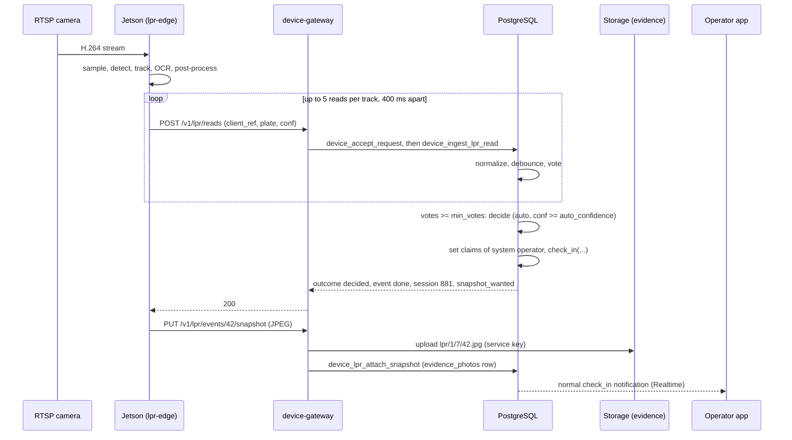
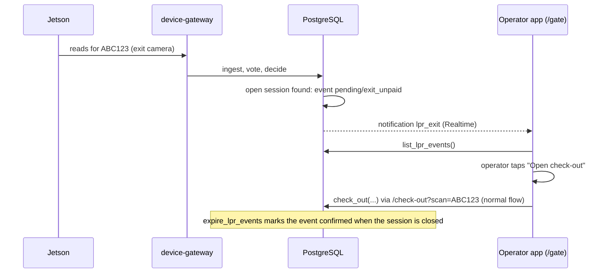
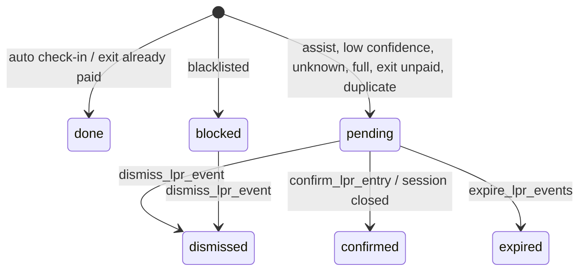

## Context

Verified in the code (migration head `0102`, `0103` taken by `add-public-booking-captcha`):

- **Latest `public.check_in`** is the 11-argument version in `0098_reservation_grace_setting.sql`: `check_in(p_plate text, p_category_id integer default null, p_color text default null, p_brand text default null, p_photos jsonb default '[]', p_idempotency_key text default null, p_client_entry_time timestamptz default null, p_lot_id integer default null, p_left_keys boolean default false, p_spot_id integer default null, p_videos jsonb default '[]')`, granted to `authenticated`. It derives the operator from `public.require_app_user()`, the lot from `public.resolve_lot(p_lot_id)`, normalizes the plate with `upper(regexp_replace(coalesce(p_plate,''), '\s', '', 'g'))`, raises `VehicleNotRegisteredError` for an unknown plate **without** a category and otherwise auto-registers the vehicle (`insert into public.vehicles ... on conflict (plate) do update`), raises `VehicleBlacklistedError` (`vehicles.is_blacklisted`, `0020`), `DuplicateOpenSessionError`, `ParkingFullError`, `CategoryFullError` (capacity trigger), `InvalidEntryTimeError` (client time more than 5 minutes ahead), and validates photo paths with `require_evidence_object()` (storage object must exist in bucket `evidence` and have `owner = auth.uid()`; and not already be referenced by `evidence_photos`). Idempotent through `replay_idempotent` / `remember_idempotent` keyed by `(key, user_id, 'rpc/check_in')`.
- **Plate normalization twins**: Dart `normalizePlate` in `lib/features/plate_scanning/domain/normalize_plate.dart` (`replaceAll(RegExp(r'\s'), '').toUpperCase()`, empty → `ValidationFailure`), SQL in `check_in` (above). Neither strips `-`. The camera therefore sends only `[A-Z0-9]`; the server applies the SQL twin and then rejects anything outside `^[A-Z0-9]{4,10}$` with `InvalidPlateError` rather than silently altering it, so a plate stored by the LPR is byte-identical to one an operator would type.
- `vehicles.plate` is globally unique (no `lot_id` on `vehicles`); `uq_open_session_per_vehicle` allows one open session per vehicle across all lots.
- `check_out` / `check_out_preview` require a signed-in operator and the active lot; the app opens the check-out for a plate with `/check-out?scan=<plate>` (`lib/app/router/app_router.dart`, `CheckOutPage.scanPlate`).
- Monthly pass test used by `slot_board` / `check_out_preview`: `monthly_passes mp where mp.vehicle_id = ... and mp.lot_id = ... and mp.active and mp.start_date <= (now() at time zone tz)::date and mp.end_date >= (now() at time zone tz)::date`, `tz = coalesce(parking_settings.business_timezone, 'America/Bogota')`.
- Storage: bucket `evidence` is private, 5 MB, `image/jpeg` and `image/png` (`0003`, extended for video in `0064`); read policy `evidence_objects_read` (`0035`) is `bucket_id = 'evidence' and public.can_read_evidence(name)`, true only after an `evidence_photos` row references the path; uploads from clients are insert-only (no `upsert`, duplicate = 409 handled as success). The service role bypasses Storage RLS. Storage and Realtime do not receive `x-lot-id`, so any policy on them must use membership helpers (`can_read_lot`, `can_read_evidence`), never `current_lot_id()`.
- `supabase/volumes/functions/evidence-archive/index.ts` deletes `evidence` objects and rows older than each lot's `evidence_retention_days`; it is not allowlisted in `supabase/.gitignore` today (agent-memory), so tracking it is part of the tasks.
- The gateway, device registry, `device_events` and the service-role RPC pattern come from `add-device-gateway`; this change only adds routes and RPCs and relies on `public.device_accept_request` having run before any route.

## Goals / Non-Goals

**Goals**

- Entry: with the camera in `assist` mode (default), every confident read becomes a pending item with the snapshot; in `auto` mode a confident, voted read of a non-blacklisted vehicle checks in by itself.
- Exit: never closes a session; raises an item that opens the check-out for the plate; reports "already paid" facts for the barrier change.
- One decision per physical car passing, however many frames the camera sees.
- Every automatic action is attributable, reversible by an operator, and evidenced by a snapshot.
- The edge service survives RTSP drops, network loss and power cycles without duplicating or inventing reads.

**Non-Goals:** see proposal.

## Decisions

### D1. Who performs an automatic check-in: a per-lot system operator, by session claims set inside a service-role RPC

`check_in` cannot be called without `auth.uid()` mapping to an active `public.users` row, and re-implementing its capacity/spot/reservation/blacklist logic would fork the most sensitive RPC in the system (and every later fix to `check_in` would need to be mirrored). Decision: `lpr_settings.acting_user_id` names an ordinary `operator` user (created by an admin through the existing `admin-users` function, e.g. username `gate-bot`, display name `Cámara de entrada`, member of the lot) and `device_ingest_lpr_read` runs, inside its own transaction:

```sql
perform set_config('request.jwt.claim.sub', acting_auth_uid::text, true);
perform set_config('request.jwt.claims',
    json_build_object('sub', acting_auth_uid, 'role', 'authenticated')::text, true);
perform set_config('request.headers', json_build_object('x-lot-id', lot::text)::text, true);
-- ... call public.check_in(named arguments) inside begin/exception ... end
-- then restore the three settings to their previous values (is_local = true as well)
```

`auth.uid()` on the Supabase image resolves the subject from these settings (the test bootstrap stub reads `request.jwt.claim.sub`); task 1.1 verifies the live definition with `select pg_get_functiondef('auth.uid'::regproc)` and, if the image reads only `request.jwt.claims`, the first `set_config` is harmless. The function is `service_role` only, so a client cannot reach this path. Sessions created this way carry `operator_id = acting_user_id` and show up in notifications and reports under that user's display name, which is exactly the "who did this" an auditor needs. Rejected: a `device_check_in` that copies `check_in`'s body (drift); `operator_id` of the admin who registered the camera (misattributes); making `parking_sessions.operator_id` nullable (touches billing, shifts, reports).

Always call `check_in` with **named** arguments (`p_plate := ...`) so a future signature change fails loudly, and never add an overload of it (documented trap).

### D2. Snapshot evidence reuses the `evidence` bucket and `evidence_photos`, uploaded after the decision

A device cannot satisfy `require_evidence_object` (`owner = auth.uid()`), so the snapshot never travels through `check_in(p_photos)`. Two-phase flow:

1. `POST /v1/lpr/reads` → the server decides; the response says `snapshot_wanted: true` for the read that produced or updated an event with no snapshot.
2. `PUT /v1/lpr/events/:id/snapshot` (`Content-Type: image/jpeg`, ≤ 256 KiB, first bytes `FF D8 FF`): the function uploads to `evidence/lpr/<lot_id>/<device_id>/<event_id>.jpg` with the service key (`x-upsert: false`), then calls `device_lpr_attach_snapshot(p_device_id, p_event_id, p_path)`, which validates that the path is exactly that string for the event's own lot and device (`InvalidSnapshotPathError` otherwise: a device must not be able to point an event at another lot's object), sets `lpr_events.snapshot_path` and, **if the event already has a session** (auto check-in), inserts `evidence_photos (session_id, file_path, taken_at)` directly (security definer; `require_evidence_object` is not applicable to this server-originated row). A second PUT for the same event answers `409 SnapshotAlreadyAttachedError`, which the device treats as success.
3. For a pending event, `confirm_lpr_entry` inserts the `evidence_photos` row after its `check_in`.

Reading the snapshot: while no `evidence_photos` row references the object, `can_read_evidence()` is false, so an additional permissive Storage policy `lpr_snapshots_read` (`bucket_id = 'evidence' and name like 'lpr/%' and public.can_read_lpr_snapshot(name)`) allows members of the event's lot (`can_read_lot`) to download it. After a session exists the original policy also applies. Orphans (dismissed/expired events) are deleted by `evidence-archive` using `purge_lpr_events`.

Rejected: a new bucket (second retention job, second policy set, UI duplication); uploading the image inside the JSON read (every read would carry ~100 KB, and reads that never reach a decision would leave orphans); storing JPEG bytes in Postgres.

### D3. Debounce and voting are server-side and deterministic

All times below are the camera's `captured_at`, validated against the server clock (`max_client_clock_skew()`: more than 5 minutes ahead → `InvalidReadTimeError`; older than 15 minutes → stored with outcome `stale`, never decided, because the car is probably gone).

`device_ingest_lpr_read` algorithm (one transaction, `pg_advisory_xact_lock(hashtext('lpr'), p_device_id)` first so reads of one camera are serialized):

1. `p_device_id` must be a `camera` of an enabled device (`InvalidDeviceKindError`); direction comes from `lpr_camera_config` (`LprDirectionNotSetError` when missing).
2. Normalize the plate (SQL twin) and validate `^[A-Z0-9]{4,10}$` (`InvalidPlateError`); `p_confidence` must be `0 < c <= 1` (`InvalidConfidenceError`).
3. Insert into `lpr_reads`. `unique (device_id, client_ref)` conflict → return the stored outcome with `"outcome": "replayed"` (idempotent retry; the response is rebuilt from the read's `event_id`).
4. If `confidence < min_confidence` → outcome `ignored_low_confidence` (stored, not a vote).
5. **Debounce**: if an event exists for the same lot, direction and plate created less than `cooldown_seconds` ago (default 120) → attach `event_id` to the read, outcome `debounced`. A car that sits in front of the camera produces one event.
6. **Vote**: `votes` = reads of the same camera and plate, `event_id is null`, `captured_at` in `[p_captured_at - vote_window_seconds, p_captured_at]`, `confidence >= min_confidence`. If `votes < min_votes` → outcome `recorded`.
7. **Decide** (D4) with `mean_conf = avg(confidence)` of those votes; attach all vote rows to the new event (`event_id`, so they are never counted again); outcome `decided`.

Defaults and ranges (`lpr_settings`): `min_confidence` 0.80 (0.50..0.99), `auto_confidence` 0.92 (0.50..0.999, must be ≥ `min_confidence`), `min_votes` 3 (1..10), `vote_window_seconds` 8 (2..60), `cooldown_seconds` 120 (10..3600), `pending_expire_minutes` 60 (5..1440), `exit_paid_window_minutes` 15 (1..120).

The edge service sends at most `max_reads_per_track` (5) reads per tracked vehicle, ≥ 400 ms apart, so `min_votes = 3` is reachable within ~1.2 s.

### D4. Decision table

Let `vehicle` = row of `vehicles` with that plate (may be absent), `session` = open session of that vehicle (any lot), `lot_full` = a `ParkingFullError`/`CategoryFullError` from `check_in`.

| Direction | Condition (first match wins) | Event `status` / `reason` | Side effects |
|---|---|---|---|
| entry | `vehicle.is_blacklisted` | `blocked` / `blacklisted` | notification `lpr_blacklisted`; never auto |
| entry | `session` exists | `pending` / `duplicate_session` | notification `lpr_pending` (misread, cloned plate or tailgater) |
| entry | `mode = 'assist'` | `pending` / `assist_mode` | notification `lpr_pending` |
| entry | `mode = 'auto'` and `mean_conf < auto_confidence` | `pending` / `low_confidence` | notification `lpr_pending` |
| entry | `mode = 'auto'`, no `vehicle`, no `default_category_id` | `pending` / `unknown_plate` | notification `lpr_pending` |
| entry | `mode = 'auto'`, `acting_user_id` null or inactive/not member | `pending` / `no_system_operator` | notification `lpr_pending` |
| entry | `mode = 'auto'`, all checks pass → `check_in` succeeds | `done` / null, `session_id` set | the normal `check_in` notification; snapshot attached when it arrives |
| entry | `check_in` raised `ParkingFullError` or `CategoryFullError` | `pending` / `lot_full` | notification `lpr_pending` |
| entry | `check_in` raised anything else | `pending` / `error`, `detail.error = <name>` | notification `lpr_pending` |
| exit | `vehicle.is_blacklisted` | `blocked` / `blacklisted` | notification `lpr_blacklisted` |
| exit | `session` open in this lot | `pending` / `exit_unpaid`, `session_id` set | notification `lpr_exit`; **no write to the session, ever** |
| exit | no open session and a session of the vehicle closed in this lot with `exit_time >= now() - exit_paid_window_minutes` | `done` / `exit_paid`, `session_id` set | none (fact for `add-barrier-control`) |
| exit | otherwise | `pending` / `no_open_session` | notification `lpr_pending` |

`lpr_events.has_pass` (boolean) is filled at decision time with the monthly-pass test quoted above; `add-barrier-control` reads it. Operators resolve pending items: entry via `confirm_lpr_entry`, any via `dismiss_lpr_event`; `exit_unpaid` is resolved implicitly when the session closes (`expire_lpr_events`).

### D5. Operator override and correction

`confirm_lpr_entry(p_event_id, p_plate default null, p_category_id default null)` lets the operator correct a misread plate (the corrected plate is normalized with the SQL twin and re-validated), choose the category for an unknown vehicle, then runs `check_in` **as the signed-in operator** (not the system user), attaches the snapshot, marks the event `confirmed` and records `resolved_by`. Idempotency key: `'lpr-confirm:' || p_event_id` (deterministic, so a double tap or retry replays the same session).

### D6. Settings are per lot; only lot admins change them

Changing `mode` to `auto` requires `acting_user_id` to be set, active and a member of the lot (`LprSystemOperatorRequiredError`) and `default_category_id`, when set, to belong to the lot (`CategoryNotFoundError`). Mode `auto` is an owner decision with real consequences (free-entry by plate spoof is possible, see threats); the UI asks for confirmation.

### D7. Notifications, not Realtime on new tables

The inbox refreshes when a `lpr_pending` / `lpr_exit` / `lpr_blacklisted` notification arrives (the existing Realtime stream, `notifications_select_own` + `can_read_lot`), on pull-to-refresh and with a 10-second poll while the page is open. No new table is added to `supabase_realtime` (a policy using `current_lot_id()` would silently kill the subscription: agent-memory). Table reads go through RPCs.

## Data model (migrations)

### `<NEXT>_lpr_settings.sql`

```sql
create table if not exists public.lpr_settings (
    lot_id                   integer primary key references public.parking_lots(id) on delete cascade,
    mode                     text    not null default 'assist' check (mode in ('assist', 'auto')),
    min_confidence           numeric(4,3) not null default 0.800 check (min_confidence between 0.5 and 0.99),
    auto_confidence          numeric(4,3) not null default 0.920 check (auto_confidence between 0.5 and 0.999),
    min_votes                integer not null default 3   check (min_votes between 1 and 10),
    vote_window_seconds      integer not null default 8   check (vote_window_seconds between 2 and 60),
    cooldown_seconds         integer not null default 120 check (cooldown_seconds between 10 and 3600),
    pending_expire_minutes   integer not null default 60  check (pending_expire_minutes between 5 and 1440),
    exit_paid_window_minutes integer not null default 15  check (exit_paid_window_minutes between 1 and 120),
    default_category_id      integer references public.categories(id) on delete set null,
    acting_user_id           integer references public.users(id) on delete set null,
    updated_at               timestamptz not null default now(),
    check (auto_confidence >= min_confidence)
);
alter table public.lpr_settings enable row level security;
grant select on public.lpr_settings to authenticated;
create policy lpr_settings_member_read on public.lpr_settings
    for select to authenticated using (lot_id = public.current_lot_id());
-- writes only through set_lpr_settings (security definer, no write grants).
drop trigger if exists trg_audit_row on public.lpr_settings;
create trigger trg_audit_row after insert or update or delete on public.lpr_settings
    for each row execute function public.record_audit();   -- no secret in this table; lot_id column present
-- record_audit reads after_row->>'id'; this table has no id, entity_id stays null: acceptable.

create table if not exists public.lpr_camera_config (
    device_id  integer primary key references public.lot_devices(id) on delete cascade,
    lot_id     integer not null references public.parking_lots(id) on delete cascade,
    direction  text    not null check (direction in ('entry', 'exit'))
);
alter table public.lpr_camera_config enable row level security;
-- no grants: read through get_lpr_settings()/list_lot_devices; written by set_lpr_camera_direction.

create or replace function public.lpr_effective_settings(p_lot_id integer)
returns public.lpr_settings language sql stable security definer set search_path = public as $$
    select coalesce(
        (select s from public.lpr_settings s where s.lot_id = p_lot_id),
        row(p_lot_id, 'assist', 0.800, 0.920, 3, 8, 120, 60, 15, null, null, now())::public.lpr_settings);
$$;
revoke all on function public.lpr_effective_settings(integer) from public, anon, authenticated;
grant execute on function public.lpr_effective_settings(integer) to service_role;
```

(The `row(...)` literal must list columns in table order; the implementer writes a test that fails if a column is added without updating it.)

### `<NEXT>_lpr_ingest.sql`

```sql
create table if not exists public.lpr_events (
    id            bigserial primary key,
    lot_id        integer not null references public.parking_lots(id) on delete cascade,
    device_id     integer references public.lot_devices(id) on delete set null,
    direction     text    not null check (direction in ('entry', 'exit')),
    plate         varchar(20) not null,
    confidence    numeric(4,3) not null,
    votes         integer not null check (votes >= 1),
    status        text    not null check (status in ('pending','done','blocked','confirmed','dismissed','expired')),
    reason        text    check (reason in ('assist_mode','low_confidence','unknown_plate','no_system_operator',
                                            'duplicate_session','lot_full','error','blacklisted',
                                            'exit_unpaid','exit_paid','no_open_session')),
    session_id    integer references public.parking_sessions(id) on delete set null,
    vehicle_id    integer references public.vehicles(id) on delete set null,
    has_pass      boolean not null default false,
    snapshot_path varchar(255),
    detail        jsonb   not null default '{}'::jsonb,
    resolved_by   integer references public.users(id) on delete set null,
    resolved_at   timestamptz,
    created_at    timestamptz not null default now()
);
create index if not exists ix_lpr_events_lot_status on public.lpr_events(lot_id, status, created_at desc);
create index if not exists ix_lpr_events_plate on public.lpr_events(lot_id, plate, direction, created_at desc);
alter table public.lpr_events enable row level security;
revoke all on public.lpr_events from anon, authenticated;   -- reads via list_lpr_events()

create table if not exists public.lpr_reads (
    id          bigserial primary key,
    lot_id      integer not null references public.parking_lots(id) on delete cascade,
    device_id   integer not null references public.lot_devices(id) on delete cascade,
    client_ref  uuid    not null,
    direction   text    not null check (direction in ('entry', 'exit')),
    plate       varchar(20) not null,
    confidence  numeric(4,3) not null check (confidence > 0 and confidence <= 1),
    captured_at timestamptz not null,
    track_id    varchar(40),
    outcome     text    not null,
    event_id    bigint  references public.lpr_events(id) on delete set null,
    created_at  timestamptz not null default now(),
    unique (device_id, client_ref)
);
create index if not exists ix_lpr_reads_vote on public.lpr_reads(device_id, plate, captured_at) where event_id is null;
alter table public.lpr_reads enable row level security;
revoke all on public.lpr_reads from anon, authenticated;

create or replace function public.can_read_lpr_snapshot(p_path text) returns boolean
language sql stable security definer set search_path = public as $$
    select exists (select 1 from public.lpr_events e
                    where e.snapshot_path = p_path and public.can_read_lot(e.lot_id));
$$;
grant execute on function public.can_read_lpr_snapshot(text) to authenticated;

drop policy if exists lpr_snapshots_read on storage.objects;
create policy lpr_snapshots_read on storage.objects for select to authenticated
    using (bucket_id = 'evidence' and name like 'lpr/%' and public.can_read_lpr_snapshot(name));
```

Service-role RPCs (`revoke all ... from public, anon, authenticated; grant execute ... to service_role`), all `security definer set search_path = public`:

| Function | Signature | Returns |
|---|---|---|
| `device_lpr_config` | `(p_device_id integer)` | `{"direction":"entry","min_confidence":0.8,"vote_window_seconds":8,"heartbeat_interval_s":60}`; `LprDirectionNotSetError` if no row |
| `device_ingest_lpr_read` | `(p_device_id integer, p_client_ref uuid, p_plate text, p_confidence numeric, p_captured_at timestamptz, p_track_id text default null)` | `{"read_id":1201,"outcome":"recorded","event":null,"snapshot_wanted":false}` (outcomes: `recorded`, `decided`, `debounced`, `replayed`, `stale`, `ignored_low_confidence`; `event` = event object when `decided`/`debounced`/`replayed`-of-decided) |
| `device_lpr_attach_snapshot` | `(p_device_id integer, p_event_id bigint, p_path text)` | `{"event_id":42,"session_id":881}`; errors `LprEventNotFoundError` (event of another device/lot counts as not found), `InvalidSnapshotPathError`, `SnapshotAlreadyAttachedError` |

Errors raised by ingest: `InvalidDeviceKindError`, `LprDirectionNotSetError`, `InvalidPlateError`, `InvalidConfidenceError`, `InvalidReadTimeError`. Event object: `{"id":42,"kind":"entry","status":"done","reason":null,"plate":"ABC123","confidence":0.947,"votes":3,"session_id":881,"has_pass":false,"snapshot_path":null,"created_at":"..."}`.

### `<NEXT>_lpr_operator_rpcs.sql`

Operator/admin RPCs (`revoke all ... from public; grant execute ... to authenticated`). Each starts with `require_app_user()` (and `require_lot_admin()` for the admin ones); lot is `current_lot_id()`.

| Function | Signature | Who | Returns / errors |
|---|---|---|---|
| `list_lpr_events` | `(p_status text default 'pending', p_limit integer default 50)` | member | array of event objects + `device_name`, newest first, limit clamped 1..200; `InvalidDataError` for unknown status |
| `confirm_lpr_entry` | `(p_event_id bigint, p_plate text default null, p_category_id integer default null)` | member | the `check_in` JSON plus `event_id`; errors `LprEventNotFoundError`, `LprEventResolvedError` (status not `pending`), `LprEventKindError` (not an entry event), `InvalidPlateError`, plus everything `check_in` raises |
| `dismiss_lpr_event` | `(p_event_id bigint, p_note text default null)` | member | `{"event_id":42,"status":"dismissed"}`; `LprEventNotFoundError`, `LprEventResolvedError`; note ≤ 200 chars stored in `detail.note` |
| `get_lpr_settings` | `()` | member | settings object + `"cameras":[{"device_id":7,"name":"...","direction":"entry"|null,"status":"online"}]` |
| `set_lpr_settings` | `(p_mode text default null, p_min_confidence numeric default null, p_auto_confidence numeric default null, p_min_votes integer default null, p_vote_window_seconds integer default null, p_cooldown_seconds integer default null, p_default_category_id integer default null, p_acting_user_id integer default null)` | lot admin | settings object; `InvalidDataError`, `LprSystemOperatorRequiredError`, `CategoryNotFoundError`, `UserNotFoundError` |
| `set_lpr_camera_direction` | `(p_device_id integer, p_direction text)` | lot admin | `{"device_id":7,"direction":"entry"}`; `DeviceNotFoundError`, `InvalidDeviceKindError` (not a camera), `InvalidDataError` |
| `expire_lpr_events` | `()` | job (revoked from clients) | integer: events changed |
| `purge_lpr_events` | `(p_days integer default 30)` | job | `jsonb` array of `snapshot_path` strings of the deleted rows that have no `evidence_photos` row (for the storage janitor); deletes reads and events older than `p_days` |

`expire_lpr_events`: `pending` events older than their lot's `pending_expire_minutes` → `expired`; `pending/exit_unpaid` events whose session is `closed` → `confirmed`. `set_lpr_settings` upserts the `lpr_settings` row (`insert ... on conflict (lot_id) do update`), validates `p_acting_user_id` is an active `operator` or `admin` user that is a member of the lot.

No overloads: every signature above is the only one; to change one later, `drop function` the old signature in the same migration.

## Device HTTP protocol (extends `add-device-gateway` v1; same headers, same errors)

All three routes: kind `camera` only.

### `GET /v1/lpr/config`

`200 {"direction":"entry","min_confidence":0.8,"vote_window_seconds":8,"heartbeat_interval_s":60}`. The service calls it at start-up and every 10 minutes; a `LprDirectionNotSetError` (400) means "an admin has not assigned the direction yet": the service keeps heartbeating and retries in 60 s.

### `POST /v1/lpr/reads`

Headers: the standard four plus `Idempotency-Key` that MUST equal `client_ref` (else 400 `InvalidDataError`). Body ≤ 4 KiB.

```json
{"client_ref": "0b6f6d5c-3d4e-4a53-9a0e-2f7d1a2b9c11",
 "plate": "ABC123",
 "confidence": 0.947,
 "captured_at": "2026-11-10T14:03:21.512Z",
 "track_id": "t-1731247"}
```

```json
// 200
{"read_id": 1201, "outcome": "decided", "snapshot_wanted": true,
 "event": {"id": 42, "kind": "entry", "status": "done", "reason": null, "plate": "ABC123",
           "confidence": 0.947, "votes": 3, "session_id": 881, "has_pass": false}}
```

Errors (in addition to the gateway table): 400 `InvalidPlateError`, `InvalidConfidenceError`, `InvalidReadTimeError`, `LprDirectionNotSetError`, `InvalidDeviceKindError`. A 5xx or network error is retried with the **same** `client_ref`.

### `PUT /v1/lpr/events/:id/snapshot`

Body: the JPEG bytes, `Content-Type: image/jpeg`, ≤ 262144 bytes, magic `FF D8 FF` else 400 `InvalidDataError`; 413 `PayloadTooLargeError` above the limit. `200 {"event_id": 42, "session_id": 881}`; `409 SnapshotAlreadyAttachedError` (treat as success); `404 LprEventNotFoundError`; 400 `InvalidSnapshotPathError` (cannot happen with a correct gateway; defence in depth). The gateway builds the path itself from the authenticated device (`lpr/${lotId}/${deviceId}/${eventId}.jpg`), uploads, then calls the RPC; if the RPC refuses after the upload, the gateway deletes the object.

### Sequence: entry, auto mode



### Sequence: assist and exit



### Event state machine



## Jetson reference implementation: `edge/lpr/` (NEW top-level directory)

### Layout

```
edge/lpr/
├── README.md                     # install, config, run, test, model export (this section, condensed)
├── pyproject.toml                # package lpr_edge, Python >= 3.10, deps pinned (see below)
├── config/lpr.example.yaml
├── systemd/lpr-edge.service
├── systemd/lpr-edge.env.example  # LPR_API_KEY_FILE, LPR_RTSP_URL_FILE paths only; no secrets inline
├── tools/export_models.sh        # ONNX -> TensorRT, run ON the Jetson
├── tools/record_fixture.py       # records N seconds of RTSP to tests/fixtures/videos/
├── tools/fake_gateway.py         # stdlib http.server implementation of the 4 routes + fault injection
├── src/lpr_edge/
│   ├── __main__.py               # entry: load config, wire components, supervise threads
│   ├── config.py                 # dataclasses + YAML loader + validation (rejects unknown keys)
│   ├── capture.py                # RtspCapture: GStreamer/OpenCV pipeline, reconnect with backoff, latest-frame slot
│   ├── sampler.py                # FrameSampler: idle/active fps, motion gate, ROI crop
│   ├── detector.py               # PlateDetector protocol; TensorRtDetector, OnnxDetector, FakeDetector
│   ├── ocr.py                    # PlateOcr protocol; TensorRtOcr, OnnxOcr, FakeOcr
│   ├── postprocess.py            # normalize, confusable fold, pattern check
│   ├── tracker.py                # IoU tracker, read scheduling, best-frame crop
│   ├── gateway_client.py         # signed-header builder, seq counter, retry/backoff, clock sync
│   ├── outbox.py                 # SQLite queue (WAL), expiry, ordering
│   ├── health.py                 # heartbeat payload, watchdog (sd_notify)
│   └── logging_setup.py          # JSON lines to stdout (journald)
└── tests/
    ├── unit/                     # postprocess, tracker, sampler, outbox, gateway_client, config
    ├── integration/              # capture reconnect (mediamtx), end-to-end with fake gateway
    └── fixtures/{videos/*.mp4, expected/*.json, plates.json}
```

### Process layout

One Python process, `Type=notify` systemd service, four threads and one asyncio-free design (blocking I/O is fine at ≤ 8 fps):

| Thread | Responsibility | Blocks on |
|---|---|---|
| `capture` | owns the RTSP pipeline; writes the newest frame into a one-slot buffer (older frames are dropped, never queued) | GStreamer appsink |
| `infer` | pulls frames at the sampler rate, runs detect → track → OCR → post-process, pushes reads and best-frame crops to the outbox | one-slot buffer |
| `sender` | drains the outbox in order through `GatewayClient`; uploads a snapshot when the response says `snapshot_wanted` | outbox condition |
| `health` | heartbeat every `heartbeat_interval_s`, `sd_notify(WATCHDOG=1)` only while `infer` advanced in the last 30 s | timer |

### RTSP capture and reconnection

Pipeline (Jetson, hardware decode): `rtspsrc location=<url> latency=200 protocols=tcp ! rtph264depay ! h264parse ! nvv4l2decoder ! nvvidconv ! video/x-raw,format=BGRx ! videoconvert ! video/x-raw,format=BGR ! appsink drop=true max-buffers=1 sync=false`. Development hosts use the same string with `avdec_h264` instead of `nvv4l2decoder`/`nvvidconv` (config `capture.decoder: nvidia|software`). `protocols=tcp` avoids UDP loss on a congested switch.

Reconnect: when the pipeline reports EOS/ERROR or no frame arrives for `capture.stall_seconds` (default 10), tear it down completely (a half-dead GStreamer pipeline leaks), then retry with backoff `1, 2, 4, 8, 16, 30 s` (cap 30 s, ±20 % jitter), reset to 1 s after 30 s of continuous frames. While disconnected, `infer` idles and `health` reports `"camera": "down"`; the heartbeat keeps flowing so the admin sees "online with camera down" rather than "offline".

### Frame sampling

`FrameSampler` runs the detector at `idle_fps` (default 2) and switches to `active_fps` (default 8) for `active_hold_s` (default 3) after any plate detection, and also when frame-difference inside the ROI exceeds `motion_threshold` (mean absolute grayscale difference on a 160x90 downscale, default 6.0). `roi` (x, y, w, h as fractions 0..1) crops the frame before detection so a wide-angle view does not read neighbouring lanes. Frames older than 500 ms when pulled are discarded (latency, not completeness, matters at a gate).

### Models and export

Interfaces: `PlateDetector.detect(frame) -> list[Box(x1,y1,x2,y2,score)]`, `PlateOcr.read(crop) -> tuple[str, float]` (raw string, mean per-character confidence). The owner supplies weights (see Open Questions); the repo ships none.

- Detector: a YOLO nano-class single-class model ("plate"), input 640x640, trained/fine-tuned by the owner, exported to ONNX with the framework's exporter (`opset 17`, `dynamic=False`, `simplify=True`).
- OCR: a compact sequence recogniser for 1-line plates (e.g. a CRNN/CTC or fast-plate-ocr style model) with input 128x64 grayscale, exported to ONNX.
- `tools/export_models.sh <detector.onnx> <ocr.onnx>` runs **on the target Jetson** (engines are tied to the GPU, TensorRT version and JetPack): `trtexec --onnx=<file> --saveEngine=/opt/lpr-edge/models/<name>_fp16.engine --fp16 --memPoolSize=workspace:1024 --skipInference` (first run also with `--verbose` and `--dumpProfile` once, to check no layer falls back to CPU), then prints SHA-256 of each engine. INT8 is explicitly out of scope until a calibration set of real plates exists.
- The engine paths and SHA-256 are in `lpr.yaml`; the service refuses to start if a hash does not match (prevents a half-copied engine).

Acceptance metrics for a model before field use (measured by the owner on a held-out set from the real camera): ≥ 98 % exact-plate accuracy on frames with a plate larger than 80 px wide in daylight, ≥ 95 % at night with IR, detector recall ≥ 99 %, p95 detect+OCR latency ≤ 80 ms per frame on the target Jetson.

### Post-processing

`postprocess.normalize(raw) -> str | None`: uppercase, remove every character outside `[A-Z0-9]` (so `-`, spaces and OCR noise never reach the server), then check against `plate.patterns` (default Colombia: cars `^[A-Z]{3}[0-9]{3}$`, motorcycles `^[A-Z]{3}[0-9]{2}[A-Z]$`). When the string does not match but has the right length (6), apply the **positional confusable fold**: letter positions map `0→O 1→I 8→B 5→S 2→Z 6→G`, digit positions map the reverse, and keep the result only if it then matches a pattern. A string that still does not match is dropped, unless `plate.accept_unmatched: true` (then it is sent as is if it satisfies `^[A-Z0-9]{4,10}$`). The mean confidence sent is `min(ocr_confidence, detector_score)`.

### Tracking and read scheduling

IoU tracker (greedy match, `iou_threshold` 0.3, `max_age_frames` 15). For each live track: at most one read every `read_interval_ms` (400) and at most `max_reads_per_track` (5), all with the same `track_id`. The track keeps its best crop (highest `min(ocr_conf, det_score)` x box area) as the snapshot JPEG (quality 85, longest side ≤ 960 px, must stay ≤ 256 KiB; re-encode at lower quality until it fits). When the gateway answers `snapshot_wanted`, the sender uploads that track's best crop; if the process restarted and the crop is gone the upload is skipped (the server keeps the event without a snapshot).

### Local queue for network loss

SQLite at `queue.path` (default `/var/lib/lpr-edge/outbox.db`, WAL, `synchronous=NORMAL`), table `outbox(id integer primary key, kind text, client_ref text unique, payload text, snapshot blob null, created_at real, attempts integer, next_try_at real)`. Reads are enqueued **before** the first send (`client_ref` is generated at enqueue time and never regenerated, AGENTS §5). The sender sends oldest first, one request in flight. A row is deleted on 2xx, on 409 `SnapshotAlreadyAttachedError`, and on non-retryable 4xx (400 family except the two retry-once cases). Rows older than `queue.max_age_s` (default 900 = the server's 15-minute stale rule) or beyond `queue.max_rows` (2000, oldest dropped first) are discarded with a counter reported in the heartbeat (`dropped`). Snapshot blobs are deleted at the same time as their row.

### Gateway client

`seq = (boot_counter << 32) | n`, `boot_counter` read from `state.path` (JSON, default `/var/lib/lpr-edge/state.json`), incremented and written atomically (temp file, `fsync`, rename) at start-up; `n` starts at 1 and is incremented per request in memory. On `DeviceReplayError` it sets `boot_counter = last_seq >> 32 + 1`, persists it and retries once; on `DeviceClockSkewError` it calls `GET /v1/time`, stores the offset and retries once (all timestamps afterwards use `monotonic-corrected wall clock`). Backoff, jitter and retry classes follow the `add-device-gateway` protocol table. TLS verification is on (system CA bundle, optional `gateway.ca_file`), never disabled.

### Config schema (`lpr.yaml`, unknown keys are an error)

```yaml
device:
  gateway_url: https://parking.example.com/functions/v1/device-gateway   # required, https only
  api_key_file: /etc/lpr-edge/api_key          # required, must be mode 0600 and owned by the service user
  firmware_version: lpr-1.0.0                  # sent as X-Device-Firmware
  ca_file: null                                # optional pinned CA bundle
capture:
  rtsp_url_file: /etc/lpr-edge/rtsp_url        # required, mode 0600 (URL may embed camera credentials)
  decoder: nvidia                              # nvidia | software
  stall_seconds: 10
sampling:
  idle_fps: 2
  active_fps: 8
  active_hold_s: 3
  motion_threshold: 6.0
  roi: [0.1, 0.2, 0.8, 0.7]                    # x, y, w, h fractions
models:
  detector: {engine: /opt/lpr-edge/models/plate_fp16.engine, sha256: "<64 hex>", input: 640, score: 0.40}
  ocr:      {engine: /opt/lpr-edge/models/ocr_fp16.engine,   sha256: "<64 hex>", width: 128, height: 64}
plate:
  patterns: ['^[A-Z]{3}[0-9]{3}$', '^[A-Z]{3}[0-9]{2}[A-Z]$']
  fold_confusables: true
  accept_unmatched: false
tracking: {iou_threshold: 0.3, max_age_frames: 15, read_interval_ms: 400, max_reads_per_track: 5}
queue: {path: /var/lib/lpr-edge/outbox.db, max_age_s: 900, max_rows: 2000}
state: {path: /var/lib/lpr-edge/state.json}
heartbeat_interval_s: 60
log_level: info                                # debug | info | warning | error
```

### systemd unit (`systemd/lpr-edge.service`)

```ini
[Unit]
Description=LPR edge service
After=network-online.target nvargus-daemon.service
Wants=network-online.target

[Service]
Type=notify
User=lpr
Group=lpr
EnvironmentFile=-/etc/lpr-edge/lpr-edge.env
ExecStart=/opt/lpr-edge/venv/bin/python -m lpr_edge --config /etc/lpr-edge/lpr.yaml
Restart=always
RestartSec=3
WatchdogSec=60
StateDirectory=lpr-edge
NoNewPrivileges=true
ProtectSystem=strict
ReadWritePaths=/var/lib/lpr-edge
ProtectHome=true
PrivateTmp=true
SupplementaryGroups=video

[Install]
WantedBy=multi-user.target
```

### Testing without hardware

| Layer | How | Runs in CI |
|---|---|---|
| `postprocess`, `tracker`, `sampler`, `outbox`, `gateway_client`, `config` | pytest, pure Python, `FakeDetector`/`FakeOcr` driven by `tests/fixtures/expected/*.json` (frame index → boxes/strings) | yes |
| Recorded video fixtures | 5 to 10 s H.264 clips in `tests/fixtures/videos/` (synthetic plates rendered onto a street background or consented captures; no real third-party plates, no personal data), decoded with OpenCV on the dev machine through `capture.decoder: software` and `file://` sources | yes |
| Model in the loop | `OnnxDetector`/`OnnxOcr` on CPU against the same clips, asserts exact plate strings from `expected/*.json`; marked `@pytest.mark.slow`, skipped when the model files are absent | optional job |
| Gateway protocol | `tools/fake_gateway.py` (stdlib `http.server`) implements `/v1/time`, `/v1/heartbeat`, `/v1/lpr/config`, `/v1/lpr/reads`, `/v1/lpr/events/:id/snapshot` with switches to answer 500, 429 + `Retry-After`, 409 replay, 401 skew, drop the connection mid-body | yes |
| RTSP reconnect | `mediamtx` + `ffmpeg -re -stream_loop -1 -i clip.mp4 -c copy -f rtsp rtsp://127.0.0.1:8554/gate`; the test kills and restarts `mediamtx` and asserts reconnect within the backoff schedule | optional job |
| Power-loss | test kills the process with SIGKILL between `enqueue` and send, restarts, asserts the row is sent exactly once with the same `client_ref` and the new `seq` is greater | yes |

Command: `cd edge/lpr && python -m pytest tests -m "not hardware and not slow"`. Hardware-only checks (marked `@pytest.mark.hardware`, never run in CI): TensorRT engine build, NVDEC pipeline, real RTSP camera, night/IR image quality, thermal throttling, systemd watchdog on the Jetson.

### Hardware bill of materials (assumptions)

Jetson Orin Nano 8 GB dev kit or an Orin NX module on a carrier (JetPack 6.x, Ubuntu 22.04, Python 3.10, TensorRT 10); an IP camera with RTSP H.264, 1080p, varifocal lens and a shutter of at least 1/1000 s (a plate at 10 km/h blurs otherwise), with an 850 nm IR illuminator for night; a PoE switch; a small UPS for the Jetson and switch; mounting height 1.0 to 2.5 m, 20 to 30 degrees off the lane axis, 3 to 6 m from the stop line; NVMe or industrial SD for `/var/lib/lpr-edge`. Estimated plate size in frame ≥ 120 px wide at the stop line.

## Flutter

### File tree (NEW unless marked)

```
lib/features/lpr/
├── domain/
│   ├── entities/lpr_event.dart        # LprEvent, LprEventKind, LprEventStatus, LprEventReason
│   ├── entities/lpr_settings.dart     # LprSettings, LprMode, LprCamera
│   ├── commands/confirm_lpr_entry.dart  # ConfirmLprEntry {eventId, plate?, categoryId?}
│   ├── commands/lpr_settings_update.dart # LprSettingsUpdate (all fields nullable)
│   └── repositories/lpr_repository.dart
├── application/
│   ├── lpr_inbox_cubit.dart           # LprInboxCubit + sealed LprInboxState
│   └── lpr_settings_cubit.dart        # LprSettingsCubit + sealed LprSettingsState
├── infrastructure/
│   ├── lpr_remote_data_source.dart
│   └── lpr_repository_impl.dart
└── presentation/
    ├── gate_page.dart                 # /gate (operators and admins)
    ├── gate_settings_page.dart        # /gate-settings (admin)
    └── widgets/{lpr_event_card.dart, lpr_confirm_dialog.dart, lpr_snapshot_view.dart}
lib/app/di/modules/lpr_module.dart
lib/app/router/deferred/gate_settings_entry.dart
```

Modified: `lib/app/di/injection.dart` (`registerLprModule(sl)`), `lib/app/router/app_router.dart` (`/gate` plain route under the shell next to `reservations`; `/gate-settings` via `_deferred`), `lib/app/router/route_access.dart` (`'/gate'` added to `operatorRoutes`; `/gate-settings` stays admin-only), `lib/app/shell/app_destinations.dart` (`/gate`, icon `Icons.videocam_outlined` / `Icons.videocam`, visible to all roles; `/gate-settings` reached from the page's app bar, admin only), `lib/features/notifications/presentation/notification_routes.dart` (`'lpr_pending' || 'lpr_exit' || 'lpr_blacklisted' => '/gate'`), `notifications_page.dart`, `lib/core/l10n/failure_messages.dart`, `lib/core/network/supabase_error_mapper.dart` (`_domainCodes`), ARB files.

### Entities and port

`LprEvent {int id; LprEventKind kind (entry|exit); LprEventStatus status; LprEventReason? reason; String plate; double confidence; int votes; int? sessionId; bool hasPass; String? snapshotPath; String deviceName; DateTime createdAt}`; `LprSettings {LprMode mode; double minConfidence; double autoConfidence; int minVotes; int voteWindowSeconds; int cooldownSeconds; int? defaultCategoryId; int? actingUserId; List<LprCamera> cameras}`; `LprCamera {int deviceId; String name; String? direction; DeviceStatus status}` (reuses `DeviceStatus` from `lib/features/devices/domain/entities/lot_device.dart`: the `lpr` feature depends on the `devices` domain, allowed since both are inner-layer pure Dart).

```dart
abstract class LprRepository {
  Future<List<LprEvent>> listEvents({String status = 'pending'});
  Future<ParkingSession> confirmEntry(ConfirmLprEntry command);   // returns the check_in JSON mapped by the existing check-in DTO mapper
  Future<void> dismiss(int eventId, {String? note});
  Future<Uint8List> snapshot(String path);                         // Storage download from bucket evidence
  Future<LprSettings> settings();
  Future<LprSettings> saveSettings(LprSettingsUpdate update);
  Future<void> setCameraDirection({required int deviceId, required String direction});
}
```

The implementer reuses the existing check-in session mapper (find it with `grep -rn "check_in" lib/features/check_in/infrastructure`) instead of defining a second session DTO.

### Cubit states

```dart
sealed class LprInboxState extends Equatable {}
final class LprInboxLoading extends LprInboxState {}
final class LprInboxEmpty extends LprInboxState { final Submission submission; }
final class LprInboxLoaded extends LprInboxState { final List<LprEvent> events; final Submission submission; }
final class LprInboxError extends LprInboxState { final Failure failure; }
```

`LprInboxCubit extends ResilientCubit`: `load()`, `confirm(ConfirmLprEntry)`, `dismiss(int, {String? note})`, `startPolling()` / `stopPolling()` (10 s `Timer.periodic`, cancelled in `close()`). `LprSettingsCubit` has the same four-state shape (`Loading / Loaded / Error`; "empty" does not apply because defaults always exist, so the four-state rule is met by Loading, Loaded, Error and an explicit `LprSettingsNoCameras` state shown with a call to action pointing to `/devices`).

UI states for `/gate`: Loading = 3 skeleton cards; Success = cards (snapshot thumbnail, plate in monospace `PlateText`, confidence, time, reason chip, primary action); Empty = icon + `gateEmptyTitle`/`gateEmptyBody` ("no pending plates", with a CTA to `/check-in`); Error = localized message + retry. Reason chips use icon + text. Entry card actions: Confirm (opens `LprConfirmDialog` with an editable plate field using `PlateInputField`, a category selector shown only for unknown vehicles) and Dismiss; exit card: "Open check-out" → `context.go('/check-out?scan=<plate>')`; blocked card: shows the vehicle's blacklist state and Dismiss. All actions ≥ 48 dp. Confirming is disabled offline (message `gateNeedsConnection`).

### l10n keys (ES / EN)

| Key | ES | EN |
|---|---|---|
| `navGate` | Portería | Gate |
| `gateTitle` | Placas detectadas | Detected plates |
| `gateEmptyTitle` | No hay placas por revisar | No plates to review |
| `gateEmptyBody` | Cuando la cámara lea una placa que necesite tu confirmación, aparecerá aquí. | When the camera reads a plate that needs your confirmation, it will appear here. |
| `gateConfirmEntry` | Confirmar entrada | Confirm entry |
| `gateDismiss` | Descartar | Dismiss |
| `gateOpenCheckOut` | Abrir salida | Open check-out |
| `gateConfirmTitle` | Confirmar placa | Confirm plate |
| `gateConfidence` | Confianza {percent}% | Confidence {percent}% |
| `gateVotes` | {count} lecturas | {count} reads |
| `gateReasonAssist` | Modo asistido | Assist mode |
| `gateReasonLowConfidence` | Confianza baja | Low confidence |
| `gateReasonUnknownPlate` | Placa no registrada | Unregistered plate |
| `gateReasonNoSystemOperator` | Sin operador del sistema | No system operator |
| `gateReasonDuplicateSession` | Ya tiene una sesión abierta | Already has an open session |
| `gateReasonLotFull` | Parqueadero lleno | Lot full |
| `gateReasonError` | No se pudo registrar | Could not register |
| `gateReasonBlacklisted` | Vehículo en lista negra | Blacklisted vehicle |
| `gateReasonExitUnpaid` | Sale con la sesión sin cobrar | Leaving with an unpaid session |
| `gateReasonNoOpenSession` | Sale sin sesión abierta | Leaving without an open session |
| `gateReasonExitPaid` | Salida ya pagada | Exit already paid |
| `gateSnapshotMissing` | Sin imagen | No image |
| `gateNeedsConnection` | Confirmar requiere conexión | Confirming needs a connection |
| `gateSettingsTitle` | Cámara de placas | Plate camera |
| `gateModeLabel` | Modo | Mode |
| `gateModeAssist` | Asistido: el operador confirma cada entrada | Assist: the operator confirms every entry |
| `gateModeAuto` | Automático: la cámara registra la entrada | Automatic: the camera registers the entry |
| `gateModeAutoConfirm` | En modo automático, una placa falsa puede abrir una sesión sin que nadie la revise. ¿Activarlo? | In automatic mode a spoofed plate can open a session without anyone reviewing it. Enable it? |
| `gateMinConfidence` | Confianza mínima | Minimum confidence |
| `gateAutoConfidence` | Confianza para modo automático | Confidence for automatic mode |
| `gateMinVotes` | Lecturas mínimas | Minimum reads |
| `gateVoteWindow` | Ventana de lecturas (s) | Read window (s) |
| `gateCooldown` | Pausa entre eventos de la misma placa (s) | Pause between events of the same plate (s) |
| `gateDefaultCategory` | Categoría para placas nuevas | Category for new plates |
| `gateActingUser` | Operador del sistema | System operator |
| `gateCameraDirection` | Sentido de la cámara | Camera direction |
| `gateDirectionEntry` | Entrada | Entry |
| `gateDirectionExit` | Salida | Exit |
| `gateNoCameras` | Registra una cámara en Dispositivos para configurarla. | Register a camera under Devices to configure it. |
| `notifTypeLprPending` | Placa por confirmar | Plate to confirm |
| `notifTypeLprExit` | Salida sin cobrar | Unpaid exit |
| `notifTypeLprBlacklisted` | Vehículo en lista negra | Blacklisted vehicle |
| `errorInvalidPlate` | Placa no válida | Invalid plate |
| `errorLprEventResolved` | Este aviso ya fue atendido | This item was already handled |
| `errorLprEventNotFound` | El aviso ya no existe | The item no longer exists |
| `errorLprEventKind` | Esta acción no aplica a una salida | This action does not apply to an exit |
| `errorLprSystemOperator` | El modo automático necesita un operador del sistema activo | Automatic mode needs an active system operator |

Notification texts (Spanish, written by SQL like the existing ones): `lpr_pending` title `Placa por confirmar`, body `<plate> (<mode text>) · <HH24:MI>`; `lpr_exit` title `Salida sin cobrar`, body `<plate> está saliendo con la sesión abierta`; `lpr_blacklisted` title `Vehículo en lista negra`, body `<plate> fue detectado en <entrada|salida>`. `dedupe_key = '<type>:' || event_id || ':user:' || user_id`. Recipients: every active member of the lot (operators need `lpr_pending`/`lpr_exit`), like `notify_session_event`.

## Threat model

| Threat | Mitigation | Residual |
|---|---|---|
| Plate printed on paper / phone screen held to the camera to enter as a pass holder or as a car already inside | Default `assist` mode puts a human in the loop; `duplicate_session` (clone of a car already inside) becomes a visible pending item; snapshot is stored for every decision; `auto` needs an explicit admin confirmation with a warning; `add-barrier-control` must not open for `pass` plates on LPR alone without its own rule | No liveness/anti-spoof: in `auto` mode a spoofed unseen plate gets a session. Accepted and documented |
| Stolen camera device key | Scoped to `camera` kind and one lot; reads cannot touch other lots; rate limit; `acting_user_id` is operator-level (cannot reach admin functions); an attacker can inject fake events → pending items or, in auto mode, check-ins; rotation fixes it | Injection until rotation. A mitigation to consider is `min_votes ≥ 2` with distinct `track_id`s (already the default of 3 reads) |
| Replay of a read | gateway `X-Device-Seq`; `unique (device_id, client_ref)` makes server-side replays idempotent | — |
| Wrong plate by OCR confusion (O/0, B/8) creates a session for the wrong vehicle | voting, `auto_confidence`, positional fold limited to valid patterns, operator correction, `confirm` shows the snapshot | A confident systematic misread can still auto-register a wrong plate; the session is visible and reversible by the operator |
| Blacklisted vehicle evades by misread | Not prevented; the alert only fires on a recognised plate | Documented |
| Device points an event at another lot's image | The gateway builds the path; `device_lpr_attach_snapshot` validates it equals `lpr/<lot>/<device>/<event>.jpg` | — |
| Operator of lot A reads lot B snapshots | Storage policy uses `can_read_lot(event lot)`; list RPC uses `current_lot_id()` | — |
| Flood of reads (stuck camera) | per-device rate limit (gateway), cooldown, edge `max_reads_per_track`, queue bounds | Events are bounded by cooldown per plate |
| Privacy: plates are personal data | Snapshots follow the lot's `evidence_retention_days`; `purge_lpr_events` default 30 days for reads/events without a session | Owner must publish a notice if the law requires it |
| RTSP credentials on the Jetson | Stored in a 0600 file outside the YAML; service runs as an unprivileged user | Physical access to the Jetson |

## Failure modes

- Camera down: heartbeat continues with `"camera":"down"`; `device_offline` alert covers the Jetson itself being down; desk keeps entering plates manually (nothing else changed).
- Network loss: reads queue locally for up to 15 minutes; older ones are dropped (server would mark them `stale` anyway). On recovery they arrive in order; the server decides on the reads' `captured_at`, so a burst of queued reads still votes correctly.
- Database/PostgREST unavailable: gateway answers 503, the edge retries with backoff.
- `check_in` raises inside the ingest transaction: caught in a `begin ... exception` block and turned into an event (`lot_full` / `error`); reads are still stored.
- System operator deactivated: auto mode degrades to `pending / no_system_operator`, never to a silent failure.
- Clock drift on the Jetson: gateway skew handling; reads with `captured_at` > 5 min ahead are refused (`InvalidReadTimeError`).
- Two cameras read the same car (misconfigured overlap): the second event is debounced by plate and direction within the cooldown.

## Risks / Trade-offs

- [Claims impersonation inside a service-role function] → isolated in one function, restored afterwards, covered by SQL tests (including that claims are restored and that a client cannot call it); revisit if Supabase changes `auth.uid()`.
- [Direct insert into `evidence_photos` bypasses `require_evidence_object`] → only the two server paths do it, both with a path the server built.
- [`min_votes` too high for fast cars] → configurable; fixtures include a fast-pass clip.
- [Exit events never close sessions, so the desk is the bottleneck for paid exits] → by requirement; `add-barrier-control` consumes `exit_paid` so a paid car leaves without desk interaction.

## Migration Plan

1. Apply `device-gateway` first, then the three LPR migrations, then deploy the new route files and `docker compose restart functions`.
2. Track and update `evidence-archive` (allowlist in `supabase/.gitignore`, call `purge_lpr_events`).
3. Add `expire_lpr_events` and the purge to `supabase/jobs.sh` and `supabase/notifications-cron.sh`.
4. Create the `gate-bot` operator with `admin-users` (or the Users screen), register the camera in `/devices`, set its direction, keep mode `assist`.
5. Install and start `edge/lpr` on the Jetson; observe pending items for a week; only then consider `auto`.
6. Rollback: set mode `assist` (instant), disable the camera device; the tables can stay.

## Open Questions

1. Which plate detector and OCR weights will be used, who trains them, and on which plate formats (Colombian cars and motorcycles only)? The post-processing patterns assume Colombian formats.
2. Which camera, and is IR illumination planned? Plate size at the stop line drives everything.
3. Is a `gate-bot` operator acceptable as the actor of automatic check-ins (it will show in reports and notifications)?
4. Default mode `assist`, `auto` only on admin confirmation: agreed? Should `auto` be refused for lots that sell monthly passes (spoof risk)?
5. Retention for snapshots of events that never became a session: 30 days (default) OK?
6. Is the Jetson on the same LAN as the VM (private CA possible) or does it reach the public TLS endpoint?
