## Context

Verified against the code at the time of writing.

**Everything the outbox replays** (`MutationEntity` in `lib/core/sync/pending_mutation.dart`: `vehicle, tariff, category, checkIn, checkOut, settings`; `MutationOperation`: `create, update, delete, close`) and its replayer, built in `lib/app/di/modules/sync_module.dart` `buildMutationReplayers`:

| Entity | Operations queued | Repository (enqueue site) | Replayer | Server write path today |
|---|---|---|---|---|
| `vehicle` | `update`, `delete` | `VehicleRepositoryImpl.update/delete` | `VehicleMutationReplayer` | PostgREST `PATCH/DELETE /vehicles?id=eq.<id>` (`SupabaseVehicleRemoteDataSource.update` uses `.update(payload).eq('id', id).select().single()`) |
| `tariff` | `update`, `delete` | `TariffRepositoryImpl` | `TariffMutationReplayer` | PostgREST on `tariffs` |
| `category` | `update` (name or capacity, as separate entries), `delete` | `CategoryRepositoryImpl.update/setCapacity/delete` | `CategoryMutationReplayer` (applies `name` if present, else `capacity`: a payload with both would drop `capacity`) | PostgREST on `categories` (`_patch`) |
| `settings` | `update` (singleton per lot, `entityId == null`, payload carries `lot_id`) | `ParkingSettingsRepositoryImpl.save` (queues the FULL `settings.toPayload()`) | `ParkingSettingsMutationReplayer` | PostgREST `PATCH /parking_settings?lot_id=eq.<lot>` with header `x-lot-id` (`SupabaseParkingSettingsRemoteDataSource.patch`) |
| `checkIn` | `create` | `CheckInRepositoryImpl` | `CheckInMutationReplayer` | RPC `check_in(... p_idempotency_key ...)` |
| `checkOut` | `close` | `CheckOutRepositoryImpl` | `CheckOutMutationReplayer` | RPC `check_out(... p_idempotency_key ...)` |

Creates for vehicles/tariffs/categories are online-only (`repository.create` calls the remote directly). Shift/cash actions are never queued (AGENTS §5). So **no entity is written through an RPC when queued except check-in/out**; the four reference entities are direct PostgREST table writes guarded only by RLS (`categories_admin_write`, `tariffs_admin_write`, `vehicles_admin_write`/`vehicles_admin_delete` from `0002`/`0024`, `settings_admin_write`, all `lot_id = current_lot_id() and is_lot_admin(lot_id)`; `grant update on public.vehicles` from `0075`).

**Version columns today** (`0001`, `0011`, `0020`, `0023`, `0041`, `0078`): `categories(id, name, created_at, capacity, lot_id)`, `tariffs(id, category_id, type, amount, start_time, end_time, active, created_at, lot_id)`, `vehicles(id, plate, category_id, color, brand, created_by, created_at, is_blacklisted, notes, owner_phone, owner_name)`, `parking_settings(id, name, ..., logo_version, updated_at, lot_id, ...)`. Only `parking_settings.updated_at` exists, and no trigger maintains it (`set_branding_logo`/`set_public_booking_protection` set it by hand; the PostgREST patch path does not). `parking_settings.logo_version`/`cover_version` are asset cache counters, not row versions. All four tables have `trg_audit_row` (AFTER, `0031`).

**Retry policy today** (`lib/core/sync/sync_service.dart`): `ServerFailure` retries with backoff; `NetworkFailure` stalls the drain; `AuthenticationFailure` stops; `ValidationFailure` and unexpected errors are dead-lettered at once (`_park` sets `deadLettered = true`); `listPending()` excludes dead letters; `discard(key)` removes a dead letter after `replayer.discard`. `SyncStatusCubit` (`lib/core/sync/sync_status_cubit.dart`) exposes `pendingCount` and `deadLetters`; `SyncBadge` (`lib/core/widgets/sync_badge.dart`) shows them in an AppBar action and a bottom sheet (`_SyncDetailsSheet`, `_DeadLetterTile`). The Hive box is `sync_outbox` (`Box<String>`, `jsonEncode(PendingMutation.toJson())`, no adapter).

**`min_app_version`** (`0076`): `parking_settings.min_app_version`, checked by `VersionBanner` (`lib/core/widgets/version_banner.dart`) with `isVersionOutdated(appVersion, minimum)`. It is advisory (a banner), not enforcement.

## Goals / Non-Goals

**Goals:** never lose an offline edit silently; detect stale bases for the four reference entities; auto-merge disjoint field edits without asking; give the user a clear field-by-field way to resolve real conflicts; keep old clients working during a transition.

**Non-Goals:** see `proposal.md`.

## Decisions

### 1. Integer `version` column, not `updated_at`

`version integer not null default 1` on the four tables, incremented by a trigger. Why: `updated_at` has microsecond precision but no maintained value on three tables, is renderable as different strings by JSON round trips (precision loss breaks equality), and two writes in one transaction share `now()`. An integer round-trips exactly and is trivially comparable in a PostgREST filter (`version=eq.7`). The backfill is the column default (existing rows become `1`; PostgreSQL stores a constant default without rewriting the table).

```sql
alter table public.vehicles         add column if not exists version integer not null default 1;
alter table public.tariffs          add column if not exists version integer not null default 1;
alter table public.categories       add column if not exists version integer not null default 1;
alter table public.parking_settings add column if not exists version integer not null default 1;
-- plus: check (version >= 1) named <table>_version_check on each (drop constraint if exists first)

alter table public.parking_settings
    add column if not exists row_version_required boolean not null default false;

create or replace function public.row_version_guard()
returns trigger language plpgsql security definer set search_path = public as $$
declare
    lot integer := public.lot_from_header();   -- header only, no membership check (enforcement is advisory to the client contract)
    path text := coalesce(current_setting('request.path', true), '');
    headers text := coalesce(current_setting('request.headers', true), '{}');
begin
    if path = '/' || tg_table_name
       and (headers::json ->> 'x-versioned-write') is null
       and exists (select 1 from public.parking_settings ps
                    where ps.lot_id = lot and ps.row_version_required) then
        raise exception 'VersionRequiredError';
    end if;
    if tg_op = 'DELETE' then
        return old;
    end if;
    if tg_op = 'INSERT' then
        new.version := 1;
        return new;
    end if;
    new.version := old.version;
    if new is not distinct from old then
        return new;
    end if;
    new.version := old.version + 1;
    return new;
end $$;

-- one trigger per table (vehicles, tariffs, categories, parking_settings):
-- drop trigger if exists trg_row_version on public.<t>;
-- create trigger trg_row_version before insert or update or delete on public.<t>
--     for each row execute function public.row_version_guard();
```

The function is shown in full because its order of checks matters (enforcement first, then the version rules); the implementer may restructure helper calls but not the semantics. `request.headers` is parsed defensively (a failed cast in a trigger would break every write: wrap the parse in `begin ... exception when others then headers := '{}'` as `lot_from_header()` does in `0024`).

Rules of `row_version_guard()` (BEFORE INSERT OR UPDATE OR DELETE per table, trigger name `trg_row_version`, `for each row`):

1. `INSERT`: leave `new.version` as given by the default (`1`); a client-supplied value is overwritten with `1`.
2. `UPDATE`: ignore any client-supplied `version`: set `new.version := old.version`; if `new is not distinct from old` return `new` unchanged (a no-op write, for example `check_in`'s `on conflict (plate) do update set plate = excluded.plate`, must not bump); otherwise `new.version := old.version + 1`.
3. Enforcement (evaluated first, only when the `x-lot-id` header's lot has `row_version_required = true`, see §6): if `current_setting('request.path', true)` equals `'/' || tg_table_name` (a direct PostgREST table call, as opposed to `/rpc/...` or no request at all) and the request header `x-versioned-write` is absent, `raise exception 'VersionRequiredError'`. The lot comes from `lot_from_header()` because `vehicles` has no `lot_id`.
4. `DELETE`: only rule 3 applies.

Rejected: an `updated_at`-only scheme (above); a hash of the row (clients cannot compute it); server-side merge in SQL (merge needs the client's base snapshot, which only the client has).

### 2. If-Match semantics on the PostgREST write

The client puts the base version in the filter: `PATCH /rest/v1/vehicles?id=eq.5&version=eq.7` with `Prefer: return=representation` (supabase-dart `.update(patch).eq('id', 5).eq('version', 7).select()` returns a list). Postgres evaluates the filter and the write atomically (`UPDATE ... WHERE id = 5 AND version = 7`); under READ COMMITTED a concurrent committed bump makes the row fail the re-checked predicate, so 0 rows are updated. **0 rows is never treated as success.** The shared helpers in NEW `lib/core/network/versioned_write.dart`:

```dart
/// Returns the updated row. Throws VersionConflictFailure when 0 rows matched.
Future<Map<String, dynamic>> updateVersioned(
  SupabaseClient client,
  String table, {
  required Map<String, Object> match,      // e.g. {'id': 5} or {'lot_id': 2}
  required Map<String, dynamic> patch,
  int? baseVersion,                        // null = legacy last-write-wins
  int? lotHeader,                          // sets x-lot-id like the settings data source
});

/// Returns normally when the row is gone (idempotent delete). Throws
/// VersionConflictFailure when it exists with another version.
Future<void> deleteVersioned(SupabaseClient client, String table,
    {required Map<String, Object> match, int? baseVersion});
```

Behaviour when 0 rows come back and `baseVersion != null`: run `select * from <table> where <match>` (same RLS, same header). Row absent: update throws `VersionConflictFailure(serverRow: null)` ("deleted on the server"); delete returns (already gone). Row present with `version != baseVersion`: throw `VersionConflictFailure(serverRow: row)`. Row present with the same version (RLS or another condition hid the write): throw `ValidationFailure('Forbidden','PermissionDeniedError')`. With `baseVersion == null` the helper does not add the filter and a 0-row result keeps today's meaning (`ValidationFailure('Not found','NotFoundError')`). Every PostgREST error is passed through `mapSupabaseError`.

`VersionConflictFailure` (in `lib/core/error/failure.dart`): `class VersionConflictFailure extends Failure { const VersionConflictFailure(this.serverRow, [String message = 'The record changed on the server']) : super(message, 'VersionConflictError'); final Map<String, dynamic>? serverRow; }` with `props` including `serverRow`. It extends `Failure` directly (not `ValidationFailure`) so `SyncService._onFailure` can match it before the `ValidationFailure` case. The code `VersionConflictError` is NOT added to `_domainCodes` in `supabase_error_mapper.dart` (the helper builds it, the database does not raise it).

Why a filter and not an RPC per entity: it works for all four tables with one helper, needs no new overloads, keeps the RLS policies as they are and keeps PostgREST semantics. Trade-off: the "typed error" is client-built; a client that omits the filter bypasses the check, which is exactly what the transition policy (§6) closes.

### 3. Three-way merge and the new outbox state

A queued update stores the **base** it was edited from: `baseVersion` (the cached row's `version` at the moment the user saved) and `baseSnapshotJson` (the cached row's fields at that moment, as the JSON the server returned: `Map<String,dynamic>` of column names). The patch (`payloadJson`) contains only the fields the user changed. On conflict the server row is "theirs".

Pure Dart in NEW `lib/core/sync/conflict/three_way_merge.dart`:

```dart
class FieldConflict extends Equatable { final String field; final Object? base, mine, theirs; }
class MergePlan extends Equatable {
  final Map<String, Object?> autoApply;      // mine, safe to send
  final List<FieldConflict> conflicts;       // need a human
  bool get serverAlreadyHasMine => autoApply.isEmpty && conflicts.isEmpty;
}
MergePlan planMerge({required Map<String, Object?>? base, required Map<String, Object?> mine, required Map<String, Object?> theirs});
```

For each field `f` in `mine`: values are compared by JSON equality after normalisation (`null` equals `''` for text columns, ints equal numerically). If `theirs[f] == mine[f]` the field is dropped (the server already has it). Else if `base != null` and `theirs[f] == base[f]` the other writer did not touch `f`: `autoApply[f] = mine[f]`. Else (`base == null`, or both changed `f` to different values): `FieldConflict`. Fields only `theirs` changed are untouched and kept.

Outcome in `SyncService` when a replay throws `VersionConflictFailure`:

| Case | Result |
|---|---|
| operation `update`, `serverRow != null`, no conflicts, `autoApply` non-empty | rewrite the entry (`payload = autoApply`, `baseVersion = serverRow['version']`, `baseSnapshot = serverRow`), keep it pending and retry now; at most 3 auto-merge rounds per drain per entry (`mergeRounds` is in-memory), the 4th parks it as a conflict. Counts as auto-merged (no user prompt) |
| operation `update`, no conflicts, `autoApply` empty (server already equals mine) | remove the entry and refresh the cache from `serverRow` through `replayer.adoptServer` |
| operation `update`, `conflicts` non-empty | park as **needs resolution** (kind `edited`), store `serverRow` |
| operation `update`, `serverRow == null` (deleted on the server) | park as needs resolution (kind `deleted`) |
| operation `delete`, `serverRow != null` (edited by someone else) | park as needs resolution (kind `edited`) |
| operation `delete`, row already gone | success (idempotent); entry removed |

Outbox entry states (Mermaid):

```mermaid
stateDiagram-v2
    [*] --> pending: enqueue (or coalesce into an existing pending entry)
    pending --> pending: ServerFailure / retryable (backoff)
    pending --> done: replay ok (removeIfUnchanged)
    pending --> pending: VersionConflict, auto-merge (<= 3 rounds)
    pending --> done: VersionConflict, server already equals mine
    pending --> needsResolution: VersionConflict with overlapping fields / delete-vs-edit / edit-vs-delete
    pending --> deadLetter: ValidationFailure, unexpected error, attempts exhausted
    needsResolution --> pending: user keeps mine / merges (rebased on server version)
    needsResolution --> done: user keeps theirs / accepts deletion (cache adopts server)
    needsResolution --> needsResolution: replay conflicts again (server changed again; new serverRow shown)
    deadLetter --> done: discard
    done --> [*]
```



`PendingMutation` JSON (persisted in the `sync_outbox` box; every new key optional):

```json
{
  "entityType": "tariff", "operation": "update", "entityId": 7,
  "payloadJson": "{\"amount\":6000}",
  "enqueuedAt": "2026-11-11T10:00:00.000", "attempts": 0, "lastError": null,
  "nextAttemptAt": null, "deadLettered": false,
  "baseVersion": 4,
  "baseSnapshotJson": "{\"id\":7,\"amount\":5000,\"type\":\"hourly\",\"version\":4,...}",
  "needsResolution": false, "conflictKind": null, "serverJson": null, "conflictAt": null
}
```

New Dart fields on `PendingMutation`: `int? baseVersion`, `String? baseSnapshotJson`, `bool needsResolution` (default false), `String? conflictKind` (`'edited'` or `'deleted'`), `String? serverJson`, `DateTime? conflictAt`; `copyWith`-style helpers `asConflict(kind, serverJson, now)`, `rebased(payload, baseVersion, snapshot)`; getter `OutboxState get state` (`pending`, `conflict`, `deadLetter`). `recordFailure`/`withPayload` copy all fields (today they rebuild by hand and would drop the new ones: update `_copy` and `withPayload`).

**Backward-compatible on-device migration (no Hive migration step):** `fromJson` reads every new key with a default (`baseVersion` null, `needsResolution` false). An entry written by an older build (no `baseVersion`) is a **legacy entry**: it replays without a version filter (last-write-wins, header still sent) and can never become a conflict; it is the documented transition path and drains as the queue empties. Conversely a *new* build writes a conflict entry with `toJson()['deadLettered'] = deadLettered || needsResolution` (but reads `deadLettered = json['deadLettered'] && !needsResolution`), so a downgraded older build sees it as a dead letter (visible, never auto-replayed, discardable) instead of replaying it blindly. A corrupt entry is still skipped by `HiveSyncOutbox._decode` as today.

`SyncOutbox` port changes (`lib/core/sync/sync_outbox.dart`, also `NotifyingSyncOutbox`, `HiveSyncOutbox`, `test/helpers/fake_sync_outbox.dart`):

- `Future<List<OutboxEntry>> listConflicts()`; `listPending()` excludes conflicts and dead letters; `listDeadLetters()` excludes conflicts.
- `enqueue` **coalesces**: for entities `vehicle|tariff|category|settings` and operation `update`/`delete`, if a pending (not dead-letter, not conflict) entry for the same `(entityType, entityId)` (settings: same `lot_id` in the payload) exists, the new patch is merged into it (new values win, same keys overwritten), keeping the OLD `baseVersion` and `baseSnapshotJson`; a `delete` replaces the patch with a delete keeping the old base. This stops one user's own two offline edits from conflicting with each other after the first replay bumps the version. Check-in and check-out are never coalesced.
- `Future<void> settle(int key, PendingMutation replayed, int? newVersion)` replaces `remove` after a successful replay: under the box lock, if the stored entry equals `replayed` it is deleted; if it changed meanwhile (an edit was coalesced into it during the in-flight replay) it is kept, rebased (`baseVersion = newVersion`, snapshot cleared so unknown-base rules apply) and stays pending. `HiveSyncOutbox` serialises `enqueue/replace/settle/remove` with an in-process `Lock` (a `Future` chain) so coalescing and settling cannot interleave.

`MutationReplayer` (`lib/core/sync/mutation_replayer.dart`) becomes:

```dart
abstract class MutationReplayer {
  MutationEntity get entity;
  /// Returns the row version after the write (null when the entity has none).
  Future<int?> replay(PendingMutation mutation);
  Future<void> discard(PendingMutation mutation) async {}
  /// Makes the local cache equal the server row (null = deleted there).
  Future<void> adoptServer(PendingMutation mutation, Map<String, dynamic>? serverRow) async {}
}
```

All six replayers change their return type (check-in/check-out return `null`). Entity replayers pass `mutation.baseVersion` to the data source and return `row['version']`.

`SyncService` additions: constructor unchanged; `_onFailure` gets `case VersionConflictFailure():` before `case ValidationFailure()`; new `Future<void> resolve(int key, ConflictResolution resolution)` (below); `SyncService.maxMergeRounds = 3`.

### 4. Resolution (what the user can do)

```dart
sealed class ConflictResolution { const ConflictResolution(); }
final class KeepTheirs extends ConflictResolution {}                 // discard mine, adopt server
final class KeepMine extends ConflictResolution {}                   // all conflicting fields mine
final class MergeFields extends ConflictResolution {                 // per field choice
  const MergeFields(this.mineFields);  final Set<String> mineFields; // fields where mine wins
}
final class KeepDelete extends ConflictResolution {}                 // delete vs edited: delete anyway
final class AcceptDeletion extends ConflictResolution {}             // edit vs deleted: accept
```

`KeepMine` equals `MergeFields(all conflicting fields)`. `SyncService.resolve(key, resolution)`:

- `KeepTheirs` (or `MergeFields` with an empty set and no auto-apply): `replayer.adoptServer(mutation, serverRow)` then remove the entry.
- `KeepMine` / `MergeFields`: new patch = `autoApply ∪ {f: mine[f] | f in mineFields}`; entry becomes pending with `baseVersion = serverRow['version']`, `baseSnapshot = serverRow`, `needsResolution = false`, attempts reset; then `flush()`. If the server changed again meanwhile the replay conflicts again and the entry returns to needs-resolution with the NEW server row (the dialog then shows `conflictAgain`). Auto-apply fields are recomputed from the stored `serverJson` at resolve time.
- `KeepDelete` (delete vs edited): rebase the delete on `serverRow['version']`, pending, flush.
- `AcceptDeletion` (edit vs deleted): `adoptServer(mutation, null)` removes the row from the local cache; remove the entry. Recreating is a Non-Goal.
- Any other combination for the entry's kind throws `StateError` (programming error; the dialog never offers it).

Delete-vs-edit rules (explicit): *mine = delete, theirs = edited* ⇒ the user chooses `KeepDelete` or `KeepTheirs` (the row reappears in the cache). *mine = edit, theirs = deleted* ⇒ only `AcceptDeletion` (the dialog still shows mine so the user can re-enter it). *mine = delete, theirs = deleted* ⇒ silent success. *mine = edit, theirs = identical edit* ⇒ silent success.

### 5. Per-entity conflict matrix

| Entity / op | Versioned? | Patch fields (conflict granularity) | Notes |
|---|---|---|---|
| vehicle update | yes | `category_id`, `color`, `brand`, `owner_phone`, `owner_name` (what `_toUpdatePayload` emits; `''` clears ⇒ `null`) | `plate` is read-only; `is_blacklisted`/`notes` are edited only through the online RPC `update_vehicle_flags` (never queued, serialized by `for update`). A `check_in` that re-homes a vehicle to another lot's category bumps `version`: this is a real change and will conflict with an offline edit of `category_id` |
| vehicle delete | yes | n/a | FK failures from sessions stay `ValidationFailure ConflictError` ⇒ dead letter (unchanged) |
| tariff update | yes | `type`, `amount`, `start_time`, `end_time`, `active` | `amount` is money in minor units: a conflict on `amount` is never auto-resolved |
| tariff delete | yes | n/a | |
| category update | yes | `name`, `capacity` (the two repository calls now coalesce into one patch; the replayer sends the whole patch, fixing the current "name wins, capacity dropped" gap) | |
| category delete | yes | n/a | tariffs/vehicles referencing it fail with FK ⇒ dead letter (unchanged) |
| settings update | yes (per lot row) | the 18 keys of `ParkingSettings.toPayload()`: `name, address, schedule, phone, website, whatsapp, evidence_retention_days, reservation_grace_minutes, whatsapp_auto, car_capacity, moto_capacity, key_capacity, car_out_of_service, moto_out_of_service, legal_policy, currency, min_app_version, police_phone` | `save()` currently queues all 18 (every offline save would conflict with any concurrent change). It must queue only fields that differ from the cached row. Server-maintained columns (`logo_version`, `cover_version`, `logo_path`, `cover_path`, `public_booking_*`, `waitlist_*`, `row_version_required`) are never in the patch, so a logo upload by someone else never conflicts with a text edit (it bumps `version`; the merge sees disjoint fields and auto-applies) |
| settings delete | n/a | | not a queued operation |
| checkIn create | no | n/a | **Safe by idempotency.** The `client_ref` becomes `p_idempotency_key`; `replay_idempotent` returns the stored answer on a retry. The auto-register of an unknown plate is `insert ... on conflict (plate) do update set plate = excluded.plate` (a no-op update, no version bump). Domain refusals (`DuplicateOpenSessionError`, `ParkingFullError`, `CategoryNotFoundError`, ...) are `ValidationFailure` ⇒ dead letter with the message (unchanged, visible, discardable) |
| checkOut close | no | n/a | **Safe by idempotency** (`p_idempotency_key`) and by status: closing a session someone else already closed raises `SessionAlreadyClosedError` (`0072`) ⇒ dead letter (unchanged). The captured `client_exit_time` is validated server-side (`StaleExitTimeError`, `InvalidExitTimeError`). A version would add nothing |

### 6. Transition window tied to `min_app_version`

Old clients (no `version` in their entities) PATCH without a version filter and without the `x-versioned-write` header: the guard trigger bumps `version` for them too, and they remain last-write-wins. To end that window deliberately:

- New column `parking_settings.row_version_required boolean not null default false`.
- New RPC `set_row_version_policy(p_required boolean) returns jsonb` (`security definer`, `set search_path = public`, `require_lot_admin()`, `grant execute ... to authenticated`, revoke from `public, anon`): when `p_required` is true and `parking_settings.min_app_version = ''` it raises `MinVersionRequiredError` (the admin must first publish the minimum build through the existing setting so the `VersionBanner` is already asking old tablets to update); otherwise sets the flag and returns `{required: bool, min_app_version: text}`. The function writes through a definer RPC, so `request.path` is `/rpc/set_row_version_policy` and the guard does not block it.
- With the flag on, `row_version_guard()` rule 3 refuses table writes (`/<table>`) that lack the header `x-versioned-write: 1` with `VersionRequiredError`. The Flutter client sets that header once on the Supabase client: in `lib/app/di/injection.dart`, right after `serviceLocator.registerSingleton<SupabaseClient>(supabase.client)`, `supabase.client.headers = {...supabase.client.headers, 'x-versioned-write': '1'};` (the `lotContext.onApplied` callback already copies the current headers, so the header survives lot changes). The client always sends it, including when replaying a legacy queue entry (those stay last-write-wins but are allowed).
- `VersionRequiredError` is mapped by the client to `errorVersionRequired` ("update the app") and, being a `ValidationFailure`, dead-letters the entry visibly instead of retrying.
- **Spike (task 1.1):** PostgREST v14.18 (the pinned image `postgrest/postgrest:v14.18` in `supabase/docker-compose.yml`) must expose `request.path`; verify with a throwaway function `select current_setting('request.path', true)` called as a table request and as an RPC. If the GUC is absent the enforcement part (rule 3 and the flag) is dropped from this change and the transition relies on `min_app_version` banner + the legacy path only; record that in `docs/agent-memory.md`.

### 7. Online edits

The same helpers are used online: `repository.update(command)` sends the entity's `version` (command field `baseVersion`, else the cached row's). On `VersionConflictFailure` online the repository parks the intended change in the outbox as a needs-resolution entry (so it is never lost and the same dialog resolves it) and rethrows the failure; `FailureMessages` shows `errorVersionConflict` pointing at the sync icon. While a conflict entry exists for a row, `update`/`delete` of that row refuse with `ValidationFailure('...', 'ConflictPendingError')` (`errorConflictPending`) so edits cannot pile up behind an unresolved conflict.

### 8. Flutter design

File tree (new = N, modified = M):

```text
lib/core/error/failure.dart                              M  VersionConflictFailure, ClientFailureCodes.conflictPending
lib/core/network/versioned_write.dart                    N  updateVersioned / deleteVersioned
lib/core/sync/pending_mutation.dart                      M  fields, state getter, JSON
lib/core/sync/sync_outbox.dart                           M  listConflicts, coalescing enqueue, settle, lock
lib/core/sync/notifying_sync_outbox.dart                 M  delegate new methods
lib/core/sync/mutation_replayer.dart                     M  Future<int?> replay, adoptServer
lib/core/sync/sync_service.dart                          M  conflict branch, resolve, auto-merge rounds
lib/core/sync/sync_status_cubit.dart                     M  conflicts list, resolve
lib/core/sync/conflict/three_way_merge.dart              N  planMerge, FieldConflict, MergePlan
lib/core/sync/conflict/conflict_resolution.dart          N  ConflictResolution sealed class
lib/core/sync/conflict/entity_fields.dart                N  FieldSpec catalog per MutationEntity
lib/core/sync/conflict/conflict_resolution_cubit.dart    N  dialog state
lib/core/widgets/sync_badge.dart                         M  conflict count, section, tile
lib/core/widgets/conflict_resolution_dialog.dart         N  the dialog
lib/core/l10n/failure_messages.dart                      M  new codes
lib/app/di/modules/sync_module.dart                      M  pass resolve to the cubit
lib/features/{vehicles,tariffs,categories,settings}/...  M  entity.version, DTO, remote (versioned helpers), repository, replayer, command/port, dialogs
lib/app/di/hive_adapters.g.yaml + generated .g.dart      M  new Hive fields
```

Entities: `Vehicle`, `Tariff`, `Category`, `ParkingSettings` each gain `final int version;` (constructor default `0`, meaning "unknown", included in `props`; `ParkingSettings.copyWith` gains `version`). `0` is never sent as a filter: unknown base ⇒ `baseVersion = null` ⇒ legacy last-write-wins for that edit (this only happens for cache rows written before the upgrade until the first online refresh). DTOs (`VehicleDto`, `TariffDto`, `CategoryDto`, `ParkingSettingsDto`) read `version` (`@JsonKey(defaultValue: 0)`) and `toDomain` passes it; regenerate with `dart run build_runner build --delete-conflicting-outputs`. Hive: add `version` to the four `AdapterSpec` types in `lib/app/di/hive_adapters.g.yaml` with the next free index (`Category` index 3 → `nextIndex: 4`; `Tariff` 7 → 8; `Vehicle` 7 → 8; `ParkingSettings` 21 → 22) by running the generator, and a test proves a cache value written without the field reads `version == 0`.

`UpdateVehicleCommand` and `UpdateTariffCommand` gain `final int? baseVersion;` (dialogs pass `existing.version`; repositories fall back to the cached row's version when null). `CategoryRepository.update(int id, String name, {int? baseVersion})` and `setCapacity(int id, int capacity, {int? baseVersion})`. Remote data sources: `update(int id, Map<String,dynamic> payload, {int? baseVersion})`, `delete(int id, {int? baseVersion})` (category: new `patch(int id, Map<String,dynamic> payload, {int? baseVersion})` replacing the two `_patch` callers); settings `patch(Map fields, {int? lotId, int? baseVersion})`. The remote data sources call `updateVersioned`/`deleteVersioned` instead of `.update(...).single()`. Settings `save()` computes `changed = settings.toPayload()` entries that differ from `await _local.read()` and queues only those (empty ⇒ no request).

**Conflict model for the UI** (`lib/core/sync/conflict/entity_fields.dart`): `class FieldSpec { final String key; final String Function(AppLocalizations) label; final String Function(AppLocalizations, Object?) format; }` and `List<FieldSpec> fieldsFor(MutationEntity)`. Formatting rules: `amount` via `Money`/`MoneyText` helpers in the site currency (never `/100`), booleans as Sí/No (`yes`/`no` l10n), nulls as an em dash, `category_id` as `#<id>` (no extra fetch), times as `HH:mm`. The dialog shows for each `FieldConflict` three columns, `Base` (muted), `Mío` and `Del servidor`, with two `ChoiceChip`s per row (≥ 48 dp). Above the rows: the auto-merged count (`conflictAutoMerged`). Buttons: `Quedarme con lo mío` (`KeepMine`), `Quedarme con lo del servidor` (`KeepTheirs`), `Aplicar` (`MergeFields`, enabled when every field has a choice). For kind `deleted` and for delete-vs-edit the dialog shows the dedicated two-button variants.

`ConflictResolutionCubit extends ResilientCubit<ConflictResolutionState>` (sealed `Equatable`): `ConflictResolutionIdle(selection)` (content), `ConflictResolutionSubmitting` (loading: buttons disabled with the 20×20 progress indicator, per `docs/ui-kit.md` "charge flows"), `ConflictResolutionDone` (empty/closed: the dialog pops; if no conflicts remain the sheet shows `conflictEmpty`), `ConflictResolutionFailed(failure)` (error with `Reintentar`; raw exceptions never reach the view). Constructed with the `OutboxEntry` and `SyncStatusCubit.resolve`.

`SyncStatus` (`sync_status_cubit.dart`): add `final List<OutboxEntry> conflicts;` (default `const []`), `total = pendingCount + deadLetters.length + conflicts.length`, `hasWork` includes conflicts, `props` includes it. `SyncStatusCubit({..., this._resolve})`: `load()` also reads `_outbox.listConflicts()`; `Future<void> resolve(int key, ConflictResolution resolution)` calls `_resolve(key, resolution)` then `load()`. `sync_module.dart` passes `sl<SyncService>().resolve`.

`SyncBadge`: icon `Icons.merge_type` with `Theme.of(context).colorScheme.tertiary` badge colour when `conflicts.isNotEmpty` and no dead letters; dead letters keep `Icons.sync_problem` + `colorScheme.error` (errors outrank conflicts). Tooltip: `syncConflictsTooltip(count)` appended like `syncPendingWithErrors`. The `_SyncDetailsSheet` gains a section titled `syncConflictSection` listing `_ConflictTile`s (entity label via the existing `_label`, id, subtitle `syncConflictTileSubtitle`, trailing chevron) that open `ConflictResolutionDialog` with a `BlocProvider` for the cubit. The sheet keeps `ListView` + `Space` tokens, no colour literals.

Widgets reused by name: `DialogHeader`, `StatusChip`, `MoneyText`, `EmptyState`, `ErrorState`, `ConfirmDialog` (confirm before `KeepDelete`/`AcceptDeletion`). Routes: none (a dialog). DI: no new registrations beyond passing `resolve`; `ConflictResolutionCubit` is built inline by the sheet (`BlocProvider(create: ...)`) because it needs the entry.

l10n keys (add to `lib/l10n/app_es.arb` and `app_en.arb`, run `flutter gen-l10n`; where an equal label already exists in the ARB for the same form field, reuse that key instead of adding the `cf*` one: grep the edit dialogs and `settings_page.dart` first):

| Key | ES | EN |
|---|---|---|
| `syncConflictsTooltip` | {count, plural, =1{1 conflicto por resolver} other{{count} conflictos por resolver}} | {count, plural, =1{1 conflict to resolve} other{{count} conflicts to resolve}} |
| `syncConflictSection` | Requieren tu decisión | Need your decision |
| `syncConflictTileSubtitle` | Otra persona cambió este registro. | Someone else changed this record. |
| `conflictTitle` | Resolver conflicto | Resolve conflict |
| `conflictIntro` | Tus cambios sin conexión chocan con cambios de otra persona. | Your offline changes clash with someone else's changes. |
| `conflictColumnBase` | Antes | Before |
| `conflictColumnMine` | Mío | Mine |
| `conflictColumnTheirs` | Del servidor | Server |
| `conflictAutoMerged` | {count, plural, =0{} =1{1 cambio sin choque se aplicará solo.} other{{count} cambios sin choque se aplicarán solos.}} | {count, plural, =0{} =1{1 non-clashing change will apply on its own.} other{{count} non-clashing changes will apply on their own.}} |
| `conflictPickEach` | Elige un valor para cada campo. | Pick a value for each field. |
| `conflictKeepMine` | Quedarme con lo mío | Keep mine |
| `conflictKeepTheirs` | Quedarme con lo del servidor | Keep the server's |
| `conflictApply` | Aplicar selección | Apply selection |
| `conflictDeletedTitle` | Otra persona eliminó este registro. | Someone else deleted this record. |
| `conflictDeletedBody` | Tus cambios no se pueden aplicar. Puedes aceptar la eliminación y volver a ingresarlos si hace falta. | Your changes cannot be applied. You can accept the deletion and re-enter them if needed. |
| `conflictAcceptDeletion` | Aceptar la eliminación | Accept the deletion |
| `conflictEditedTitle` | Otra persona editó este registro mientras lo eliminabas. | Someone else edited this record while you deleted it. |
| `conflictKeepDelete` | Eliminar de todos modos | Delete anyway |
| `conflictKeepRecord` | Conservar el registro | Keep the record |
| `conflictAgain` | El registro cambió de nuevo. Revisa los valores actuales. | The record changed again. Review the current values. |
| `conflictEmpty` | No hay conflictos pendientes. | No pending conflicts. |
| `conflictNone` | Sin valor | No value |
| `errorVersionConflict` | Otra persona cambió este registro. Revisa el conflicto desde el ícono de sincronización. | Someone else changed this record. Review the conflict from the sync icon. |
| `errorConflictPending` | Resuelve primero el conflicto pendiente de este registro. | Resolve the pending conflict for this record first. |
| `errorVersionRequired` | Actualiza la aplicación para editar este registro. | Update the app to edit this record. |
| `errorMinVersionRequired` | Define primero la versión mínima de la app. | Set the minimum app version first. |
| `cfCategoryId` | Categoría | Category |
| `cfColor` | Color | Color |
| `cfBrand` | Marca | Brand |
| `cfOwnerPhone` | Celular del propietario | Owner mobile |
| `cfOwnerName` | Nombre del propietario | Owner name |
| `cfTariffType` | Tipo de tarifa | Tariff type |
| `cfAmount` | Valor | Amount |
| `cfStartTime` | Hora de inicio | Start time |
| `cfEndTime` | Hora de fin | End time |
| `cfActive` | Activa | Active |
| `cfName` | Nombre | Name |
| `cfCapacity` | Capacidad | Capacity |
| `cfSettings*` | one key per settings field (`cfSettingsName`, `cfSettingsAddress`, `cfSettingsSchedule`, `cfSettingsPhone`, `cfSettingsWebsite`, `cfSettingsWhatsapp`, `cfSettingsEvidenceRetentionDays`, `cfSettingsReservationGraceMinutes`, `cfSettingsWhatsappAuto`, `cfSettingsCarCapacity`, `cfSettingsMotoCapacity`, `cfSettingsKeyCapacity`, `cfSettingsCarOutOfService`, `cfSettingsMotoOutOfService`, `cfSettingsLegalPolicy`, `cfSettingsCurrency`, `cfSettingsMinAppVersion`, `cfSettingsPolicePhone`) | reuse the Spanish/English label text of the matching control in `settings_page.dart` | same |

`FailureMessages._byCode` maps `VersionConflictError` ⇒ `errorVersionConflict`, `ConflictPendingError` ⇒ `errorConflictPending`, `VersionRequiredError` ⇒ `errorVersionRequired`, `MinVersionRequiredError` ⇒ `errorMinVersionRequired`.

## Concurrency analysis

- Two admins (A online, B offline): A writes (`version 4 → 5`); B's replay `PATCH ?id=eq.7&version=eq.4` matches 0 rows (UPDATE re-evaluates the predicate after A's commit under READ COMMITTED) ⇒ conflict, B's edit not applied.
- Two replays of the same entry (two tabs/devices share nothing: the outbox is per device) cannot race; within a device `SyncService.flush` shares one in-flight drain (`_inFlight`), and the outbox lock serialises `enqueue/settle`.
- Edit during an in-flight replay: coalesced into the stored entry; `settle` keeps and rebases it (never deleted unseen).
- A trigger bump racing a PostgREST patch from the same user is serialized by the row lock.
- `now()` constant-in-transaction is irrelevant (integer versions); tests must not rely on `updated_at`.

## Security analysis

- Authorisation is unchanged: RLS policies stay as they are; the version filter is an extra predicate, never a substitute. A non-admin PATCH still fails with `42501` (⇒ `PermissionDeniedError`); a 0-row result with the same version is reported as permission denied, not as a conflict, so RLS cannot be used to probe other lots' rows (a row hidden by RLS looks absent: the probe `select` is also RLS-filtered, so "absent" means "not visible to you", reported as a deletion conflict only for entries the user queued themselves for their own lot).
- Lot isolation: the probe select and the write both carry the same `x-lot-id`; settings helper keeps the `lotHeader` behaviour from `SupabaseParkingSettingsRemoteDataSource.patch`. `VersionConflictFailure.serverRow` only ever contains rows the user can read.
- The trigger ignores a client-supplied `version`, so a client cannot forge a future version to win later conflicts.
- `serverJson`/`baseSnapshotJson` stored on device contain reference data the admin already caches (tariff amounts, vehicle owner name/phone). Vehicle `owner_phone`/`owner_name` are personal data: they already live in the Hive vehicle cache; the outbox adds no new exposure class, and entries are removed on resolution. Logout behaviour for the outbox is unchanged (`docs/architecture.md`: the outbox is kept).
- `row_version_required` is admin-only (`require_lot_admin()`), per lot.
- Typed errors and roles: `VersionRequiredError` (all roles, writes only), `MinVersionRequiredError` (admin RPC), `AdminRequiredError` (operator on the RPC).

## Trade-offs and rejected alternatives

- **CRDTs / OT**: rejected. The data are small records edited by a handful of admins, field-level three-way merge with a human tie-break covers it; CRDTs would need operation history per field, a new sync protocol and server support that PostgREST does not give, and would still need a human for money values (two concurrent tariff amounts have no meaningful automatic merge).
- **`updated_at` as the version**: rejected (§1).
- **Server-side merge RPC per entity**: rejected (needs the base snapshot on the server and a new RPC per table; the filter works for all four).
- **Auto-resolving by "latest edit wins" per field**: rejected; it is today's behaviour with extra steps and hides money changes.
- **Rebase-on-success instead of coalescing**: rejected (needs the new version from every replay path and still races with in-flight edits); coalescing keeps one entry per row.
- **Conflict as a `deadLettered` sub-flag only**: rejected for the model (the two states need different actions) but kept in the serialised form for downgrade safety (§3).

## Open questions for the owner

1. Is "accept the deletion" enough for edit-vs-deleted, or should the user be able to recreate the record (new id, references lost)?
2. Should money fields (`tariffs.amount`, settings capacity fields) require an explicit confirmation even when only one side changed them?
3. After enabling `row_version_required`, should old tablets be blocked completely (today: writes refused, banner advisory)?
4. Is it acceptable that legacy queue entries (written before this release) replay as last-write-wins one last time?
5. Should an unresolved conflict older than N days alert an admin through a notification?
6. Vehicle owner phone/name edited in the history dialog (`update_vehicle_flags`, online only) is not versioned: acceptable?
